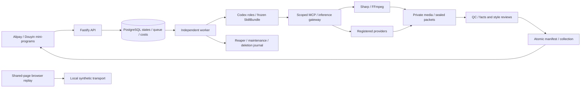

# One Tap Assets · 一品成片

New: the [support desk](docs/实施/客服接单回复与处理工作台-v1.0.md) provides a real API-backed queue, exclusive claiming, private proof access, replies, resolution and closure. Buyers query their latest reply. Seventeen unit cases, ten browser checks and four actual API smoke checks pass; the targeted API test command timed out at 180 seconds without case results and remains recorded as a timeout.

Earlier round entries retain their own historical source snapshots; the current delivery is defined by this round’s provenance. This ZIP includes current server/web outputs and complete mini-program source; final mini-program binaries were not rebuilt.

New: [order feedback and aftercare records](docs/实施/订单反馈与售后记录-v1.0.md) adds six categories, optional private evidence, original-request recovery, paged owned history, order filtering and current status queries. Thirty-two focused cases and ten browser checks pass, including actual PNG uploads to the local service. Staff processing, live refunds/repairs, cloud storage and devices remain unverified.

New: [selective album saving and recovery](docs/实施/相册分类保存与宿主回调-v1.0.md) adds whole-pack, image-only, video-only and individual retry actions. Original progress restores on reopening; confirmed success is skipped and UNKNOWN requires manual inspection. Both adapters wait for complete before advancing. Twenty-seven focused cases and ten browser checks pass; actual phone album writes remain unverified.

New: [original-order cancellation and refunds](docs/实施/订单取消与原支付动作-v1.0.md) adds explicit cancellation before production, paid-queue cancellation and original-refund progress. Cached payment actions recheck current state; UNKNOWN only queries the original order, and late payment creates one original refund intent. Seventeen unit, six native API and nine browser cases pass; live payments/refunds and devices remain unverified.

New: [server draft recovery and exact-spec continuation](docs/实施/草稿恢复与方案规格续选-v1.0.md) restores live owned drafts, ready profiles and matching original plans after reopening. All four preset/variant references survive capture; missing or withdrawn versions never fall back to another variant. Seventeen unit and three native API cases plus eight browser checks pass; real login, providers and devices remain unverified.

New: [sequential capture and original upload batches](docs/实施/逐张拍照与原上传批次-v1.0.md) adds one-photo camera capture, album additions, targeted retake/removal and cancellation recovery. A valid 3–5-photo set starts recognition; changed batches cannot overwrite original uploads. Ten focused cases and six shared-page checks pass. Native-device permissions still require acceptance.

New: [bounded generated repair and paid-source reuse](docs/实施/生成式受限修复与原素材复用-v1.0.md) connects both silent routes to selective purchases, verified original files, fresh reference review, changed bytes, new final consensus and delivery. Two focused cases pass; seven older cases were not selected. External models/metering are synthetic. Original sold limits remain frozen; native-audio repair and live/device acceptance remain incomplete.

Previous round: [bounded photo-candidate repair](docs/实施/原图候选修复与重新验收-v1.0.md) connects located failures to a CONTENT revision, changed files, a new sealed packet, fresh dual review and delivery. Two focused native integration cases pass with synthetic external roles and metering. Original order limits remain frozen; native-audio repair, live providers and device acceptance remain unfinished.

[English](README.en.md) · [中文](README.md) · [Documentation](docs/README.md) · [Quick start](docs/guides/QUICKSTART.en.md) · [Implementation status](docs/guides/STATUS.md) · [Changelog](CHANGELOG.md)

**Photograph a product, choose a preset, receive a coordinated asset pack.** One Tap Assets is a recoverable cloud production service designed primarily for **Alipay and Douyin mini-programs**. It covers product recognition, content planning, image/video production, post-production, review and asset retrieval. The planned **Plus web application** serves advanced editing and deeper production and remains P1 work.

This repository is under active development: requirements **v3.1**, development contracts **v1.1**, and frozen **C “Yuzu Creative Studio” design v1.0**. The complete product and production admission have **not** passed; every official preset remains unavailable for sale. Shared screens, the native backend, silent packs for all three routes and private audio delivery for both generated routes are implemented. Real Codex operation, audio quality, official variants, native devices and commercial operation remain incomplete. See [implementation evidence](assets/implementation/current.json) and the [public verification summary](docs/verification/publication.json).

Quick delivery: see the [handover and startup guide](docs/delivery/README.md). Run `.\scripts\setup-local.ps1`, then `doctor`, `local:start` or `preview:serve`. `delivery:build --smoke` runs bounded builds and focused smoke checks; `delivery:package` creates a ZIP with source and successful outputs. A fully green comprehensive suite is not a packaging prerequisite.

Current candidate: typecheck, doctor/startup, 17 unit cases, ten browser checks and four API smoke checks PASS. The API test command timed out without case results. Builds: server: PASS, preview: PASS, alipay: NOT_RUN, douyin: NOT_RUN. No comprehensive suite was run. Bound: 405 source files / 42 contracts / 4 resources; bd27a390. See [delivery](docs/delivery/current.json) and [provenance](docs/verification/support-desk-source.json).

## Screens and recorded interaction


最新客服工作台 / Latest support desk: [操作与来源](docs/media/support-desk/README.md)


[MP4](docs/media/support-desk/walkthrough.mp4) · [WebM](docs/media/support-desk/walkthrough.webm) · [截图与摘要 / Screens and hashes](docs/media/support-desk/capture-manifest.json)。实际本地HTTP/API/数据库操作，客户、订单、图片及身份为合成夹具；未验生产客服、真实交易或真机。Actual local operations with synthetic inputs; no production/live/device claim.

最新订单反馈 / Latest order feedback: [操作与来源](docs/media/support/README.md)


[MP4](docs/media/support/walkthrough.mp4) · [WebM](docs/media/support/walkthrough.webm) · [截图及摘要 / Screens and hashes](docs/media/support/capture-manifest.json)。实际共享页面录制，合成上传/回执与处理状态；不证明真实客服、退款或手机权限。Actual UI recording with synthetic support outcomes and no live staff or device claims.

最新相册保存 / Latest album saving: [操作与来源](docs/media/album-save/README.md)


[MP4](docs/media/album-save/walkthrough.mp4) · [WebM](docs/media/album-save/walkthrough.webm) · [截图及摘要 / Screens and hashes](docs/media/album-save/capture-manifest.json)。实际共享页面录制，合成相册回调与清单；没有写入真实手机相册。Actual UI recording with synthetic callbacks and no native device writes.

最新订单操作 / Latest order actions: [操作与来源](docs/media/order-actions/README.md)


[MP4](docs/media/order-actions/walkthrough.mp4) · [WebM](docs/media/order-actions/walkthrough.webm) · [截图及摘要 / Screens and hashes](docs/media/order-actions/capture-manifest.json)。实际共享页面录制，合成订单/金额/退款状态；不代表实际支付或退款到账。Actual UI recording with synthetic states; no live transaction or native-device claim.

最新草稿恢复 / Latest draft recovery: [操作与来源](docs/media/draft-resume/README.md)


[MP4](docs/media/draft-resume/walkthrough.mp4) · [WebM](docs/media/draft-resume/walkthrough.webm) · [截图及摘要 / Screens and hashes](docs/media/draft-resume/capture-manifest.json)。实际共享页面录制，合成数据，官方方案仍禁售。Actual UI recording with synthetic metadata; no real recognition, payment or native-device claim.

最新拍照交互 / Latest capture flow: [逐张拍照说明](docs/media/photo-capture/README.md)


[MP4](docs/media/photo-capture/walkthrough.mp4) · [WebM](docs/media/photo-capture/walkthrough.webm) · [实际截图与来源](docs/media/photo-capture/capture-manifest.json)。实际共享页面录制，使用自绘合成商品，非宿主真机或真实识别/付款证明。Actual shared-page recording with synthetic photos; native-device and live-service acceptance remain separate.


[MP4 recording](docs/media/walkthrough.mp4) · [Original WebM](docs/media/walkthrough.webm) · [Ten screenshots and capture instructions](docs/guides/DEMO.md) · [Media provenance and hashes](docs/media/capture-manifest.json)

These are **actual browser captures at 430 × 932**, reusing shared mini-program screens with local synthetic business data and an original illustrated product. The recording lasts about 14.56 seconds. They show UI behavior, not native mini-program device captures, real paid orders or model-generated product results, and do not represent an implemented Plus app. The ¥0 order, 2030 collection date and product illustration are fixtures. The script closes its browser and checks page failures and external requests.

## Baked AI disclosure and every-frame checks

The platform freezes the visible disclosure rule in the original quote/order contract. It checks real image glyph RGBA pixels including opaque alpha and every decoded video crop; a single missing frame blocks publication. Native captions retain their existing upper-right `AI 演绎`; the uniform mark occupies the upper-left region. Original audio, captions and mixing remain intact. Generated-image footers identify AI-generated assets, and photo layouts identify product photography. Frozen C design originals retain their bytes.


[Actual 15-second MP4, GIF and provenance](docs/media/ai-disclosure/README.md) · [Contract, recovery and verification details](docs/实施/AI可见标识与逐帧文件验收-v1.0.md). This self-drawn/static native fixture demonstrates disclosure pixels, not generated-ad quality, host declarations or commercial admission. Recreate it with `.\scripts\run.ps1 docs:disclosure`.

The official `ai-presenter-multi` means continuous multi-shot production, not a required multi-speaker feature. Original 12/15-second specifications, cross-shot product/character consistency and real speech/rights/full-variant acceptance remain required. Missing historical policies or proofs are blocked without rewriting sold contracts or buying models again.

## Native audio and POST integration

The new [native-audio final review and transactional delivery](docs/实施/原生声音最终双复核与事务交付-v1.0.md) connects both private generated routes. FACTS prepares or recovers the unique original listening request; STYLE only reads that result. Full observations and original request/response/result hashes reach both fresh Codex roles, metered inference and persistent tool proofs. Immutable reports bind the complete input. Publication uses the native-audio verifier and transactionally rechecks original costs, files, model/rights and fencing before linking the manifest, collection and release. BLOCK, INSUFFICIENT and UNKNOWN never count as approval or authorize another purchase.

The [independent listening protocol](docs/实施/独立听音协议与原订单回执-v1.0.md) remains the foundation for complete stereo/audio and visual input, original budgets, exact SSE and UNKNOWN recovery. Unallocatable cached usage remains on financial hold. Negative tone fixtures remain insufficient. Positive control fixtures deliberately fabricate Chinese semantic PASS to exercise authorization/delivery; **they do not prove Chinese speech exists in the audio, listening accuracy or real billing**.

An independently runnable kernel processes actual audio/timestamps, four Chinese caption styles and licensed music with music-only ducking. Private production, once-only full-track ASR, POST, file QC, original listening, final double review and transactional delivery are connected. **Public audio orders, real speech quality/billing/rights, official multi-shot variants and production operation remain unadmitted.**

The [durable asynchronous transcription service](docs/实施/异步音频转写与原任务回执-v1.0.md) derives a private WAV from a registered order video, freezes its model/rate and original budget, stores raw submit/query/result receipts, and binds supplier word timestamps to the source video/PCM. Missing ACKs never authorize another purchase; legacy contracts reject distinct stereo channels, while an explicitly frozen mean-stereo ASR derivative checks cancellation risk without replacing the delivery stereo track. Results require approved HTTPS URLs. Seventeen native database/media cases use **synthetic recognition and usage responses**, not real-provider recognition evidence. ASR configuration defaults to disabled.

The new [native audio contract and original-order accounting](docs/实施/原生声音合同与原订单费用-v1.0.md) freezes the character/voice/video-model combination, authorization versions and text digests, four caption styles and a fixed font, explicit no-bed or licensed-music gain/ducking/looping, original unit gain, and **one ASR request over the complete assembled track**. The execution snapshot binds this contract. Once-only prepaid-license allocations and the ASR ceiling share the original total while preserving aftercare funds; changing source videos or resuming instances cannot replenish the ASR allowance. Revocation stops execution; an original payment received after revocation is recorded and produces one refund intent. Twenty-three native cases use **synthetic authorizations, recognition/usage and payment facts**, not commercial-rights or real speech certification. Cross-shot product/character/voice binding, real listening/billing/rights and production audio admission remain incomplete; `NATIVE_AUDIO_NOT_ADMITTED` and all sales-disabled gates remain.

The new [private native-audio order integration](docs/实施/原生有声订单制作与后期接入-v1.0.md) connects both generated routes through scoped HTTPS/stdio/MCP tools: actual complete-track assembly, once-only durable ASR, and captions/licensed-music POST. An ALAC intermediate preserves original decoded PCM byte-for-byte; final POST outputs AAC. Original tasks and stored POST manifests survive lost ACKs and transaction rollback. Missing/replaced music blocks paid generation; source, settled transcription, rights and fencing are rechecked at commit. Ten native integration cases and four channel-policy unit cases use synthetic external responses. **They do not certify real speech quality, official multi-shot support or complete audio delivery.** Public quotes and order creation retain `NATIVE_AUDIO_NOT_ADMITTED`.

The new [native-audio file QC and sealed review evidence](docs/实施/原生声音文件验收与审查封存-v1.0.md) independently reconstructs the original/licensed mix, compares actual AAC and seals complete source/final stereo WAV, original settled transcript, ASS and technical JSON. Actual frames also cover caption phrase/word timestamps. Commit rechecks original files, music, licenses and private copies. Reports remain `semantic_review=PENDING` and `independent_listening=REQUIRED`; historical orders without a listening contract still reject `INDEPENDENT_AUDIO_REVIEW_REQUIRED`. The new private chain revalidates the original settled semantic PASS for the same packet without rewriting technical reports. Four unit regressions and twelve expanded native-order cases use synthetic tones, recognition and rights, without certifying real listening quality. Public audio orders stay closed.


[Four styles, actual MP4/PNG files and recapture](docs/media/native-audio/README.md) · [Processing design and trust boundary](docs/实施/原生音轨字幕与配乐后期内核-v1.0.md) · [Audio media hashes and provenance](docs/media/native-audio/capture-manifest.json). The GIF has no audio; MP4 clips contain synthetic tones. These fixtures contain no real Chinese speech or ASR, do not prove that displayed words were spoken, and are not official presenter samples. Reproduce with `.\scripts\run.ps1 docs:audio`; no browser or external model is called.

## Customer workflow

1. **Take photos.** Capture or select 3–5 photos showing the whole product, another angle and real details. No product form is required.
2. **Recognize the product.** Multimodal analysis separates observed appearance, visible text, evidence-backed features, hypotheses and unknowns. Unknowns are omitted or expressed neutrally. It must not invent efficacy, materials, prices or brand promises. Corrections are optional; typing is not mandatory.
3. **Choose a preset.** Browse official/community styles by product suitability, pacing and deliverables, then select an execution variant. Unadmitted variants show a preparation state and cannot be purchased.
4. **Confirm the pack.** Inspect the complete asset list, dimensions, duration, audio mode, usage and quote. Use a supported personal preview if available. Freeze photos, product identity, preset/version, model/rate contracts, budget and deadline together.
5. **Produce in the cloud.** After verified payment, durable stages perform production, post-processing, file QC, factual review, style review and delivery. Progress resumes from the server; local UI state is not fulfillment evidence.
6. **Collect and save.** Retrieve images, videos and copy. Native album saves track each file and support retries. Download and album insertion are distinct results. Supported revisions create linked deliveries while preserving the original and its collection expiry.

The most complete implemented path is **PHOTO_LAYOUT without speech**, tested with synthetic Codex/usage/isolation responses plus actual database and media processing. Real recognition, paid inference, payment and album behavior require separate admission. This intended journey does not imply every step is commercially ready.

## Presets and production routes

A preset is a versioned declarative specification: inputs, product evidence, shots/pacing, copy, output manifest, licensed resources, route, SkillBundle, budget and quality gates form a frozen sales contract. Community creators extend the same schema. Sample production, rights, moderation and admission precede publication. Presets cannot introduce arbitrary executable code, and customer photographs are private by default.

| Route | Behavior and use | Current boundary |
| --- | --- | --- |
| `PHOTO_LAYOUT` | Original photos, deterministic motion, rapid cuts, product cards and companion video | Actual media plus synthetic-role coverage for silent production/post/QC/double review/delivery |
| `PER_SHOT_AI` | Per-shot references and clips for premium details, lifestyle scenes and single-shot presentations | Silent packs through delivery have native-media/synthetic-role coverage. Private audio production/ASR/POST/QC/original listening/final double review/transactional delivery are connected with fabricated semantic control responses; official variants and real operation remain unverified |
| `REFERENCE_FILM` | Unified references/timecodes for continuous multi-shot ads, preserving contracted native audio | Silent film uses the complete pack chain. Private native-audio production/ASR/POST/QC/original listening/final double review/transactional delivery are connected with fabricated semantic control responses; official variants and real operation remain unverified |

The paid route cannot silently fall back to photo layout. Moving a still is not a real turntable shot. One approved reference cannot replace complete-pack review. Audio is contracted separately: silent tests do not prove native sound, music or subtitles.

Generated execution first derives references from the frozen Codex plan, completes and releases an independent facts reviewer, then starts the unique production role with `render_generated_pack`. It recovers original image/video intents, assembles actual generated PNG/MP4 and binds source/approval hashes through post and delivery. Fresh facts and style roles review the entire output pack. Reference and final facts reviews share the original role quota; takeover does not increase cost/call limits or extend the deadline. See the [silent-pack orchestration specification](docs/实施/生成式无声整包与阶段编排-v1.0.md) for fixture coverage and remaining admission boundaries.

The official baseline comprises **10 styles and at least 14 execution variants**, all within the complete P0 target:

| Official style | Base variant | Additional generative variants |
| --- | --- | --- |
| Minimal Clean · 极简纯净 `minimal-clean` | Photo layout | — |
| Warm Handmade · 自然手作 `warm-handmade` | Photo layout | — |
| Quiet Luxury · 轻奢细节 `quiet-luxury` | Photo layout | AI premium details |
| Fresh Daily · 清新日常 `fresh-daily` | Photo layout | AI lifestyle scene |
| Appetite Flash · 食欲快闪 `appetite-flash` | Photo layout | — |
| Home Calm · 家居留白 `home-calm` | Photo layout | — |
| Feature Cards · 特征卡片 `feature-cards` | Photo layout | — |
| Color Pop · 色彩撞击 `color-pop` | Photo layout | — |
| Launch Story · 上新叙事 `launch-story` | Photo layout | — |
| Portrait Social · 竖版种草 `portrait-social` | Photo layout | AI single-shot presenter; AI multi-shot presenter |

This is a design/contract catalog, **not 14 admitted services**. Exact counts, sizes, durations and routes belong to each [preset JSON](assets/presets/presets.v3.1.json) version. See [component specifications](docs/设计/方案组件与执行变体规格-v3.0.md) and [cloud mappings](assets/blueprints/云端方案映射.v3.1.json) for composition and provenance.

## Codex, skills and review

Content planning, production, post-production and pre-delivery review are designed around controlled Codex roles. The server freezes inputs and preloads an admitted style/variant SkillBundle. The registry contains **19 skills and 14 bundles**. Customers receive neither personal Codex logins, arbitrary shell access nor other customers’ instances.

| Stage | Execution model |
| --- | --- |
| `PLAN` | Structured content plan from product evidence, unknowns, pack specifications and style |
| `PRODUCTION` / `POST` | Bounded MCP actions; native Sharp/FFmpeg or registered providers perform actual processing |
| `QC` | Actual dimensions, duration, decoding, fonts, frame samples and pack completeness; seal a review packet |
| `REVIEW_FACTS` / `REVIEW_STYLE` | Fresh instances independently examine facts and style/experience using actual images and sealed text; immutable reports bind hashes and execution evidence |
| `DELIVER` / release | Recheck order/reports transactionally, publish an immutable manifest, revoke capabilities and use an independent reaper for instances/orphans |

Generated references have an independent identity service comparing actual original/generated PNGs against every product anchor. Missing evidence, forged sources, uncertainty or failed instance release blocks approval. **Both video routes now require the original approved report and the corresponding generated PNG**, revalidated during reservation, submission, recovery and media completion. Three scoped MCP handlers accept logical shot/submission IDs; the platform derives frozen prompts, references, models, rates and video specifications. The 15 reference, 35 gateway and six MCP cases exercise native PostgreSQL/media with synthetic inference and isolation assertions. [Execution and recovery details](docs/实施/生成式购买门禁与MCP工具接入-v1.0.md) describe role uniqueness and lease takeover; the later silent-pack specification above defines the integrated scope. Final packs still require both independent reviews. Real Codex, the restricted native launcher and production cleanup remain unverified.

## Architecture and stack



| Layer | Implementation |
| --- | --- |
| Mini-programs | Taro 4.3.1, React 18.3.1, TypeScript 5.9.3; 17 shared screens and platform ports |
| Browser replay | Vite 8.3.5 and React DOM adapters with local fixtures |
| Backend | Node.js 24, tested with 24.22.1; Fastify 5.12.7; worker/reaper/maintenance CLIs |
| Persistence | Native PostgreSQL, local 17.6-1; durable stages/outbox, lease fencing and immutable receipts; 26 migrations |
| Media | Sharp 0.35.5, native FFmpeg/ffprobe, private storage and local development storage |
| Agent | Codex app-server, bounded stdio/MCP, metered inference and style SkillBundles |
| Verification | Vitest 5.0.5, Playwright 1.64.1, native PG/actual media and explicit synthetic provider/host fixtures |
| Tooling | pnpm 10.13.1, one lockfile, JSON Schema 2020-12; 77 business/26 management endpoint contracts |

The project does not launch local Docker, WSL, virtual machines or Testcontainers, and does not require Redis. Native development scripts target Windows PowerShell. A complete startup on other operating systems has not been verified here.

## Run locally

Install Git, clone and run from the repository root. Tools, caches, databases and temporary media stay inside ignored `runtime/`.

```powershell
git clone git@github.com:copypasteltd/one-tap-assets.git
Set-Location one-tap-assets
.\scripts\bootstrap-native.ps1
.\scripts\run.ps1 install --frozen-lockfile
.\scripts\run.ps1 dev:preview
```

Open `http://127.0.0.1:4173/` for photos, analysis, community, presets, confirmation, orders, collection, library and creator entry points. Replay needs no database, payment or model credentials. It cannot buy real services or save to a phone album. Close its tabs afterward and stop the server with `Ctrl+C`.

For the native backend:

```powershell
.\scripts\bootstrap-native.ps1 -Postgres
.\scripts\run.ps1 exec tsx scripts/dev-setup.ts
# Set native FFMPEG_PATH and FFPROBE_PATH in the generated .env.local.
# Never commit that file.
.\scripts\run.ps1 dev:api
```

Run `.\scripts\run.ps1 dev:worker` in another root-directory terminal; start `dev:reaper` and `dev:media-maintenance` separately when needed. Setup creates HTTPS certificates/random database credentials, initializes a UTF-8 application database, migrates and seeds it. The default API is `https://localhost:3100`. Keep paid/publication flags off. Initialize the independent deletion journal separately; never reconstruct an empty journal from an old database backup. The [native guide](docs/guides/QUICKSTART.en.md) covers prerequisites, devices and recovery constraints.

Build the mini-programs:

```powershell
$env:TARO_APP_API_BASE = 'https://your-admitted-api.example'
.\scripts\run.ps1 build:alipay
.\scripts\run.ps1 build:douyin
```

Import `runtime/build/mini-alipay/` and `runtime/build/mini-douyin/` into official platform developer tools. Configure app IDs, HTTPS domains, admitted payment contracts and permissions. Compilation does not certify native login/payment/album behavior. Douyin trade also needs an admitted `TARO_APP_DOUYIN_TRADE_CONTRACT`.

## Configuration, cost control and recovery

[`.env.example`](.env.example) lists settings. Actual values belong in ignored local configuration or deployment secrets. Mini-program builds receive public API/host settings, never provider credentials.

- **Data/media:** database/TLS, `STORAGE_*`, FFmpeg/ffprobe. Register original object keys/hashes before writes or erasure.
- **Recognition/generation:** `PROVIDER_*` / `VISION_*` are separate from optional `GENERATION_*`. Allowlist exact API/CDN hosts, do not send API authorization to media downloads, and reject arbitrary redirects.
- **Codex:** service credentials, binary hash, protocol/model/rate versions, restricted launcher, admission file, skills and metered proxy. Do not use personal login state.
- **Payments:** merchant configuration, signing/verification keys, callbacks and verified trade contracts. Payment, fulfillment and refund state are separate; a callback cannot authorize delivery by itself.
- **Admission:** `PAYMENTS_ENABLED`, `PROVIDER_GENERATION_ENABLED`, `COMMUNITY_PUBLISHING_ENABLED`, `CODEX_SERVICE_ENABLED` default to `false`; analysis/sample budgets default to zero. Credentials alone do not grant admission.

Persist a one-time intent and atomically reserve the original order’s total budget before paid side effects. Model/rate contracts are frozen, not hardcoded. `UNKNOWN` recovers the original request/provider task and retains its cost hold without buying again. Lease generations reject stale workers; retries do not extend the original deadline. Files, reports, manifests and downloads bind actual-byte hashes. Private erasure and financial recovery are separate. Restore requires replaying an independent signed deletion journal; production durability and complete privacy erasure remain unverified.

Resuming a client session, recovering an original provider task, repairing candidate media and revising a delivery are separate flows. **PHOTO_LAYOUT and both silent generated routes have bounded candidate repair; native-audio repair remains unfinished.** A `repair_rounds` field or lease takeover does not produce a new candidate, new sealed packet and two fresh reviews. Rejected work remains blocked; failure, refund and release have separate states. Never force PASS or recreate an order to bypass them. Limited photo aftercare does not implement generated revisions or free platform correction. See [recovery and repair boundaries](docs/guides/RECOVERY.md) for actual handling, error codes and remaining acceptance conditions.

### Implemented server constraints

[First-pass cost protection and original accounting](docs/实施/首轮制作费用隔离与原费用回执-v1.0.md) now protect both frozen repair and aftercare holds within the original order total. Concurrent work and UNKNOWN recovery cannot consume those holds; an original intent cannot change ownership or rates. New spending rechecks payment, revocation and the original deadline after waiting for the lock. PHOTO_LAYOUT now uses these boundaries for candidate production, resealing and two fresh reviews; native-audio repair remains unfinished.

[Original MCP observation recovery and bridge shutdown](docs/实施/MCP原工具查询恢复与桥接回收-v1.0.md) now resume only acknowledged original intents after transient read failures. The third consecutive failure stops; the existing 20-second HTTP cap and role deadline remain. Authority/rate/TLS failures are not retried, an uncertain creation POST is not repeated, and stdin closure aborts bridge-owned I/O. The historical ASR failure still has no confirmed cause.

The worker adds [private failure diagnostics and log isolation](docs/实施/Worker脱敏故障诊断与日志隔离-v1.0.md). Internal events use fixed categories, allowlisted native codes and execution phases while client errors keep their existing contract. Raw errors, SQL, paths and customer content are excluded. Synchronous or asynchronous sink failures cannot change work transactions; settlement failures retain original lease recovery. See [actual verification](docs/verification/README.md). The earlier production failure and build timeout remain unresolved.

The tool worker now uses [atomic claims and concurrent leases](docs/实施/工具队列原子领取与并发租约-v1.0.md). One database statement claims the original task while retaining handler filtering, UNKNOWN availability, the 45-second lease, fences and revocation checks. A controlled 64-poll empty-queue run used 64 statements instead of 192. This does not establish the cause of earlier timeouts; current full verification is reported separately.

Rendered titles, copy and photo-video subtitles now receive [complete-text and pre-purchase layout checks](docs/实施/完整展示文字与购买前排版校验-v1.0.md). The pinned font is measured in actual pixels: text wraps in full or is rejected without dropping its suffix. Visible shot-intent claims share the evidence gate. Content, quotes and production purchases are preflighted; changed renderer inputs cannot replace an original media operation. Native-audio repair remains unfinished.

New: [repair cost authorization within the original order](docs/实施/修复费用授权与原订单额度-v1.0.md). The platform revalidates a failed independent report and binds one immutable authorization to six fresh candidate stages. Generation, inference, ASR and listening derive cost purpose from the actual platform stage. Original total/repair/aftercare holds, extra-call limits, deadlines and provider/role quotas remain; UNKNOWN stays occupied, released/zero-cost calls still count, and each authorized generation node permits one extra purchase. PHOTO_LAYOUT now connects located failures to changed candidates, fresh dual review and delivery; native-audio repair remains unfinished.

## Repository map and docs

```text
src/api/            API, auth, domain services, 26 SQL migrations
src/worker/         Durable stages, Codex, MCP, media/review/reaping/privacy
src/shared/         Shared screens, platform ports, recovery and generated contracts
src/mini-alipay/    Alipay shell
src/mini-douyin/    Douyin shell
src/preview/        Shared-screen browser adapters
assets/            C design, presets, contracts, skills, fonts, research, evidence
docs/              Requirements, design, development, implementation, guides and media
tests/             Unit/native integration tests and explicit synthetic fixtures
scripts/           Native setup, contracts, builds, recording and verification
runtime/           Private runtime/tools/builds/logs; excluded from Git
```

- Product: [PRD](docs/01-产品需求PRD.md), [58 requirements/flows](docs/02-功能需求与用户流程.md), [billing](docs/04-计费交易与运营.md), [acceptance](docs/05-验收测试与实施计划.md).
- Design: [frozen C design](docs/设计/定型/C-柚子创作社-v1.0/README.md), [artwork/archive](assets/design/柚子创作社/v1.0/), [traceability](docs/设计/需求追踪矩阵-v3.1.md). Baseline artwork is never overwritten.
- Engineering: [architecture](docs/guides/ARCHITECTURE.md), [development docs 00–18](docs/开发/README.md), [implementation progress](docs/实施/源码实现进度-v3.1.md), [contribution rules](CONTRIBUTING.md), [security](SECURITY.md).
- Operations and publishing: [recovery/repair boundaries](docs/guides/RECOVERY.md), [ongoing docs/media/commit/push synchronization](docs/guides/PUBLISHING.md).
- Research: [upstream assessment](docs/评估/one-tap-ads仓库核查与差距评估-2026-10-27.md), [recipe analysis](docs/评估/方案案例与生成流程深析-2026-10-27.md). Research exports retain AGPL attribution and are not admitted production presets.

Root READMEs and operational guides are bilingual. Detailed historical requirements/design/implementation records are primarily Chinese and retain their authoritative versions.

## Validation and remaining work

```powershell
.\scripts\run.ps1 verify:implementation  # Types, units, native integration, server and both mini builds
.\scripts\run.ps1 build:preview
.\scripts\run.ps1 verify:docs
.\scripts\run.ps1 verify:publication     # Links, media hashes, source snapshot and Git candidates
```

For UI evidence, start `dev:preview` and run `docs:media` in another terminal. `test:ui` invokes the same capture/assertion script. Local Edge, native FFmpeg/ffprobe and project-local Playwright recording components are required; see the [demo guide](docs/guides/DEMO.md).

Historical 346c8c21 results remain in [cost provenance](docs/verification/repair-cost-native-source.json). This round uses user-requested focused delivery checks. See the [delivery guide](docs/delivery/README.md) for current build/package results; prior passes and unexecuted tests are not promoted to current verification.

完整命令未通过；源码进展与独立构建不升级为完整通过。 The full command chain fails; source progress and separate builds do not replace it.

Remaining work includes official-variant and real-service acceptance of both generative routes, real native-audio quality and commercial admission, real Codex/isolation/cleanup, provider/payment/storage admission, four device groups, complete bounded one-round automatic repair, 14 variants × 30 full-pack benchmarks, complete community/aftercare, Plus/management UI and acceptance of all **58 requirements / 52 P0 requirements**. Follow [status and priorities](docs/guides/STATUS.md).

Each development round synchronizes code, both READMEs, affected guides, applicable screenshots/video/GIF and the [changelog](CHANGELOG.md), then commits, pushes normally and verifies the remote commit. The [publishing guide](docs/guides/PUBLISHING.md) defines the sequence and documentation-only validation. Never overwrite unfamiliar remote work or commit credentials, customer photos, database files or caches.

## Licensing and provenance

No blanket open-source license has been selected for independently authored project code; do not assume MIT. Exported upstream research recipes/prompts retain AGPL-3.0, Noto Sans SC retains OFL-1.1, and dependencies keep their own licenses. The demo product was illustrated for this project. See [THIRD_PARTY_NOTICES](THIRD_PARTY_NOTICES.md) for scope, sources and original notices.
