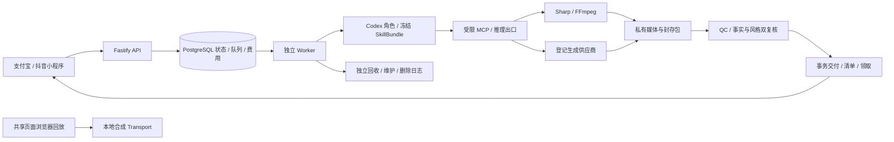

# 一品成片 · One Tap Assets

[中文](README.md) · [English](README.en.md) · [文档目录](docs/README.md) · [快速启动](docs/guides/QUICKSTART.md) · [实现与待办](docs/guides/STATUS.md) · [更新记录](CHANGELOG.md)

**拍下商品，选一套方案，得到成体系的商品素材。** 一品成片以支付宝小程序、抖音小程序为主要入口，把商品识别、内容规划、图片/视频制作、后期、验收和素材领取组织成可恢复的云端服务。网页 Plus 定位于复杂编辑与深化制作，属于后续 P1 范围。

当前是持续开发的源码仓库：需求 **v3.1**、开发契约 **v1.1**、已定型的 **C「柚子创作社」设计 v1.0**。完整产品与生产准入均未通过，官方方案全部禁售。共享页面、原生后端与多项媒体/恢复路径已有实现；真实 Codex、生成式整包、宿主真机与商用运行仍有待办。具体证据见 [实现清单](assets/implementation/current.json) 和 [公开核验摘要](docs/verification/publication.json)。

## 界面与操作演示


[MP4 录屏](docs/media/walkthrough.mp4) · [原始 WebM](docs/media/walkthrough.webm) · [10 张截图与复录说明](docs/guides/DEMO.md) · [媒体来源/摘要清单](docs/media/capture-manifest.json)

以上是 **430 × 932 的实际浏览器回放**，复用双小程序共享页面，使用本地合成业务数据和自绘示例商品，录屏约 14.56 秒。它展示页面与操作方式；并非小程序宿主真机截图、真实付费订单或模型生成效果，也不代表 Plus 已实现。页面上的 ¥0 演示订单、2030 年领取时间和商品插画均为夹具。录制脚本关闭浏览器，并检查页面异常和外部请求。

## 用户如何使用

1. **拍照**：在小程序拍摄或选择 3–5 张商品照片，覆盖整体、角度和细节；无需填写商品表格。
2. **自动认识商品**：多模态识别形成商品档案，区分类别/外观/可见文字、证据特征、推测和未知项。未知信息省略或使用中性表达，不编造功效、材质、价格或品牌承诺。用户可选纠错，默认不要求输入文字。
3. **挑选方案**：在社区按商品适配、视觉风格、节奏和素材规格，选择官方或作者预设的具体执行变体。未准入变体展示准备状态，不能下单。
4. **确认这一套**：查看完整素材列表、比例/时长/声音方式、用量与报价；可使用受支持的本人预览。方案、照片、商品锁、模型/费率、预算和截止时间一并冻结。
5. **云端制作**：付款确认后，持久任务完成制作、后期、文件检查、商品事实复核、风格体验复核和交付。离开小程序后可从服务端恢复进度，本地页面状态不能作为履约凭证。
6. **领取与保存**：领取图片、视频和配套文案，按宿主能力逐项保存相册，失败项可续存。下载完成和进入相册分别记录。受支持的售后修改交付关联新版本，保留原版及原领取到期。

当前最完整的执行路径是 **原图排版、无声素材包**，由合成 Codex/费用/隔离响应配合真实数据库和媒体工具测试。识别、付费推理、支付和相册的真实服务效果仍需独立准入，不能把目标流程当作所有环节已商用。

## 方案体系：风格与制作路线分离

预设是版本化的声明式生产规格：输入要求、商品证据、镜头/节奏、文案、输出清单、资源许可、路线、SkillBundle、预算与质量门禁共同构成可售合同。社区作者使用同一结构扩展，经过样例制作、授权、审核与准入后才能发布；不能上传任意可执行代码或把客户照片默认公开。

| 制作路线 | 制作方式与适用内容 | 当前边界 |
| --- | --- | --- |
| `PHOTO_LAYOUT` | 原图排版、确定性推拉/快闪、图文卡片与配套视频，保留真实商品外观 | 原图无声制作/后期/QC/双复核/交付有原生媒体与合成角色测试 |
| `PER_SHOT_AI` | 每镜生成参考素材与视频，适合质感、生活场景、单镜讲解 | 持久供应商调用和参考身份服务已有；生产 MCP、视频购买门禁和整包未连通 |
| `REFERENCE_FILM` | 统一参考帧与时间码，生成连续多镜广告并保护原生声音 | 异步视频适配基础已有；完整参考生成、整包/后期/双复核与有声未完成 |

不能在付款后偷偷把生成路线换成原图排版，不能把静态图推拉称为真实转台，也不能用一张参考帧代替整包验收。声音是独立规格，原生声音/配乐/字幕须与报价一致；无声测试不能证明有声可用。

官方保底 **10 套风格、至少 14 个执行变体**，全部属于完整 P0 目标：

| 官方风格 | 基础变体 | 额外生成变体 |
| --- | --- | --- |
| 极简纯净 `minimal-clean` | 图文展示 | — |
| 自然手作 `warm-handmade` | 图文展示 | — |
| 轻奢细节 `quiet-luxury` | 图文展示 | AI 质感展示 |
| 清新日常 `fresh-daily` | 图文展示 | AI 生活场景 |
| 食欲快闪 `appetite-flash` | 图文展示 | — |
| 家居留白 `home-calm` | 图文展示 | — |
| 特征卡片 `feature-cards` | 图文展示 | — |
| 色彩撞击 `color-pop` | 图文展示 | — |
| 上新叙事 `launch-story` | 图文展示 | — |
| 竖版种草 `portrait-social` | 图文展示 | AI 单镜讲解、AI 连续多镜 |

目录是设计/契约基线，**不是 14 个已经可售的服务**。素材数量、尺寸、时长和路线以 [预设 JSON](assets/presets/presets.v3.1.json) 的具体版本为准。[方案组件规格](docs/设计/方案组件与执行变体规格-v3.0.md) 和 [云端映射](assets/blueprints/云端方案映射.v3.1.json) 记录来源与组合规则。

## Codex 如何参与制作与核验

内容梳理、实际制作、后期与验收前审查均以受控 Codex 角色为目标执行内核。服务端冻结输入，按风格/执行变体预载登记的 SkillBundle，当前登记 **19 个 Skill、14 个 Bundle**。客户不会获得个人 Codex 账号、任意 Shell 或其他客户实例。

| 环节 | 执行逻辑 |
| --- | --- |
| 内容 `PLAN` | 商品证据、未知项、素材规格和风格共同生成结构化内容计划 |
| `PRODUCTION` / `POST` | 角色通过限定 MCP 工具请求媒体任务；原生 Sharp/FFmpeg 或登记供应商执行实际处理 |
| `QC` | 检查真实文件尺寸、时长、解码、字体、帧采样与整包完整性，形成封存审查包 |
| `REVIEW_FACTS` / `REVIEW_STYLE` | 新实例分别核对商品事实与风格/体验，消费实际图片和封存文本，报告绑定摘要与运行证据 |
| `DELIVER` / 释放 | 平台事务核对原订单与报告，发布不可变清单、撤销能力；独立回收器处理进程/目录与孤儿实例 |

生成参考帧另有独立身份服务：实际原图和生成 PNG 逐帧逐商品锚点核验，缺项、伪造来源、UNCERTAIN 或释放失败均阻断。该核心已有 15 项专项，**尚未接入视频购买边界**，正式整包仍须双复核。当前角色测试采用合成进程/模型/用量/隔离断言，真实 Codex、原生受限身份启动器和生产释放尚未验收。

## 技术结构



| 层 | 当前选型 |
| --- | --- |
| 客户端 | Taro 4.3.1、React 18.3.1、TypeScript 5.9.3，17 个共享页面及支付宝/抖音适配 |
| 浏览器回放 | Vite 8.3.5、React DOM，共享页面与本地演示数据 |
| 服务端 | Node.js 24（本次验证 24.22.1）、Fastify 5.12.7、独立 Worker/回收/维护 CLI |
| 持久化 | 原生 PostgreSQL（本地 17.6-1）、阶段队列、outbox、租约代次、不可变回执，21 个迁移 |
| 媒体 | Sharp 0.35.5、原生 FFmpeg/ffprobe、登记私有对象存储及本地开发存储 |
| Agent | Codex app-server、受控 stdio/MCP、独立推理计量和风格 SkillBundle |
| 验证 | Vitest 5.0.5、Playwright 1.64.1、原生 PG/真实媒体、显式合成供应商与宿主夹具 |
| 工程 | pnpm 10.13.1、单一 lockfile、JSON Schema 2020-12、77 个业务/26 个管理接口契约 |

本项目不调用本地 Docker、WSL、虚拟机或 Testcontainers，不依赖 Redis。开发脚本面向 Windows PowerShell；其他系统的完整启动流程未经本项目验证。

## 快速运行

安装 Git，克隆后在项目根目录运行。工具、缓存、数据库和临时素材位于项目内忽略的 `runtime/`。

```powershell
git clone git@github.com:copypasteltd/one-tap-assets.git
Set-Location one-tap-assets
.\scripts\bootstrap-native.ps1
.\scripts\run.ps1 install --frozen-lockfile
.\scripts\run.ps1 dev:preview
```

打开 `http://127.0.0.1:4173/`，浏览拍照、识别、社区、方案、确认、订单、领取、素材库和作者入口。回放不需要数据库、付款或模型密钥，不能向真实服务购买或保存到手机相册。看完关闭本次标签，终端 `Ctrl+C` 停止服务。

完整本地后端另执行：

```powershell
.\scripts\bootstrap-native.ps1 -Postgres
.\scripts\run.ps1 exec tsx scripts/dev-setup.ts
# 在生成的 .env.local 配置本机原生 FFMPEG_PATH、FFPROBE_PATH；不要提交该文件。
.\scripts\run.ps1 dev:api
```

另一个根目录终端运行 `.\scripts\run.ps1 dev:worker`，按需独立运行 `dev:reaper`、`dev:media-maintenance`。初次初始化生成本地 HTTPS 证书和随机数据库凭证，创建 UTF-8 应用库并迁移/种子化；API 默认 `https://localhost:3100`。付费与社区发布开关保持关闭。独立删除日志须单独初始化，不能从旧数据库备份重建空日志。[完整联调指南](docs/guides/QUICKSTART.md) 说明前置条件、真机配置与恢复约束。

构建双小程序：

```powershell
$env:TARO_APP_API_BASE = 'https://your-admitted-api.example'
.\scripts\run.ps1 build:alipay
.\scripts\run.ps1 build:douyin
```

输出在 `runtime/build/mini-alipay/`、`runtime/build/mini-douyin/`。用平台官方开发者工具导入，配置应用 ID、HTTPS 域名、支付合同与宿主权限；编译通过不代表登录/支付/相册真机验收。抖音交易还需要经核验的 `TARO_APP_DOUYIN_TRADE_CONTRACT`。

## 配置、计费与恢复逻辑

[`.env.example`](.env.example) 是配置目录，真实值只留在忽略的本地环境或部署密钥系统。小程序只注入公开 API 地址与宿主合同，不能注入供应商密钥。

- **数据/媒体**：`DATABASE_URL`、TLS、`STORAGE_*`、FFmpeg/ffprobe；私有对象先登记原键与摘要，再写入/删除。
- **识别/生成**：`PROVIDER_*` / `VISION_*` 与可选独立 `GENERATION_*` 分离；仅允许确切 API/CDN 主机，下载媒体不携带 API Authorization，拒绝任意重定向。
- **Codex**：服务专用凭证、二进制摘要、协议/模型/费率版本、受限启动器、准入文件、Skill 注册和独立推理出口，不借用个人登录态。
- **支付**：两端商户、签名/核验密钥、回调与合同。付款、履约、退款状态分别持久化，页面或回调不能直接宣告交付。
- **准入**：`PAYMENTS_ENABLED`、`PROVIDER_GENERATION_ENABLED`、`COMMUNITY_PUBLISHING_ENABLED`、`CODEX_SERVICE_ENABLED` 默认 `false`，识别/样例预算默认零。填写密钥不等于准入启售。

付费副作用先持久化一次性意图并原子预留原订单总预算，模型/费率合同不硬编码。`UNKNOWN` 查询原请求/供应商任务并保留费用，不重新购买；Worker 接管使用租约代次拒绝旧回写，重试不延长原截止。最终文件、报告、交付清单和下载绑定真实字节摘要。敏感内容删除与财务恢复分别处理，备份恢复须重放独立签名删除日志；生产外部持久性和完整隐私删除仍待验收。

## 代码与文档导航

```text
src/api/            API、鉴权、领域服务、21 个 SQL 迁移
src/worker/         持久阶段、Codex、MCP、制作/复核/回收/隐私
src/shared/         双端页面、平台端口、客户端恢复与生成契约
src/mini-alipay/    支付宝小程序壳
src/mini-douyin/    抖音小程序壳
src/preview/        共享页面浏览器回放适配
assets/            C 原稿、预设、契约、Skill、字体、研究与实现索引
docs/              需求、设计、开发、实施、双语指南与媒体
tests/             单元/原生集成测试与显式合成夹具
scripts/           原生启动、契约生成、构建、录制和核验
runtime/           私有运行数据/工具/构建/日志（不提交）
```

- 产品：[PRD](docs/01-产品需求PRD.md)、[58 项功能与流程](docs/02-功能需求与用户流程.md)、[计费交易](docs/04-计费交易与运营.md)、[验收计划](docs/05-验收测试与实施计划.md)。
- 设计：[C 定型文档](docs/设计/定型/C-柚子创作社-v1.0/README.md)、[设计资产与原稿](assets/design/柚子创作社/v1.0/)、[需求追踪](docs/设计/需求追踪矩阵-v3.1.md)，原稿与归档不可覆盖。
- 开发：[技术结构与数据流](docs/guides/ARCHITECTURE.md)、[开发文档 00–18](docs/开发/README.md)、[实现进度](docs/实施/源码实现进度-v3.1.md)、[贡献约束](CONTRIBUTING.md)、[安全边界](SECURITY.md)。
- 研究：[上游评估](docs/评估/one-tap-ads仓库核查与差距评估-2026-10-27.md)、[案例深析](docs/评估/方案案例与生成流程深析-2026-10-27.md)。研究导出保留 AGPL 声明，不是已验证可售方案库。

## 验证与后续开发

```powershell
.\scripts\run.ps1 verify:implementation  # 类型、单元、原生集成、服务端和双小程序；刷新证据
.\scripts\run.ps1 build:preview
.\scripts\run.ps1 verify:docs
.\scripts\run.ps1 verify:publication     # 入口链接、媒体 SHA、源码快照、候选文件与忽略规则
```

UI 回放/媒体更新先启动 `dev:preview`，再执行 `docs:media`（`test:ui` 为同一脚本）；需要 Edge、原生 FFmpeg/ffprobe 与项目内 Playwright 录制组件，详见 [演示指南](docs/guides/DEMO.md)。

2026-10-28本次源码验证：类型检查、**50/50 单元测试、250/250 原生集成测试**、服务端和双小程序构建均通过；回放构建及10页捕获通过。测试结论以实现 JSON 为准，公开摘要区分真实数据库/媒体与合成模型/支付/隔离。

待完成生成式工具与两条完整产线、原生有声、真实 Codex/隔离/清理、模型/支付/存储准入、四组真机、14 变体 × 30 次整包基准、完整社区与售后、Plus/管理界面，以及全部 **58 项需求 / 52 项 P0** 验收。[状态与优先顺序](docs/guides/STATUS.md) 持续跟踪。

后续每轮同步代码、双语 README、相关指南、适用截图/录屏/GIF 与 [CHANGELOG](CHANGELOG.md)，正常提交推送并核对远端提交号，不强制覆盖未知远端工作。实际凭证、客户照片、数据库和缓存不进入 Git。

## 许可与素材来源

独立编写的项目源码尚未选择统一开源许可证，不应推断为 MIT。第三方研究配方/提示词保留 AGPL-3.0，Noto Sans SC 保留 OFL-1.1，依赖适用各自许可证，演示插画为本项目自绘。范围、原始声明与来源见 [THIRD_PARTY_NOTICES](THIRD_PARTY_NOTICES.md)。
