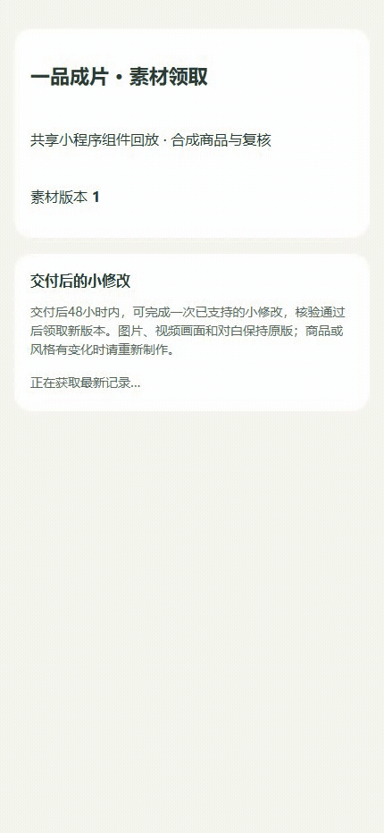
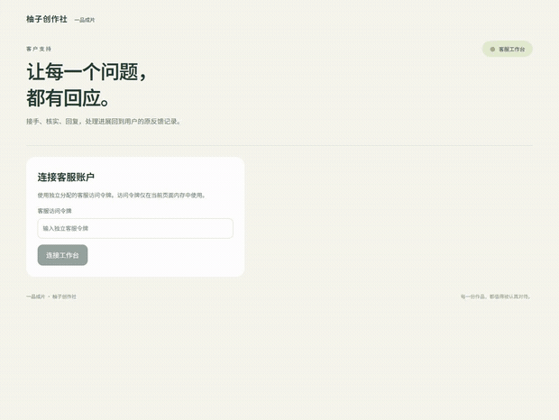
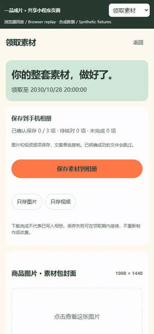
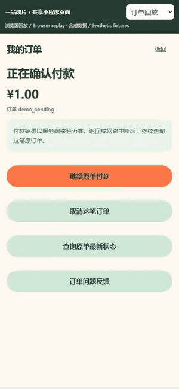
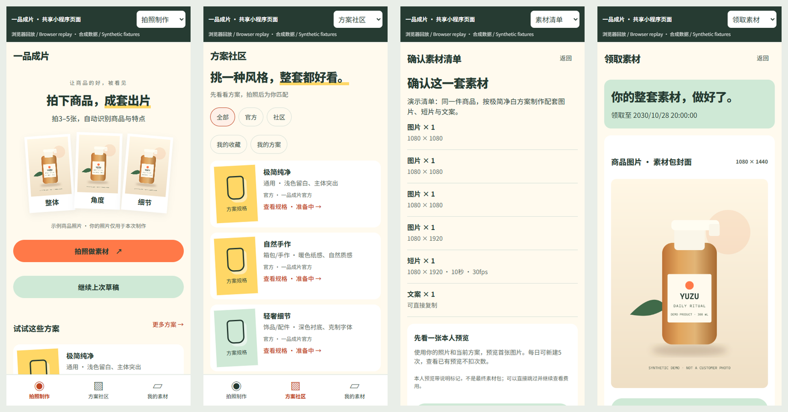
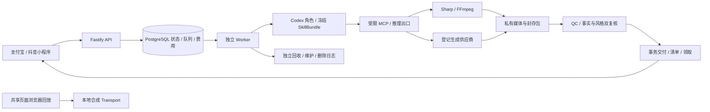

# 一品成片 · One Tap Assets

本轮接通[社区商业配置与可信风格执行](docs/实施/社区商业配置与可信风格执行-v1.0.md)：平台从已准入蓝本一次性冻结价格、模型与费用；社区新编号正确绑定可信风格 Skill，买家规划、制作、复核和受限修改使用同一冻结配置。配置不继承准入或开售状态，已付款订单不受新销售停售影响。

5项定向检查通过（社区商业3、两生成订单回归2/9未选）；类型/server/preview/自检/本地启动PASS，主库31迁移。430源码/42契约/4资源，`71c658d6`。全量、单元全套、双小程序重编及复录NOT_RUN；原93媒体和C原件保留。[准确证据](docs/verification/community-commerce-source.json) · [当前构建](docs/delivery/current.json) · [交付包](docs/delivery/package.json)。真实服务/真机/完整社区准入/Plus/云端待完成，所有方案仍禁售。

以下内容保留其历史来源，当前状态以上述记录为准。

本轮接通[生成式社区样例与独立平台额度](docs/实施/生成式社区样例与独立平台额度-v1.0.md)：作者可选逐镜头生成或参考整片的无声样例，经参考身份核验、实际制作/后期和全新双复核，再私有下载并申请独立公开副本。样例使用平台额度，不创建买家订单；原预算/次数/截止及 UNKNOWN 处理保持。

本轮10项定向检查通过（主专项9，原订单回归1）；类型/server/preview/自检/本机启动PASS，主库30迁移。426源码/42契约/4资源，`e7a80120`。全面测试、单元全套、双小程序重编和复录NOT_RUN；原93媒体及C原件保留。[精确来源](docs/verification/generated-sample-source.json) · [当前构建](docs/delivery/current.json) · [交付包入口](docs/delivery/package.json)。真实服务、真机与云部署待完成，全部方案仍禁售。

以下内容保留其历史来源，当前状态以上述记录为准。

[中文](README.md) · [English](README.en.md) · [文档目录](docs/README.md) · [快速启动](docs/guides/QUICKSTART.md) · [实现与待办](docs/guides/STATUS.md) · [更新记录](CHANGELOG.md)

本轮收口[图片加字与实际素材售后](docs/实施/图片加字与实际素材售后-v1.0.md)：小程序领取页选图并输入短标题，实际生成保留完整原画面的标题卡PNG，重新验收后交付新版本；客服原工单同类纠错接通。三路线专项通过，原音视频/预算/次数/截止保持；旧订单无授权不增加权益。

**拍下商品，选一套方案，得到成体系的商品素材。** 一品成片以支付宝小程序、抖音小程序为主要入口，把商品识别、内容规划、图片/视频制作、后期、验收和素材领取组织成可恢复的云端服务。网页 Plus 定位于复杂编辑与深化制作，属于后续 P1 范围。

当前是持续开发的源码仓库：需求 **v3.1**、开发契约 **v1.1**、已定型的 **C「柚子创作社」设计 v1.0**。完整产品与生产准入均未通过，官方方案全部禁售。共享页面、原生后端、三路线无声整包及两条生成路线的内部有声交付已有实现；真实 Codex、声音质量、官方变体、宿主真机与商用运行仍有待办。具体证据见 [实现清单](assets/implementation/current.json) 和 [公开核验摘要](docs/verification/publication.json)。

快速交付入口：[交付与启动指南](docs/delivery/README.md)。执行`.\scripts\setup-local.ps1`初始化，再用`doctor`自检、`local:start`启动后端、`preview:serve`查看共享页面。`delivery:build --smoke`只做有界构建和核心冒烟，`delivery:package`生成源码与实际成功产物ZIP；按本轮要求不等待全面测试绿灯。

当前候选：类型/server/preview/自检/启动PASS；8单元、4项三路线/迁移API专项与5项共享组件录制检查通过，42旧API用例未选。绑定421源码/42契约/4资源，`bc77e6cf`，29迁移。全面测试/双小程序重编NOT_RUN；85历史媒体/C设计原字节保持，新录8媒体。见[交付记录](docs/delivery/current.json)、[精确来源](docs/verification/image-text-source.json)。


最新实际图片修改 / Latest actual image revision: [操作与来源](docs/media/image-text/README.md)



[MP4](docs/media/image-text/walkthrough.mp4) · [WebM](docs/media/image-text/walkthrough.webm) · [实际原图与新图 / Actual before and after](docs/media/image-text/README.md)。真实共享组件、HTTPS、五阶段和新PNG；商品/语义/身份/计量合成，非宿主真机或生产证明。Actual shared-component and native file effects with synthetic product/semantic/identity/metering inputs.

最新素材纠错 / Latest support repair: [操作与来源](docs/media/support-repair/README.md)


[MP4](docs/media/support-repair/walkthrough.mp4) · [WebM](docs/media/support-repair/walkthrough.webm) · [截图与摘要 / Screens and hashes](docs/media/support-repair/capture-manifest.json)。实际本地页面/五阶段/文件效果；商品、语义、身份与计量合成，非生产或真机证明。Actual effects with synthetic inputs and roles, no live-service admission.

最新客服工作台 / Latest support desk: [操作与来源](docs/media/support-desk/README.md)



[MP4](docs/media/support-desk/walkthrough.mp4) · [WebM](docs/media/support-desk/walkthrough.webm) · [截图与摘要 / Screens and hashes](docs/media/support-desk/capture-manifest.json)。实际本地HTTP/API/数据库操作，客户、订单、图片及身份为合成夹具；未验生产客服、真实交易或真机。Actual local operations with synthetic inputs; no production/live/device claim.

最新订单反馈 / Latest order feedback: [操作与来源](docs/media/support/README.md)


[MP4](docs/media/support/walkthrough.mp4) · [WebM](docs/media/support/walkthrough.webm) · [截图及摘要 / Screens and hashes](docs/media/support/capture-manifest.json)。实际共享页面录制，合成上传/回执与处理状态；不证明真实客服、退款或手机权限。Actual UI recording with synthetic support outcomes and no live staff or device claims.

最新相册保存 / Latest album saving: [操作与来源](docs/media/album-save/README.md)



[MP4](docs/media/album-save/walkthrough.mp4) · [WebM](docs/media/album-save/walkthrough.webm) · [截图及摘要 / Screens and hashes](docs/media/album-save/capture-manifest.json)。实际共享页面录制，合成相册回调与清单；没有写入真实手机相册。Actual UI recording with synthetic callbacks and no native device writes.

最新订单操作 / Latest order actions: [操作与来源](docs/media/order-actions/README.md)



[MP4](docs/media/order-actions/walkthrough.mp4) · [WebM](docs/media/order-actions/walkthrough.webm) · [截图及摘要 / Screens and hashes](docs/media/order-actions/capture-manifest.json)。实际共享页面录制，合成订单/金额/退款状态；不代表实际支付或退款到账。Actual UI recording with synthetic states; no live transaction or native-device claim.

最新草稿恢复 / Latest draft recovery: [操作与来源](docs/media/draft-resume/README.md)


[MP4](docs/media/draft-resume/walkthrough.mp4) · [WebM](docs/media/draft-resume/walkthrough.webm) · [截图及摘要 / Screens and hashes](docs/media/draft-resume/capture-manifest.json)。实际共享页面录制，合成数据，官方方案仍禁售。Actual UI recording with synthetic metadata; no real recognition, payment or native-device claim.

最新拍照交互 / Latest capture flow: [逐张拍照说明](docs/media/photo-capture/README.md)


[MP4](docs/media/photo-capture/walkthrough.mp4) · [WebM](docs/media/photo-capture/walkthrough.webm) · [实际截图与来源](docs/media/photo-capture/capture-manifest.json)。实际共享页面录制，使用自绘合成商品，非宿主真机或真实识别/付款证明。Actual shared-page recording with synthetic photos; native-device and live-service acceptance remain separate.

## 界面与操作演示




[MP4 录屏](docs/media/walkthrough.mp4) · [原始 WebM](docs/media/walkthrough.webm) · [10 张截图与复录说明](docs/guides/DEMO.md) · [媒体来源/摘要清单](docs/media/capture-manifest.json)

以上是 **430 × 932 的实际浏览器回放**，复用双小程序共享页面，使用本地合成业务数据和自绘示例商品，录屏约 14.56 秒。它展示页面与操作方式；并非小程序宿主真机截图、真实付费订单或模型生成效果，也不代表 Plus 已实现。页面上的 ¥0 演示订单、2030 年领取时间和商品插画均为夹具。录制脚本关闭浏览器，并检查页面异常和外部请求。

## 可见AI标识与全帧检查

生成式方案的标识规则由平台随原报价冻结，覆盖交付图片和视频全部帧。图片使用实际字形RGBA检查（含不透明Alpha），视频完整解码标识区域，逐帧核对；单独一帧缺失也会阻断。原生字幕已有右上“AI 演绎”，统一标识放在左上，保留原音轨、字幕和混音。生成图页脚明确写“AI 生成素材”，原图路线标注“商品实拍”。C设计原件保持原字节。


[实际15秒视频、GIF和来源](docs/media/ai-disclosure/README.md) · [冻结、恢复与验收细则](docs/实施/AI可见标识与逐帧文件验收-v1.0.md)。示例是自绘商品与原生静帧视频，只证明标识像素检查，不是模型生成广告、宿主声明或商业准入。复录：`.\scripts\run.ps1 docs:disclosure`。

官方 `ai-presenter-multi` 指“连续多镜”，不是必须多个说话人；12/15秒原规格、跨镜商品/人物一致性、真实中文/授权与完整变体验收继续保留。历史缺标识合同或清单不能静默补写或重买模型。

## 原生声音与后期接入

新增[原生声音最终双复核与事务交付](docs/实施/原生声音最终双复核与事务交付-v1.0.md)：内部两生成路线在原 `REVIEW_FACTS` 租约中准备或恢复唯一听音意图，`REVIEW_STYLE` 只读同一原结果。完整听音观察及原请求/响应/结果摘要进入两个全新 Codex 角色、实际推理和受控工具证明，不可变报告绑定完整输入；交付使用有声验证器，事务内重验原费用、原文件、模型/资源许可和租约，再关联 manifest、授权领取与释放。`BLOCK/INSUFFICIENT/UNKNOWN` 不会被当作通过，不另买一次。

[独立听音协议与原订单回执](docs/实施/独立听音协议与原订单回执-v1.0.md)仍是底层双声道/全部画面协议、原预算、精确 SSE 与 UNKNOWN 恢复依据。无法准确分摊的缓存用量保持待核对。测试提示音的负向观察明确为证据不足；新增正向控制用例刻意构造中文语义 PASS，仅验证授权与交付逻辑，**不证明实际音频包含中文、模型听对或真实账单准确**。

已有独立可运行的实际音轨/时间码、四种中文字幕、许可配乐与压低内核。内部制作、一次原整轨 ASR、后期、文件 QC、独立听音、最终双复核和事务交付现已连接；**公开有声订单、真实中文质量/账单/授权、官方连续多镜变体和生产运行仍未准入**。

已有[异步转写与原任务恢复](docs/实施/异步音频转写与原任务回执-v1.0.md)：内部 POST 服务从本订单登记视频解码私有 WAV，冻结模型/费率和原预算，保存原提交/查询/结果回执，并将实际字级转写绑定原视频/PCM。ACK 丢失不重新购买；历史合同仍拒绝不同立体声，显式冻结的新均值副本策略会检查相消风险且保留原交付双声道。结果只使用许可 HTTPS 路径。17 项专项使用原生数据库/媒体与**合成识别及用量响应**，并非真实 ASR 效果。ASR 环境配置默认关闭。

新增[原生声音合同与原订单费用](docs/实施/原生声音合同与原订单费用-v1.0.md)：人物/声音/视频模型组合、授权正文摘要/版本、四种字幕和固定字体、无配乐或指定许可配乐的音量/压低/循环、原声单位增益，以及**一次完整整轨 ASR**共同冻结并绑定执行快照。人物/声音/配乐的预付许可分摊和 ASR 上界纳入原总预算，保留售后额度；分摊仅记一次，换源视频或恢复实例不补充识别次数。许可撤销会阻断执行；若付款已到账，保留原付款并创建唯一退款意图。23 项原生专项使用**合成授权、识别/用量与付款事实**，不是商业授权或真实口播认证。连续多镜人物/商品绑定、真实听音/计费/商业授权与最终有声生产准入仍待完成，`NATIVE_AUDIO_NOT_ADMITTED` 和全部禁售保留。

新增[原生有声订单制作与后期接入](docs/实施/原生有声订单制作与后期接入-v1.0.md)：两条生成路线在内部订单通过受控 HTTPS/stdio/MCP 完成实际原声整轨组装、一次持久 ASR 和字幕/许可配乐后期。中间片采用无损 ALAC 并逐字节核对原 PCM，最终后期输出 AAC；同一原任务和已存后期清单可在丢失 ACK/提交回滚后恢复。配乐缺失/替换会在付费生成前拒绝，来源、原转写、许可和租约在事务提交时再核验。十项原生整链专项和四项声道回归使用合成外部响应，**不代表真实语音效果、官方连续多镜或完整有声交付**。公开报价及创建订单仍由 `NATIVE_AUDIO_NOT_ADMITTED` 阻断。

新增[原生声音文件验收与审查封存](docs/实施/原生声音文件验收与审查封存-v1.0.md)：内部两路线在制作/POST 后独立重算原声与许可配乐混音，比较实际 AAC，封存原整轨/成片双声道 WAV、原成功转写、ASS 和技术报告，并补取句/词时间点的实际视频帧。提交时重查原文件、配乐、许可和私有副本；换文件或撤权不能封存。报告仍为 `semantic_review=PENDING`、`independent_listening=REQUIRED`；未冻结独立听音合同的历史订单仍以 `INDEPENDENT_AUDIO_REVIEW_REQUIRED` 阻断；新内部链路必须重验同包已结算且语义 PASS 的原响应，原技术报告不被回写。新增四项单元回归，原生订单专项扩为十二项；合成提示音/识别/授权不能证明真实中文听感，公开有声订单继续关闭。


[四种样式、实际 MP4/PNG 与复录说明](docs/media/native-audio/README.md) · [完整处理方案与信任边界](docs/实施/原生音轨字幕与配乐后期内核-v1.0.md) · [音频媒体 SHA/来源清单](docs/media/native-audio/capture-manifest.json)。GIF 无音，MP4 才包含提示音；演示没有真实中文语音或 ASR，不证明字幕文字被说出，也不是官方人物讲解样片。复现使用 `.\scripts\run.ps1 docs:audio`，不打开浏览器、不访问外部模型。

## 用户如何使用

1. **拍照**：在小程序拍摄或选择 3–5 张商品照片，覆盖整体、角度和细节；无需填写商品表格。
2. **自动认识商品**：多模态识别形成商品档案，区分类别/外观/可见文字、证据特征、推测和未知项。未知信息省略或使用中性表达，不编造功效、材质、价格或品牌承诺。用户可选纠错，默认不要求输入文字。
3. **挑选方案**：在社区按商品适配、视觉风格、节奏和素材规格，选择官方或作者预设的具体执行变体。未准入变体展示准备状态，不能下单。
4. **确认这一套**：查看完整素材列表、比例/时长/声音方式、用量与报价；可使用受支持的本人预览。方案、照片、商品锁、模型/费率、预算和截止时间一并冻结。
5. **云端制作**：付款确认后，持久任务完成制作、后期、文件检查、商品事实复核、风格体验复核和交付。离开小程序后可从服务端恢复进度，本地页面状态不能作为履约凭证。
6. **领取与保存**：领取图片、视频和配套文案，按宿主能力逐项保存相册，失败项可续存。下载完成和进入相册分别记录。受支持的售后修改交付关联新版本，保留原版及原领取到期。

当前最完整的执行路径是 **原图排版、无声素材包**，由合成 Codex/费用/隔离响应配合真实数据库和媒体工具测试。识别、付费推理、支付和相册的真实服务效果仍需独立准入，不能把目标流程当作所有环节已商用。

## 方案体系：风格与制作路线分离

预设是版本化的声明式生产规格：输入要求、商品证据、镜头/节奏、文案、输出清单、资源许可、路线、SkillBundle、预算与质量门禁共同构成可售合同。社区作者使用同一结构扩展，经过样例制作、授权、审核与准入后才能发布；不能上传任意可执行代码或把客户照片默认公开。

| 制作路线 | 制作方式与适用内容 | 当前边界 |
| --- | --- | --- |
| `PHOTO_LAYOUT` | 原图排版、确定性推拉/快闪、图文卡片与配套视频，保留真实商品外观 | 原图无声制作/后期/QC/双复核/交付有原生媒体与合成角色测试 |
| `PER_SHOT_AI` | 每镜生成参考素材与视频，适合质感、生活场景、单镜讲解 | 无声整包到交付有原生媒体/合成角色专项；内部有声制作/ASR/后期/QC/原听音/最终双复核/事务交付已接通，正向语义为合成控制响应；官方变体/真实服务未准入 |
| `REFERENCE_FILM` | 统一参考帧与时间码，生成连续多镜广告并保护原生声音 | 无声整片接入完整整包链路；内部原生有声制作/ASR/后期/QC/原听音/最终双复核/事务交付已接通，正向语义为合成控制响应；官方变体与真实服务仍待验 |

不能在付款后偷偷把生成路线换成原图排版，不能把静态图推拉称为真实转台，也不能用一张参考帧代替整包验收。声音是独立规格，原生声音/配乐/字幕须与报价一致；无声测试不能证明有声可用。

生成式执行先按冻结的Codex计划生成参考，再由独立事实角色核验并释放实例，之后启动唯一制作角色调用`render_generated_pack`。它恢复原图片/视频任务、组装实际生成PNG/MP4，并将来源SHA和参考报告绑定到后期与交付；最终事实、风格角色检查完整成品。参考与最终事实复核共享原角色额度，接管不增加费用/次数或延长截止。[无声整包编排细则](docs/实施/生成式无声整包与阶段编排-v1.0.md)区分内部夹具覆盖与真实服务准入。

官方保底 **10 套风格、至少 14 个执行变体**，全部属于完整 P0 目标：

| 官方风格 | 基础变体 | 额外生成变体 |
| --- | --- | --- |
| 极简纯净 `minimal-clean` | 图文展示 | — |
| 自然手作 `warm-handmade` | 图文展示 | — |
| 轻奢细节 `quiet-luxury` | 图文展示 | AI 质感展示 |
| 清新日常 `fresh-daily` | 图文展示 | AI 生活场景 |
| 食欲快闪 `appetite-flash` | 图文展示 | — |
| 家居留白 `home-calm` | 图文展示 | — |
| 特征卡片 `feature-cards` | 图文展示 | — |
| 色彩撞击 `color-pop` | 图文展示 | — |
| 上新叙事 `launch-story` | 图文展示 | — |
| 竖版种草 `portrait-social` | 图文展示 | AI 单镜讲解、AI 连续多镜 |

目录是设计/契约基线，**不是 14 个已经可售的服务**。素材数量、尺寸、时长和路线以 [预设 JSON](assets/presets/presets.v3.1.json) 的具体版本为准。[方案组件规格](docs/设计/方案组件与执行变体规格-v3.0.md) 和 [云端映射](assets/blueprints/云端方案映射.v3.1.json) 记录来源与组合规则。

## Codex 如何参与制作与核验

内容梳理、实际制作、后期与验收前审查均以受控 Codex 角色为目标执行内核。服务端冻结输入，按风格/执行变体预载登记的 SkillBundle，当前登记 **19 个 Skill、14 个 Bundle**。客户不会获得个人 Codex 账号、任意 Shell 或其他客户实例。

| 环节 | 执行逻辑 |
| --- | --- |
| 内容 `PLAN` | 商品证据、未知项、素材规格和风格共同生成结构化内容计划 |
| `PRODUCTION` / `POST` | 角色通过限定 MCP 工具请求媒体任务；原生 Sharp/FFmpeg 或登记供应商执行实际处理 |
| `QC` | 检查真实文件尺寸、时长、解码、字体、帧采样与整包完整性，形成封存审查包 |
| `REVIEW_FACTS` / `REVIEW_STYLE` | 新实例分别核对商品事实与风格/体验，消费实际图片和封存文本，报告绑定摘要与运行证据 |
| `DELIVER` / 释放 | 平台事务核对原订单与报告，发布不可变清单、撤销能力；独立回收器处理进程/目录与孤儿实例 |

生成参考帧另有独立身份服务：实际原图和生成 PNG 逐帧逐商品锚点核验，缺项、伪造来源、UNCERTAIN 或释放失败均阻断。两条生成路线的**视频购买已强制绑定核验报告和对应生成帧**，预留、发送、恢复和媒体完成均重新检查。3个 MCP 只接受镜头/提交 ID，平台恢复冻结输入；不能由模型传入任意提示词、参考图或价格。参考核心15项、网关35项、MCP 6项专项使用原生PG/实际媒体与合成模型/隔离。[调用和恢复细则](docs/实施/生成式购买门禁与MCP工具接入-v1.0.md)说明同角色唯一约束与租约接管；后续无声整包接入范围以上述编排说明为准。正式整包仍须最终双复核；真实 Codex、受限身份启动器和生产释放尚未验收。

## 技术结构



| 层 | 当前选型 |
| --- | --- |
| 客户端 | Taro 4.3.1、React 18.3.1、TypeScript 5.9.3，17 个共享页面及支付宝/抖音适配 |
| 浏览器回放 | Vite 8.3.5、React DOM，共享页面与本地演示数据 |
| 服务端 | Node.js 24（本次验证 24.22.1）、Fastify 5.12.7、独立 Worker/回收/维护 CLI |
| 持久化 | 原生 PostgreSQL（本地 17.6-1）、阶段队列、outbox、租约代次、不可变回执，26 个迁移 |
| 媒体 | Sharp 0.35.5、原生 FFmpeg/ffprobe、登记私有对象存储及本地开发存储 |
| Agent | Codex app-server、受控 stdio/MCP、独立推理计量和风格 SkillBundle |
| 验证 | Vitest 5.0.5、Playwright 1.64.1、原生 PG/真实媒体、显式合成供应商与宿主夹具 |
| 工程 | pnpm 10.13.1、单一 lockfile、JSON Schema 2020-12、77 个业务/32 个管理接口契约 |

本项目不调用本地 Docker、WSL、虚拟机或 Testcontainers，不依赖 Redis。开发脚本面向 Windows PowerShell；其他系统的完整启动流程未经本项目验证。

## 快速运行

安装 Git，克隆后在项目根目录运行。工具、缓存、数据库和临时素材位于项目内忽略的 `runtime/`。

```powershell
git clone git@github.com:copypasteltd/one-tap-assets.git
Set-Location one-tap-assets
.\scripts\bootstrap-native.ps1
.\scripts\run.ps1 install --frozen-lockfile
.\scripts\run.ps1 dev:preview
```

打开 `http://127.0.0.1:4173/`，浏览拍照、识别、社区、方案、确认、订单、领取、素材库和作者入口。回放不需要数据库、付款或模型密钥，不能向真实服务购买或保存到手机相册。看完关闭本次标签，终端 `Ctrl+C` 停止服务。

完整本地后端另执行：

```powershell
.\scripts\bootstrap-native.ps1 -Postgres
.\scripts\run.ps1 exec tsx scripts/dev-setup.ts
# 在生成的 .env.local 配置本机原生 FFMPEG_PATH、FFPROBE_PATH；不要提交该文件。
.\scripts\run.ps1 dev:api
```

另一个根目录终端运行 `.\scripts\run.ps1 dev:worker`，按需独立运行 `dev:reaper`、`dev:media-maintenance`。初次初始化生成本地 HTTPS 证书和随机数据库凭证，创建 UTF-8 应用库并迁移/种子化；API 默认 `https://localhost:3100`。付费与社区发布开关保持关闭。独立删除日志须单独初始化，不能从旧数据库备份重建空日志。[完整联调指南](docs/guides/QUICKSTART.md) 说明前置条件、真机配置与恢复约束。

构建双小程序：

```powershell
$env:TARO_APP_API_BASE = 'https://your-admitted-api.example'
.\scripts\run.ps1 build:alipay
.\scripts\run.ps1 build:douyin
```

输出在 `runtime/build/mini-alipay/`、`runtime/build/mini-douyin/`。用平台官方开发者工具导入，配置应用 ID、HTTPS 域名、支付合同与宿主权限；编译通过不代表登录/支付/相册真机验收。抖音交易还需要经核验的 `TARO_APP_DOUYIN_TRADE_CONTRACT`。

## 配置、计费与恢复逻辑

[`.env.example`](.env.example) 是配置目录，真实值只留在忽略的本地环境或部署密钥系统。小程序只注入公开 API 地址与宿主合同，不能注入供应商密钥。

- **数据/媒体**：`DATABASE_URL`、TLS、`STORAGE_*`、FFmpeg/ffprobe；私有对象先登记原键与摘要，再写入/删除。
- **识别/生成**：`PROVIDER_*` / `VISION_*` 与可选独立 `GENERATION_*` 分离；仅允许确切 API/CDN 主机，下载媒体不携带 API Authorization，拒绝任意重定向。
- **Codex**：服务专用凭证、二进制摘要、协议/模型/费率版本、受限启动器、准入文件、Skill 注册和独立推理出口，不借用个人登录态。
- **支付**：两端商户、签名/核验密钥、回调与合同。付款、履约、退款状态分别持久化，页面或回调不能直接宣告交付。
- **准入**：`PAYMENTS_ENABLED`、`PROVIDER_GENERATION_ENABLED`、`COMMUNITY_PUBLISHING_ENABLED`、`CODEX_SERVICE_ENABLED` 默认 `false`，识别/样例预算默认零。填写密钥不等于准入启售。

付费副作用先持久化一次性意图并原子预留原订单总预算，模型/费率合同不硬编码。`UNKNOWN` 查询原请求/供应商任务并保留费用，不重新购买；Worker 接管使用租约代次拒绝旧回写，重试不延长原截止。最终文件、报告、交付清单和下载绑定真实字节摘要。敏感内容删除与财务恢复分别处理，备份恢复须重放独立签名删除日志；生产外部持久性和完整隐私删除仍待验收。

离页恢复、原供应商任务恢复、素材自动修复和交付后修改是不同流程。**原图与两条无声生成路线已接通一次受限修复；原生口播修复仍待接通**：`repair_rounds`字段与原阶段接管不能代替“新候选版本、新封存包、两份新复核”。验收不通过仍阻断交付，失败/退款与释放分别按状态处理，不能手改PASS或重建订单绕过。原图有限售后与平台免费纠错已分别接通原五阶段流程；两条生成路线的无声及保留原音视频的有声售后已接通；图片内容、视频字幕改制及原生制作失败修复仍待实现。[故障恢复与修复边界](docs/guides/RECOVERY.md)列出实际处理逻辑、错误码及剩余验收条件。

### 已实现的服务端约束

新增[修复费用授权与原订单额度](docs/实施/修复费用授权与原订单额度-v1.0.md)：平台重验原失败报告，为六个新候选阶段冻结唯一费用授权；生成、推理、转写与听音只从实际阶段选择费用域，继续使用原总额、修复额、额外调用上限与截止。UNKNOWN保留占款，明确不收费或零金额调用也计入次数，每个获准生成节点最多额外购买一次。原图及两条无声生成路线已接通受限修复、新候选和双新复核交付；原生口播仍待接通。

新增[首轮制作费用隔离与原费用回执](docs/实施/首轮制作费用隔离与原费用回执-v1.0.md)：修复、售后保留额同时从原总预算的首轮可用部分扣除；并发及 UNKNOWN 不会吞掉保留额，同一费用意图不能更换归属或费率。新增费用检查已付款、撤权及等待锁后的原截止。该费用保护是自动修复的前置条件；新候选制作、新审查包和双新复核仍待接通。

新增[MCP原工具查询恢复与桥接回收](docs/实施/MCP原工具查询恢复与桥接回收-v1.0.md)：已收到编号的任务遇到暂时性查询故障时，只恢复查询原任务；连续第三次失败停止，原20秒请求上限与角色截止不变。授权/限流/TLS错误不重试，创建回执未知不重发；输入关闭会取消桥自身的网络等待。历史ASR故障根因仍待确认。

当前增加[完整展示文字与购买前排版校验](docs/实施/完整展示文字与购买前排版校验-v1.0.md)：照片分析后生成的标题、配套文字与原图短片字幕按固定字体实际测宽，完整换行或明确拒绝；不会静默丢掉末尾。字幕中的高风险商品断言同样查证据。规划、报价及制作购买前都检查，原媒体任务的版本变化保持阻断；交付前完整自动修复仍待实现。

Worker新增[脱敏故障诊断与日志隔离](docs/实施/Worker脱敏故障诊断与日志隔离-v1.0.md)：内部只记录固定异常分类、允许的原生错误码及执行位置，客户端保持原有错误码；原始异常/SQL/路径/客户内容不进入该诊断。日志回调的同步或异步失败不能改变原任务事务，工具收尾失败仍保留原租约恢复规则。最新核验见[验证说明](docs/verification/README.md)，历史制作故障和构建超时的根因尚未确认。

工具 Worker 新增[原子领取与并发租约](docs/实施/工具队列原子领取与并发租约-v1.0.md)：单条数据库语句领取原任务，保留处理器白名单、UNKNOWN恢复时间、45秒租约、代次与撤权检查。64次空队列实测由192条语句减为64条；这项对照不代表历史超时根因已经解决，完整结果见验证记录。

## 代码与文档导航

```text
src/api/            API、鉴权、领域服务、26 个 SQL 迁移
src/worker/         持久阶段、Codex、MCP、制作/复核/回收/隐私
src/shared/         双端页面、平台端口、客户端恢复与生成契约
src/mini-alipay/    支付宝小程序壳
src/mini-douyin/    抖音小程序壳
src/preview/        共享页面浏览器回放适配
assets/            C 原稿、预设、契约、Skill、字体、研究与实现索引
docs/              需求、设计、开发、实施、双语指南与媒体
tests/             单元/原生集成测试与显式合成夹具
scripts/           原生启动、契约生成、构建、录制和核验
runtime/           私有运行数据/工具/构建/日志（不提交）
```

- 产品：[PRD](docs/01-产品需求PRD.md)、[58 项功能与流程](docs/02-功能需求与用户流程.md)、[计费交易](docs/04-计费交易与运营.md)、[验收计划](docs/05-验收测试与实施计划.md)。
- 设计：[C 定型文档](docs/设计/定型/C-柚子创作社-v1.0/README.md)、[设计资产与原稿](assets/design/柚子创作社/v1.0/)、[需求追踪](docs/设计/需求追踪矩阵-v3.1.md)，原稿与归档不可覆盖。
- 开发：[技术结构与数据流](docs/guides/ARCHITECTURE.md)、[开发文档 00–18](docs/开发/README.md)、[实现进度](docs/实施/源码实现进度-v3.1.md)、[贡献约束](CONTRIBUTING.md)、[安全边界](SECURITY.md)。
- 运行与发布：[故障恢复/有限修复](docs/guides/RECOVERY.md)、[后续文档/媒体/提交推送同步](docs/guides/PUBLISHING.md)。
- 研究：[上游评估](docs/评估/one-tap-ads仓库核查与差距评估-2026-10-27.md)、[案例深析](docs/评估/方案案例与生成流程深析-2026-10-27.md)。研究导出保留 AGPL 声明，不是已验证可售方案库。

## 验证与后续开发

```powershell
.\scripts\run.ps1 verify:implementation  # 类型、单元、原生集成、服务端和双小程序；刷新证据
.\scripts\run.ps1 build:preview
.\scripts\run.ps1 verify:docs
.\scripts\run.ps1 verify:publication     # 入口链接、媒体 SHA、源码快照、候选文件与忽略规则
```

UI 回放/媒体更新先启动 `dev:preview`，再执行 `docs:media`（`test:ui` 为同一脚本）；需要 Edge、原生 FFmpeg/ffprobe 与项目内 Playwright 录制组件，详见 [演示指南](docs/guides/DEMO.md)。

历史346c8c21整套结果保留在[原费用验证](docs/verification/repair-cost-native-source.json)。本轮按用户要求采用快速交付检查；当前实际构建和包内容见[交付指南](docs/delivery/README.md)，不沿用历史通过或把未执行测试写成通过。

完整命令未通过；源码进展与独立构建不升级为完整通过。 The full command chain fails; source progress and separate builds do not replace it.

待完成两条生成式路线的官方变体与真实服务验收、原生有声真实质量与商业准入、真实 Codex/隔离/清理、模型/支付/存储准入、四组真机、最多一轮的完整自动修复、14 变体 × 30 次整包基准、完整社区与售后、Plus/管理界面，以及全部 **58 项需求 / 52 项 P0** 验收。[状态与优先顺序](docs/guides/STATUS.md) 持续跟踪。

后续每轮同步代码、双语 README、相关指南、适用截图/录屏/GIF 与 [CHANGELOG](CHANGELOG.md)，正常提交推送并核对远端提交号，不强制覆盖未知远端工作。执行顺序与文档独立更新的验证规则见[发布指南](docs/guides/PUBLISHING.md)。实际凭证、客户照片、数据库和缓存不进入 Git。

## 许可与素材来源

独立编写的项目源码尚未选择统一开源许可证，不应推断为 MIT。第三方研究配方/提示词保留 AGPL-3.0，Noto Sans SC 保留 OFL-1.1，依赖适用各自许可证，演示插画为本项目自绘。范围、原始声明与来源见 [THIRD_PARTY_NOTICES](THIRD_PARTY_NOTICES.md)。
