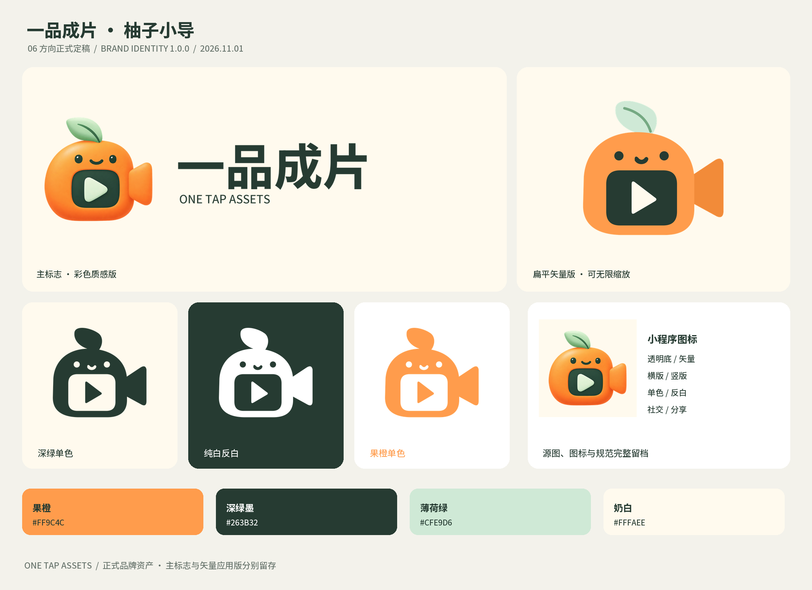

# 一品成片 · 柚子小导品牌定稿 / Citrus Director Brand 1.0.0

**用户于2026-11-01选择06「柚子小导」作为正式LOGO方向。** 产品名仍为「一品成片」，英文为「ONE TAP ASSETS」；柚子小导是品牌角色/标志名称。

[快速取用](START-HERE.md) · [离线素材库](index.html) · [品牌手册PDF](guidelines/一品成片-柚子小导-品牌手册-v1.0.pdf) · [手册预览](guidelines/guide-preview.png) · [物料轮播](brand-showcase.gif) · [完整SHA256](manifest.json)

## 本次定稿包含

| 分类 | 已交付 |
| --- | --- |
| 原稿与主标志 | 原始1254PNG与原提示词、透明边缘清理后的原生尺寸稿、紧边母版、透明2048/1024/512/256 PNG、奶白/纯白/深绿背景稿。 |
| 真正矢量 | 独立扁平路径SVG；彩色、深绿、纯白、纯黑、果橙五种；图形、横版、竖版、仅中文横版；另有小尺寸简化SVG。字标已转路径，无外链字体、图片或脚本。 |
| 标准组合 | 原选定质感形象的横竖PNG字标；透明、奶白、纯白、深底与反白字标版本。中文准确排版“一品成片”，英文“ONE TAP ASSETS”。 |
| 图标 | 奶白、纯白、深绿背景的1024/512/256/192/180/128图标；16/24/32/48/64/96/128小尺寸稿；16/24/32/48/64多尺寸ICO。 |
| 网页交接 | favicon.svg/ico、apple-touch-icon、192/512网页图标、相对路径site.webmanifest及head示例。接入时按自己的静态路径拷贝，不会自行修改网站。 |
| 上线物料 | 1200×630分享封面PNG/JPG、1080×1080方图、1080×1920海报、1920×640横幅、1200×960分享卡、800×240透明片尾标记。 |
| 颜色 | sRGB HEX/RGB JSON、独立前缀CSS变量、Adobe ASE、GIMP GPL。 |
| 规范与交接 | 8页PDF、逐页PNG预览、小尺寸实像素对照、离线HTML、主总览、5帧GIF、元数据与SHA256文件清单。 |

## 视觉定型

主标志保留用户选择的软萌相机形象：叶子、温暖果橙机身、深绿播放窗口、友善表情和右侧镜头。原图作为源文件完整留存；主标志仅清除孤立极低透明度边缘杂点，不改变保留图形内的RGB。

**扁平矢量版是配套应用稿**：依据同一角色重绘为真正Bezier路径，用于印刷、任意缩放和单色场景。原图的体积光照使用PNG保留；2048主图是从原始1254导出的放大版本，原生细节以1254源图为准。

| 基础颜色 | HEX | RGB |
| --- | --- | --- |
| 果橙 | #FF9C4C | 255,156,76 |
| 深绿墨 | #263B32 | 38,59,50 |
| 薄荷绿 | #CFE9D6 | 207,233,214 |
| 奶白 | #FFFAEE | 255,250,238 |

留白 `u = 图形最长可见边 / 8`，四周至少u。设计使用下限：质感图形64px，标准扁平32px，专用favicon简化稿16px；带英文组合宽至少240px，仅中文组合宽至少160px，扁平印刷图形至少12mm。16/24/32专用稿省略面部细节，保留叶子和播放窗口。小尺寸对照请看[实像素PNG](guidelines/small-size-inspection.png)。

不拉伸、倾斜、旋转、替换叶子/表情、压文字、添加发光描边或任意改色。质感稿/扁平稿分别整套使用。传播语为“拍下商品，成套表达。”；辅助传播语“让好商品，被好好看见。”。颜色文件以sRGB为准，印刷按打样校色。

当前C界面基线继续负责页面设计，品牌动作橙与UI动作橙#FF7948区分管理；品牌CSS仅提供独立变量。当前素材轮未部署页面、修改服务配置或配置HTTPS。

## 文件来源、版本与复导出

原始形象来自本会话用户指定的sub2-image-gen / gpt-image-2.5流程，原图SHA256记录在[品牌元数据](brand.json)。本轮从已选原图制作交付文件，没有再次调用生图服务。字体为Noto Sans SC / OFL，许可见[source/font-OFL.txt](source/font-OFL.txt)，来源见[source/font-source.json](source/font-source.json)。矢量字标已转路径；PDF字体为内部静态实例的子集，原字体文件不重复分发。

三个复导出脚本在仓库 `scripts/design/`：`build-citrus-brand.py` 构建原图衍生与真矢量；`create-citrus-brand-guide.py` 创建手册；`finalize-citrus-brand.py --visually-inspected` 在实际检查后验证并导出交付包。所需Python库为Pillow、NumPy、SciPy、fontTools、CairoSVG、ReportLab与pypdf；PDF逐页检查使用原生Poppler。没有Docker、WSL、虚拟机、子代理或浏览器依赖。

源工作目录为 `output/imagegen/2026-11-01-citrus-director-final/`；正式版本留档于 `assets/brand/citrus-director/v1.0.0/`，当前指针在 `assets/brand/current.json`。后续修订使用新版本；原十款候选和C冻结设计保持历史原件。

完整ZIP为工作目录内 `one-tap-assets-citrus-director-brand-v1.0.0.zip`，外部SHA回执在仓库本目录的 `package-receipt.json` 及ZIP旁 `.sha256`。ZIP不包含自己的外部回执；文件清单不包含自身与外部ZIP回执，避免循环哈希。整包解压后本目录链接自足，选择START-HERE或index.html即可。

## 本轮完成与后续

| 编号 | 本轮已完成 |
| --- | --- |
| B01 | 用户06选型记录、品牌v1.0.0与当前指针。 |
| B02 | 主标志、透明底、真正矢量、横竖/中文组合、单色与反白。 |
| B03 | 多尺寸图标、ICO、网页交接文件、上线封面/海报/片尾。 |
| B04 | 颜色文件、8页品牌手册、离线浏览、文件清单与完整ZIP。 |
| B05 | 素材专项检查及中英说明、状态与更新记录同步。 |

| 编号 | 后续待处理 |
| --- | --- |
| B06 | 将此定稿版本接入双小程序、Plus、官网和具体上线宣传位置；按实际宿主检查上传与显示。 |

## English

The user selected **06 Citrus Director** on 2026-11-01. This is the finalized **One Tap Assets / 一品成片 brand asset release 1.0.0**. The soft shaded original mascot remains the primary identity. A separately drawn flat path-only SVG family supports scalable, monochrome, reverse and print use; it does not claim to reproduce the original raster shading as vectors.

Included: unchanged original and prompt, cleaned transparent raster masters, up to2048px raster exports, outlined Chinese/English horizontal and vertical lockups, five SVG color modes, tiny icons, three app-icon backgrounds, multi-size ICO, web handover files, launch/social graphics, Adobe ASE/JSON/CSS/GPL colors, eight-page PDF guide, page previews, offline gallery, GIF and SHA256 manifest. Existing RGB values inside the retained primary silhouette are unchanged; only isolated very-low-alpha edge specks are removed. The2048 export is a resampled derivative of the1254 original.

Noto Sans SC is used under OFL; licensing and provenance are included. No new image-generation API call was made in this finalization round. The versioned assets and bilingual documentation are committed; the complete ZIP is exported locally under ignored output/imagegen with an external checksum receipt. Application deployment and host/device upload acceptance follow separately; the established C UI and HTTP-only configuration remain in effect.
