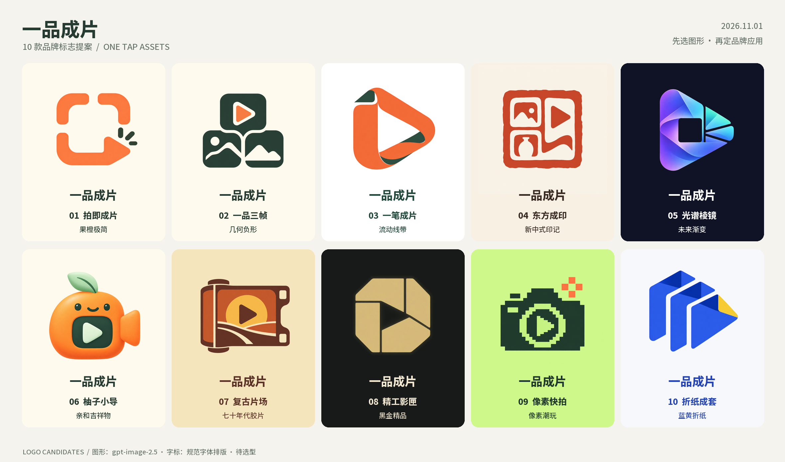

# 一品成片 · 10 款 LOGO 选型 / Ten logo candidates

2026-11-01，Asia/Taipei。状态：**已生成并整理，等待用户选型**。现有 C「柚子创作社」继续作为 UI 基线。本轮只新增品牌候选资产。



[逐款浏览页面](index.html) · [逐款 GIF](logo-showcase.gif) · [小尺寸实像素对照](small-size-comparison.png) · [候选元数据](candidates.json) · [文件 SHA256 清单](manifest.json)

## 选型目录 / Candidate index

| 编号 | 名称与大图 | 风格 | 图形含义 | 可用文件 |
| --- | --- | --- | --- | --- |
| 01 | [拍即成片](01-tap-frame/preview.png) | 果橙极简 / Citrus minimalism | 拍照取景框与播放切口合一，直接表达拍照成片。 | [1024 PNG](01-tap-frame/icon-1024.png) · [横版字标](01-tap-frame/wordmark-horizontal.png) |
| 02 | [一品三帧](02-three-frames/preview.png) | 几何负形 / Geometric negative space | 三枚素材方块借“品”字结构组合，突出一件商品生成一套素材。 | [1024 PNG](02-three-frames/icon-1024.png) · [横版字标](02-three-frames/wordmark-horizontal.png) |
| 03 | [一笔成片](03-one-ribbon/preview.png) | 流动线带 / Continuous ribbon | 连续线带把照片边角转成播放形，表达一次操作完成制作。 | [1024 PNG](03-one-ribbon/icon-1024.png) · [横版字标](03-one-ribbon/wordmark-horizontal.png) |
| 04 | [东方成印](04-vermilion-seal/preview.png) | 新中式印记 / Contemporary seal | 印章结构结合素材格与播放切口，强调有章法、有成品感。 | [1024 PNG](04-vermilion-seal/icon-1024.png) · [横版字标](04-vermilion-seal/wordmark-horizontal.png) |
| 05 | [光谱棱镜](05-spectral-prism/preview.png) | 未来渐变 / Spectral technology | 棱镜将单个输入分解为多种内容，突出 AI 创作和多规格产出。 | [1024 PNG](05-spectral-prism/icon-1024.png) · [横版字标](05-spectral-prism/wordmark-horizontal.png) |
| 06 | [柚子小导](06-citrus-director/preview.png) | 亲和吉祥物 / Friendly mascot | 把柚子与小导演合为亲和角色，传递轻松自助的创作体验。 | [1024 PNG](06-citrus-director/icon-1024.png) · [横版字标](06-citrus-director/wordmark-horizontal.png) |
| 07 | [复古片场](07-retro-film/preview.png) | 七十年代胶片 / Seventies film badge | 胶片匣、票券与暖色块组合，形成有记忆点的复古影像品牌。 | [1024 PNG](07-retro-film/icon-1024.png) · [横版字标](07-retro-film/wordmark-horizontal.png) |
| 08 | [精工影匣](08-precision-aperture/preview.png) | 黑金精品 / Luxury precision | 精密光圈与播放负形结合，强调品质、稳定和专业交付。 | [1024 PNG](08-precision-aperture/icon-1024.png) · [横版字标](08-precision-aperture/wordmark-horizontal.png) |
| 09 | [像素快拍](09-pixel-snapshot/preview.png) | 像素潮玩 / Pixel pop | 像素相机结合播放符号，突出快速、好玩和内容创作者属性。 | [1024 PNG](09-pixel-snapshot/icon-1024.png) · [横版字标](09-pixel-snapshot/wordmark-horizontal.png) |
| 10 | [折纸成套](10-folded-assets/preview.png) | 蓝黄折纸 / Folded editorial | 三张折纸素材合成前进箭头，表达规范成套、快速交付。 | [1024 PNG](10-folded-assets/icon-1024.png) · [横版字标](10-folded-assets/wordmark-horizontal.png) |

建议 **02 一品三帧**作为主品牌，品字结构与图片/视频组合能够解释“一件商品、一套内容”。**01 拍即成片**与现有 C 的配色、圆角和轻松操作更接近；**06 柚子小导**适合作为运营角色和品牌 IP。01/02/03/06在色彩上较容易兼容 C；04/05/07/08/09/10提供差异风格备选，选定后再做正式应用规范。

## 文件与使用 / Files and usage

每款独立目录包含：

| 文件 | 用途与事实范围 |
| --- | --- |
| `source.png` | 网关实际返回的 1254×1254 原图，不覆盖、不重绘；01–03及05–10为RGBA，04为RGB。 |
| `prompt.txt` | 完整创意提示词，不含服务配置和密钥。 |
| `icon-1024/512/256/128/64/32.png` | 带背景的规范尺寸图标候选；实际尺寸逐项核对。用于小程序图标、头像及网页等位置的选型与后续适配。 |
| `wordmark-horizontal.png` | 2048×640 横版图形＋准确中文“一品成片”＋英文 ONE TAP ASSETS。 |
| `wordmark-vertical.png` | 1024×1280 竖版图形＋规范品牌字标。 |
| `preview.png` | 1440×960 单款设计展示卡，包含方案编号、名称和风格。 |
| `small-sizes.png` | 32/48/64/128像素原尺寸排布，供检查实际识别度，不将放大展示当作小尺寸效果。 |
| `favicon.ico` | 16/32/48/64多尺寸网页图标候选。 |

图形来自用户指定的 **sub2-image-gen** Skill及其配置网关，执行原脚本 `scripts/sub2_image_gen.py`；模型 **gpt-image-2.5**，high quality，每款独立提示词，未替换生成渠道或模型。请求1024×1024，实际返回1254×1254，因此如实保留原图并单独缩放导出。现有Alpha按各方案背景合成；04保留原画背景。没有推断抠图、自动矢量追踪或伪称SVG母版。

品牌文字使用仓库现有 **Noto Sans SC / OFL-1.1** 字体准确排版，不依赖图像模型写字；随包保留[字体许可](font-OFL.txt)及[来源](font-source.json)，不重复分发字体文件。PNG为栅格候选，完整单色/反白版、矢量精修及最终平台上传裁切在选型后定稿。本轮已查看十张原图、总览、字标示例和小尺寸对照；32像素时04/05/06/07的细节会收敛，应以轮廓识别，选定后继续简化小尺寸专用版。

## 本地复导出 / Local export

生成工作文件位于 `output/imagegen/2026-11-01-logo-candidates/`（按仓库规则忽略）；安全的原图、提示词、衍生图、总览和GIF在本目录长期留档并提交。以下命令仅本地整理，不调用模型：

```text
python -B -X utf8 scripts/design/package-logo-candidates.py
python -B -X utf8 scripts/design/finalize-logo-candidates.py --visually-inspected
```

第二条仅在实际看过对应原图和对照后执行。需要Pillow；使用仓库已有字体。再次实际生图应通过用户指定Skill脚本与`prompt.txt`，不要把网关地址/密钥写进仓库。曾误启动一次重复生成协调进程，发现后已停止；交付按十份不同原图核对，文件数量不用于推断上游计费或被取消请求的执行状态。

ZIP导出到 `output/imagegen/2026-11-01-logo-candidates/one-tap-assets-logo-candidates-2026-11-01.zip`，校验见仓库本目录的外部 `package-receipt.json` 及ZIP旁的 `.sha256`；ZIP不重复提交二进制，也不包含自己的外部回执。解压后打开 `index.html` 浏览全部方案，无外部依赖、跟踪或接口请求。GIF是十张真实设计卡的轮播，不是应用操作录屏。本轮没有应用UI变更，也没有打开浏览器或修改HTTP部署。

## 本轮完成与待办 / Completed and pending

| 编号 | 已完成 |
| --- | --- |
| L01 | 十款独立风格真实生图、原图与提示词留存。 |
| L02 | 规范图标、横竖字标、ICO、设计卡、小尺寸对照、总览、GIF和本地ZIP。 |
| L03 | 图片解码/尺寸、十份原图差异与工作副本一致性、清单SHA256及静态链接核对。 |

| 编号 | 待完成 |
| --- | --- |
| L04 | 用户从01–10选择主LOGO方向。 |
| L05 | 选定款矢量精修、单色/反白/小尺寸版和正式品牌应用规范。 |
| L06 | 将选定资产应用至双小程序、Plus、官网和上线宣传内容。 |

## English

Ten independently generated logo-symbol directions for **One Tap Assets / 一品成片**. Each symbol was produced through the explicitly requested **sub2-image-gen** gateway using **gpt-image-2.5**, high quality, with its own archived prompt. The gateway returned 1254×1254 images despite a 1024×1024 request; originals are preserved byte-for-byte. Exported icons have verified 1024/512/256/128/64/32 dimensions. Existing transparency is composited over each direction's background; no vector master or inferred background removal is claimed.

The archive includes exact Chinese/English typeset lockups, individual boards, a full contact sheet, actual-size comparisons, a ten-frame GIF, offline HTML gallery and SHA256 file manifest. Typography uses the repository's OFL-licensed Noto Sans SC. The ZIP is exported locally under the ignored `output/imagegen/` folder; its receipt and all source/derivative assets are versioned here. The ZIP excludes its own external receipt to avoid circular hashes.

Recommended main identity: **02 Three Frames**, whose three-part layout echoes 品 and combines image/video assets. **01 Tap Frame** closely fits the current citrus/cream/forest-green UI; **06 Citrus Director** supports a friendly brand mascot. All ten are **unselected candidates**; the existing C UI baseline and HTTP-only server remain in place. Selection, vector refinement, monochrome/reverse/tiny-icon variants and product rollout follow afterward.
