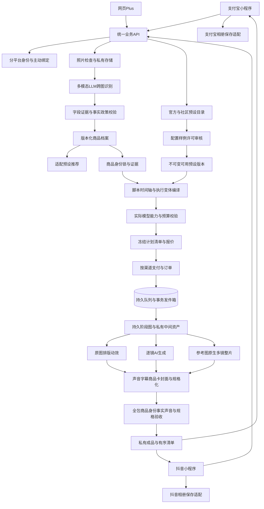

# 一品成片：架构、数据与接口

P01｜v3.1｜2026-10-27｜自有业务设计，未实现。双小程序为核心，多模态识别/商品锁为必经服务，官方10套/至少14变体与社区共用三路线云端执行协议；网页Plus为进阶载体。以下为本项目业务合同，不是供应商或宿主官方接口。

当前工程细化入口为[开发文档v1.1](开发/README.md)，含[架构决策](开发/01-技术选型与架构决策.md)、[业务/管理接口合同](开发/04-接口契约与错误语义.md)、[数据事务](开发/03-领域数据与数据库设计.md)及[持久生成管线](开发/05-云端任务与生成管线.md)。这些细则保持本版需求范围，原v2.1实施文档仅历史。

## 架构与代码边界

唯一工作根目录为 `E:\dev\sandbox\支付宝黑客松\一品成片`。`src/mini-alipay/`、`src/mini-douyin/`为核心客户端，`src/shared/`为schema/状态，`src/web/`为Plus，`src/api/`、`src/worker/`承载后端与识别/媒体任务。当前仅有目录，没有应用实现。所有运行缓存、日志和临时文件进入本项目runtime，使用Windows原生进程，不调度Docker/WSL/虚拟机。

后端采用模块化单体、关系数据库、受控对象存储和持久Worker。视觉、图片/视频/声音供应商在后端调用，密钥不进小程序；图像/FFmpeg在受控Worker执行。商品档案是共用业务层，社区仅管理声明式方案与单独授权样例，无权读取买家照片、分镜、供应商结果或订单。开发验证使用Windows原生进程，生产运行在后续配置的授权云计算资源；操作系统/硬件由能力基准决定，当前没有部署。候选Taro/React先做双端实验再冻结。

候选为TypeScript API、PostgreSQL事务/持久队列、独立Worker和私有对象存储。v2.1 [实现细则](实施/一品成片架构与实现细则-2026-10-27.md) 中通用归属/交易/保存规则继续适用，三路线、时限、模型与验收以本版及 [v3规格](设计/方案组件与执行变体规格-v3.0.md) 为准。one-tap-ads本地SQLite/页面状态须替换为服务端快照与任务，不通过买家打开网页推进生成。

## 领域模型

| 实体 | 关键字段 | 不变量 |
| --- | --- | --- |
| User/Tenant/PlatformIdentity | platform、app_id、subject_id、user_id、binding | 服务端确定归属；不同平台昵称不自动合并 |
| ProductDraft/Asset | tenant、sha256、mime、size、quality、expires_at | 私有上传与本地临时路径区分，定位元数据剥离 |
| AnalysisJob/Attempt | input_hash、model/prompt/policy_version、state、attempt、trace、deadline | 真实视觉调用可追踪，初始+最多1次重试；失败不产生报价或付款 |
| ProductProfileVersion | category/name、observations、label_texts、hypotheses、unknowns、photo_roles、conflicts、evidence、schema_version、hash | 区分观察/OCR/推测/未知，证据必须属于本租户当前输入 |
| ProductIdentityLock | profile_version、product_form、package_form、count_unit、structure/color/text/accessory_anchors、evidence_refs、unknowns、hash | 商品锁来自输入事实，不从生成画面反推；包装/单位/结构改变为缺陷 |
| SourceRecipe/ComponentVersion | upstream_commit/id、source_hash、license、canonical_semantics、review、capabilities | 391来源条目只读研究；运镜/Look/人物等未准入不能变成可执行承诺 |
| OptionalCorrectionVersion | field、value、source、actor、confirmed_at | 轻量纠错可选，保留原识别证据；不必填全表 |
| Preset/Creator | id、source=OFFICIAL/COMMUNITY、author、parent_ref、visibility | 10套官方维护；社区不受10套数量上限限制 |
| PresetVersion/ResourceLicense | input、style、timeline、output_slots、copy_policy、fallback、review、license、resource_hashes | 发布后不可变；资源和可派生权逐项核验；不能执行作者代码 |
| ExecutionVariantVersion | preset_version、engine、canonical_narrative/mode、component_refs、audio_policy、input_rules、output_contract、slo/retry/cost_policy | 10套最少14变体；每变体独立审核/样例/价格，原生和交付规格分开 |
| ProviderModelVersion/CapabilitySnapshot | provider/model/version、duration/reference/pixel/audio/language_caps、price_version、verified_at、status | 报价使用实际模型能力/费率；无验证或变更不可静默替换 |
| CharacterVersion/SceneLock | appearance、clothes、voice_ref、setting/light、rights、reference_asset_ids | 准入人物/声音；参考编号和镜头角色固定，私有衍生不公开 |
| ScriptPlanVersion/ShotPlan | profile/lock/variant、fact_refs、dialogue/caption、start/end/overlap_frames、source/camera/character_refs、hash | 报价前规划校验；总帧精确，无来源数字拒绝，修改产生新版本 |
| ReferenceFrameSet | grid_or_independent、cell/shot_mapping、crop_geometry、effective_pixels、asset_hashes、identity_qc | 人物参考计入额度；关键帧不过检不进入视频付费 |
| PresetPublication/Review | draft_version、sample_ids、rights_attestation、reviewer、decision、reason | 私有草稿→待审→退回或发布；新版本重新审核 |
| PrivateCreatorSample / PublicSample | 私有SAMPLE来源、独立公开ID、source_consent/input_hash、license、preset_version、media_hash、expires_at、state | 私有源始终PRIVATE；审核后独立复制/登记，单独最多30天授权与撤回，不依赖原商品照片或私有下载链接 |
| Favorite/Fork/Report/Moderation | actor、preset/version、parent_license、reason、state、audit | 收藏幂等、署名来源保留、举报处置可追踪 |
| CompositionVersion | asset/profile/preset/template/model/rule_versions、seed、hash | 制作与可选本人预览使用同版；已售内容不受社区改版影响 |
| Quote/Order/ExecutionSnapshot | tenant/channel/app、plan_hash、profile/lock/variant/components、model_caps/rates、manifest、cost/retry/slo、amount_fen、expires_at | 报价15分钟；服务端定价，版本/路线/声音和截止冻结 |
| Payment/Refund | order、provider_ref、verified_state、amount_fen | 原渠道核验/查单/退款，不跨渠道复用凭证 |
| StageRun/ProviderSubmission | order/plan/shot/stage、input_hash、idempotency_key、submission_state、provider_task_id、receipt、lease | 回执先持久化，UNKNOWN查原任务，不盲重购 |
| RenderJob/Deliverable/QCDecision | order、repair_round、fixed_deadline、cost_budget、slot/spec/native_spec/hash、defects、policy_version、manifest | 最多一轮有界修复，整包商品/事实/声音/规格通过后原子发布 |
| DeviceSaveSession/Receipt | installation、artifact、attempt、state/error、time | 仅设备体验遥测，不改变服务端交付或账务 |

商品档案的每项观察至少包含字段名、value、status、source_asset_ids和证据说明；可定位时记录归一化区域并验证边界。可靠度保留模型输出与平台校验结果，不能把自报概率当准确率；冲突字段进入待用/省略列表。包装成分/认证文字仅说明图中标签写了什么，不证明真实成分或认证有效。

识别档案是结构化数据，不是要求用户填写的前台表单。客户端只显示轻量摘要与可选“识别有误”；用户正常直接选方案。档案和证据跟随照片清理，交易仅留最小哈希/版本凭据。公共方案没有ProductProfile和买家Asset读取权。

配置草案为 [presets.v3.1.json](../assets/presets/presets.v3.1.json)，schema版本3.0，10方案/14变体。DESIGN、未授权资源、model=null或price=null均不能变成已售方案。v2及v1映射仅保留历史，当前接口与报价不读它们。

## 自动处理管线

1. 客户端合法登录/上传，服务端检查资源与必要隐私同意；不上传整相册。
2. 触发跨图视觉识别，记录类别/可见特征/OCR/照片角色/未知/冲突。校验schema、来源、证据和事实规则；模型API支持的JSON模式须实测，服务端仍独立校验。
3. 生成不可变ProductProfileVersion，给简短摘要并推荐适配预设。视觉超时或结构错误有限重试，失败在收费前明示；不偷偷用选中品类替代识别。字段不确定可省略或用通用类别，照片不可用才提示补拍。
4. 建立商品锁，按输入充分性和准入能力过滤方案/变体；用户选择效果后，自动规划事实脚本、精确帧时间轴、参考策略、声音与模型，校验时长/参考数/原生规格/成本。冻结计划/资源/清单与报价，规划不提交未经确认的视频付费任务。
5. 用户主动付款，所属渠道后端核验并事务写订单、任务和发件箱。正常制作无需每单人工审核。
6. 持久任务图并行准备图片包和视频参考。按PHOTO_LAYOUT/PER_SHOT_AI/REFERENCE_FILM执行；关键帧先验锁，人物/原声按合同生成。实际供应商任务ID先落库，结果私有保存后执行声音、字幕、标识、音乐、商品卡/封面和编码。
7. 对全包媒体、身份/人物跨帧、事实台词、声音/字幕和许可QC，全部通过才原子发布manifest。最多一轮预算内修复；原图600/逐镜1800/参考整片3600秒为初始设计截止，具体按已售SLO冻结，超限失败退款，不缩减数量/换路线。
8. 小程序按顺序列作品，用户主动保存到相册。保存与渲染、收费分离，部分保存失败只续存失败项。

识别使用按实际模型像素/数量/格式限制生成的受控视觉副本，原图仍供正式排版，裁切证据需能映射回原图；不能把上传允许的30MP直接视为模型可接收上限。识别缓存按租户+照片集哈希+模型/提示/政策版本隔离，并遵守照片删除；不跨租户缓存命中暴露商品信息。免费识别/创作者样例受公开的频率与额度限制，防刷不限制已购订单执行/领取，也不以隐藏付费代替错误反馈。数量和时限在成本实验后冻结。

## 社区发布管线与状态

`DRAFT → VALIDATING → PENDING_REVIEW → PUBLISHED`，退回为CHANGES_REQUIRED；暂停、普通下架、强制禁用分别记录。创作者选择受控叙事/运镜/Look/人物/声音/字幕和版式，声明每个执行变体的输入/输出；服务端检查能力、资源与30次基准及质量/成本。新增模型/语言/变体重新发布，不接受任意文件路径/外链URL/脚本/工作流执行。

发布时公开配置、作者与来源链、明确许可和已授权样例；不公开创作者原始私有照片或任意客户数据。派生需父版本允许，继承署名/许可约束并独立验收。审核可人工完成；普通订单自动执行已审版本，不能为了社区机制加逐单人工关卡。

普通下架停止新单，旧合同照常履约。强制禁用出问题的素材/版本时保留审计，定位未完成订单、通知并退款/补偿；不自动换模板，不声称可收回用户已保存媒体。作者退出后配置/许可的保留范围依据发布时明确授权，不能无限代入默认许可。

## 平台适配

内部抽象包括login/capturePhotos/upload/downloadAuthorizedMedia/saveImage/saveVideo/openPermissionSettings/launchApprovedPayment/resumeOnForeground，这些不是官方API名字。抖音官方提供图片选择/保存和视频保存能力；视频需先下载到本地路径并按用户/隐私授权执行。支付宝境内图片/视频保存参数、最低版本还需正式文档与真机确认，不用Alipay+或淘宝同名接口作证。

相册、支付、订单、下载域名和前后台能力分别按两端批准的规范验收。支付宝走获准小程序支付和赛事路径；抖音按其交易/订单/iOS规则，不外跳支付宝收银绕过。网页Plus独立接入，身份接续需主动绑定，退款仍回原渠道。

## 自有业务API

基路径 `/v1/p01`；写操作Idempotency-Key按租户+动作绑定摘要，冲突409。所有输入服务端校验归属，返回code/message/retryable/trace_id。这是拟建业务接口，不是支付或模型官方协议。

| 方法与路径 | 用途/返回 |
| --- | --- |
| POST /sessions/platform | 用真实平台临时凭证交换本产品会话 |
| POST /products、POST /assets | 建立免事实表单草稿、检查并上传私有照片 |
| POST /products/{id}/analyses | 指定照片版本触发视觉任务，返回analysis_id；同版本可命中本人有效缓存 |
| GET /analyses/{id} | 识别状态、真实失败/重试和输入问题 |
| GET /products/{id}/profile | 当前结构化档案、可展示摘要和证据，只有本人可读 |
| POST /products/{id}/corrections | 可选轻量纠错，生成新档案版本，旧报价失效 |
| GET /presets、GET /presets/{id}/versions/{version} | 已审目录，按本人profile可过滤；来源/作者/样例、效果变体、声音/清单/区间价格 |
| GET /presets/{id}/versions/{version}/variants | 已审变体的输入、AI演绎/声音、清单、可用/阻止原因，不暴露密钥 |
| GET /products/{id}/preset-recommendations | 根据本人档案推荐，未知也给适配通用方案 |
| POST /products/{id}/input-check | 方案输入充分性与照片补拍/安全降级 |
| POST /plans、GET /plans/{id} | 自动编译档案/商品锁/方案变体为版本化脚本/时间轴/能力计划；可异步，返回plan_hash/阻止原因，正常用户无审稿关卡 |
| POST /preset-drafts、PATCH /preset-drafts/{id} | 本人受控方案草稿，按expected_version防覆盖 |
| POST /preset-drafts/{id}/samples | 自有/授权照片样例生成，默认私有，不引用买家订单链接 |
| POST /preset-drafts/{id}/submit | 验证配置/样例/许可/成本，进入审核，不直接发布 |
| GET /preset-publications/{id} | 作者查看审核/退回原因，审批接口限运营角色 |
| PUT /presets/{id}/favorite、DELETE /presets/{id}/favorite | 幂等收藏/取消 |
| POST /presets/{id}/forks | 明确父版本与许可，生成本人新草稿并保留来源 |
| POST /presets/{id}/reports | 举报与处理追踪，不越权公开私有信息 |
| POST /quotes、POST /orders | 绑定有效plan_hash、实际模型/声音/预算/截止与全包价格，生成订单和获准渠道付款动作 |
| GET /orders/{id}、GET /jobs/{id} | 付款/任务/退款与实际阶段、期限分别返回 |
| GET /jobs/{id}/stages | 本人实际阶段摘要/可恢复状态；供应商凭证与原始调试数据只在受控后台 |
| GET /orders/{id}/deliverables | 私有有序媒体、文案、领取期限与权益 |
| POST /deliverables/{id}/download-link | 验证权益发5分钟短链，保存失败不再收费 |
| POST /save-sessions、POST /save-sessions/{id}/receipts | 设备保存会话与幂等回执，仅体验数据 |
| POST /orders/{id}/cancel、/revisions、/tickets | 取消、一次受限修改/平台纠错、售后 |
| POST /payment-events/{provider} | 后端验签，核对渠道/商户/应用/订单/金额，重复不重复履约 |

所有路径统一前缀 `/v1/p01`；方案专项早期的 `/v1/recipes` 等名称只是概念草案，按本表收敛，不另维护第二套生产协议。Provider注册、发布/停售、QC复核/对账接口限运营/服务身份，不向普通买家开放。

## 云端任务、状态与成本一致性

计划状态为 `PLANNING → VALIDATING → READY/BLOCKED/FAILED`；READY不代表媒体已生成。订单付款、业务履约和退款分开。任务状态为 `QUEUED → PREPARING → GENERATING → POST_PROCESSING → QC → DELIVERED`，可在阶段进入一轮REPAIRING；终态为DELIVERED/FAILED/CANCELLED，失败再走独立退款状态。进程崩溃不改变合同截止。

供应商提交状态为 `INTENT_RECORDED → SUBMITTING → ACKNOWLEDGED → RUNNING → RESULT_AVAILABLE → DOWNLOADED`，请求结果不明为UNKNOWN。唯一键包含order_id/plan_hash/stage_id/shot_id/attempt；响应与任务ID落库后才等待。无法查询/幂等的供应商须有对账和重复费用承担策略，不能把网络超时当确定未提交。已下载且hash/QC有效的产物不重新购买；修改参考依赖时只失效相关下游。

端到端截止从确认付款且必要输入具备的 `fulfillable_at` 固定。各阶段写预计/实付成本，新增付费意图前原子预留预算；并发镜头不能分别用满同一整单余额。检测、图片/人物参考、失败/修复、下载/合成都在成本和时间内，保存队列独立。退款与任务取消竞态按唯一分支锁定，迟到结果保持私有并清理，不二次交付/收费。

## 私有参考与供应商资产生命周期

原图、商品锁、Character/Scene衍生、分镜图/裁图、原生片和后期产物按tenant/project/order隔离。供应商取图票据限定对象/用途/时效，失效只可由后端按任务重新签发；不把买家链接写入社区配置或日志。下载仅接受注册供应商的受控结果与目标存储规则，禁止作者任意URL触发服务端抓取。

未付款照片/档案/预览默认24小时，已付款输入/档案默认7天覆盖48小时修改窗口，完整输出自交付后7天。原图/档案/锁/中间参考与在线缓存按相同政策一并清理；提前删除按账户/订单政策处理，不消灭必要交易义务。供应商可删副本发删除并记回执，不可控制的保留在准入时披露并评估，不虚称立即删除。交易/授权必要凭据最小保留，买家相册副本不受服务端清理控制。

## 相册状态与恢复

`PENDING_DOWNLOAD → DOWNLOADING → READY_TO_SAVE → SAVING → SAVED`；失败分类下载/权限/空间/格式/系统，回调丢失为UNKNOWN。只有保存成功回调才计该项已入相册，不以下载成功代替。

用户可点保存整套/只存图片/只存视频/单项，初始串行或经真机证明的低并发；单文件存后及时回收临时副本。退出/后台暂停本地队列，前台恢复只续存未完成项，链接过期可重新取；UNKNOWN提示可能已存，由用户检查/再存。不能保证系统相册可查哈希去重，默认只跳过本安装已明确成功项。

临时预算100MB、单正式媒体≤30MB是待实测目标，10套最长20秒视频逐一验证。已售规格不能为满足设备预算而悄悄降级。双小程序×iOS/Android相册、最低版本、合法域名和编码均为发布门槛。

## v3.1 Codex运行时与数据增补

Worker增加实例管理器、CodexRuntimeAdapter、可信Skill仓、平台MCP工具网关、双复核与回收器；app-server仅服务内stdio，模型会话不是订单真源。四阶段详见[Codex架构](开发/14-Codex内核与分阶段编排.md)。

新增SkillVersion/SkillBundle、AgentInstance/AgentRun、SkillLoadEvidence、ToolCallIntent、ReviewPacket/ReviewReport、CleanupReceipt等逻辑记录；实例绑定tenant/order或未付preview、执行代次、受限OS身份及工作区。检查点包含输入/输出哈希、角色/协议/Skill/模型版本、已发生副作用和剩余预算；不持久保存原始思维链。

ExecutionSnapshot升级为1.1.0，新增不可变codex_contract：runtime/protocol/model/费率、Bundle/Skill/prompt/tool/QC版本、角色调用/token/成本限制、双复核与回收策略。新契约位于[开发v1.1](../assets/development/v1.1/README.md)，历史1.0快照保留原版本，不直接重写。

订单尚不存在时，Codex工具意图及费用按tenant＋preview归属，报价用[CodexQuoteBinding](../assets/development/v1.1/contracts/codex-quote-binding.schema.json)保存合同摘要与Skill版本，后续按原报价建立已售快照。新增Agent成本预留记录与供应商预留关联，重启/包装调用不重复计算同一费用。

交付事务除manifest外写双复核引用和ReleaseRequested outbox。回收器拥有独立租约与fencing_token，只有核验进程/能力/临时数据已清理才能RELEASED；未决供应商任务保留在独立对账记录。新增管理查询/释放接口只能由管理身份访问，小程序沿用业务进度与交付接口，禁止传入任意Codex prompt/Skill路径或直接访问RPC。
