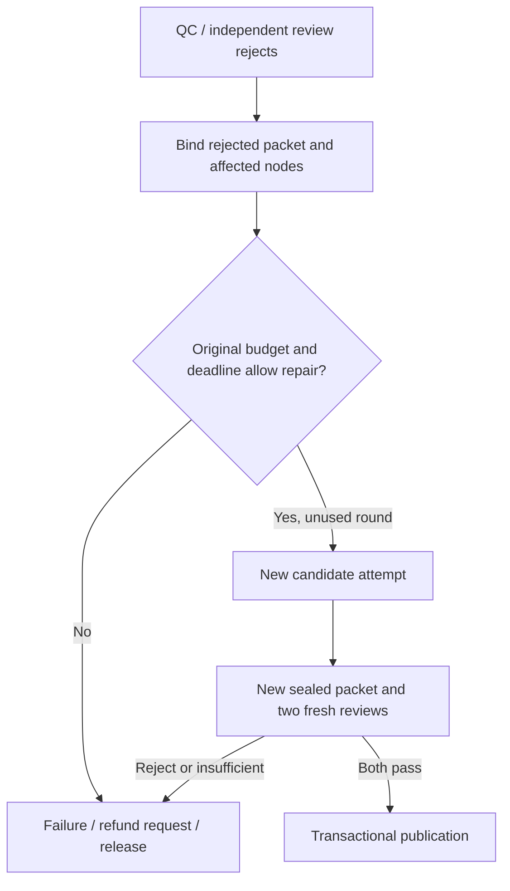

# 故障恢复与修复边界 / Recovery and repair boundaries

费用恢复新增[首轮制作费用隔离与原费用回执](../实施/首轮制作费用隔离与原费用回执-v1.0.md)：首轮不能占用原修复/售后保留额，UNKNOWN仍占用原额度；旧执行超占时保留原账目并阻止新购买，不补高额度。Original accounting preserves UNKNOWN obligations and protected repair/aftercare holds. Historical over-commitment stops new purchases; it does not replenish the budget or implement automatic repair.

排版专项新增[完整展示文字与购买前校验](../实施/完整展示文字与购买前排版校验-v1.0.md)。`LAYOUT_TEXT_OVERFLOW`/缺字/实际重叠拒绝制作；已有媒体phase输入或版本变化返回`MEDIA_INPUT_CHANGED`，不新建媒体操作、改键重做或补写旧证明。原规划缺少用户选择返回`PLAN_INPUT_CHANGED`，需重新选择，不推断历史风格。这是原操作保护；完整自动素材修复与历史迁移仍未实现。Measured layout rejects incomplete output, and changed media inputs preserve/block the original operation. Missing original selections fail explicitly with PLAN_INPUT_CHANGED. These guards do not implement bounded automatic repair or historical migration.

[中文 README](../../README.md) · [English README](../../README.en.md) · [启动 / Quick start](QUICKSTART.md) · [当前状态 / Status](STATUS.md)

本指南对应当前已提交源码。它区分“继续原任务”“重做候选素材”和“交付后修改”：三者使用不同的身份、预算与交付证据。完整的自动修复产线尚未接通；不能通过改数据库状态或重建订单模拟完成。

This guide describes the committed implementation. Resuming an original operation, repairing candidate media and revising an existing delivery are separate operations with different identities, budgets and evidence. The complete automatic repair pipeline is not connected. Editing database states or recreating an order does not implement it.

## 1. 哪种情况恢复什么 / What resumes

| 场景 / Situation | 当前处理 / Current behavior | 不能据此认定 / Does not establish |
| --- | --- | --- |
| 小程序关闭、切后台 / Client leaves | 重新登录后查询本人商品、方案、订单和交付；从服务端事实继续 / Resume owner-scoped server records | 页面进度不是付款或交付证明 / UI progress is not payment or delivery evidence |
| 原请求回执丢失 / Reply lost | 使用原幂等意图及对应恢复查询；不创建第二份购买 / Recover the original idempotent operation | 换一个幂等键不是安全重试 / A new key is not a safe retry |
| Worker中断 / Worker interrupted | 原持久阶段在租约到期后由新代次接管；核对已有角色和媒体检查点 / Take over the original durable stage and checkpoints | 不重置尝试次数、预算或绝对截止 / No reset of attempts, budget or deadline |
| 供应商结果未知 / Provider result unknown | 保留费用预留，查询原任务或核对原存储回执 / Retain the hold and reconcile the original task/receipt | UNKNOWN不是失败、免费或可重购 / UNKNOWN is not failure, free usage or repurchase permission |
| 文件检查或独立复核不通过 / QC or review rejects | 阻断发布；由阶段失败/期限终止路径进入失败、退款与释放 / Block publication; failure/deadline handling terminates, requests refund and release | 尚无完整自动修复链路 / No complete automatic repair chain |
| 交付后有限修改 / Limited aftercare | 支持的原图无声订单走独立REVISION五阶段，发布关联新版本 / Eligible silent photo orders use five revision stages and a linked manifest | 不等于视频内编辑、生成式售后或免费平台纠错 / Not in-video editing, generated aftercare or free platform correction |
| 下载或相册失败 / Download or album save fails | 从当前交付清单续存失败项，保留逐文件journal / Retry failed files against the current manifest and journal | 不回流生成或再扣制作费用 / No new generation purchase |

“请求退款”与“资金已经退回”是两个状态；释放事件与“实例进程树已经清理”也不同。当前真实支付、受限身份/进程树、真机相册与完整外部隐私删除仍待准入。

A refund request is distinct from a completed financial refund. A release event is distinct from verified process-tree cleanup. Real payment, restricted identities/process trees, device album behavior and complete external erasure remain unadmitted.

## 2. 本地运行与观察 / Native operation and observation

新增[Worker脱敏故障诊断与日志隔离](../实施/Worker脱敏故障诊断与日志隔离-v1.0.md)。平台内部可按受控任务ID、`failure_phase`、固定分类及允许原生码定位问题；客户端保持原错误码。日志回调的同步/异步故障不能改变事务。日志是尽力输出，缺失日志不证明成功，也不提供重购权限；仍须核对原租约、原回执和原费用。

The [private diagnostic contract](../实施/Worker脱敏故障诊断与日志隔离-v1.0.md) correlates an internal task ID, phase, fixed category and allowlisted native code. Client errors keep their existing contract. Sync/async sink failures cannot change transactions. Best-effort logs are not proof of success or permission to repurchase; reconcile the original lease, receipts and costs.

本地数据库启动调用到时后，原生PostgreSQL可能仍在执行自身恢复。本轮曾出现启动包装器60秒到时、原实例随后恢复就绪的实际记录。先确认本项目数据目录及原实例，再查询就绪；不要因包装器返回就重复初始化数据库或启动第二个实例。就绪探测不运行迁移、不读取凭证：

A startup wrapper can time out while the original native PostgreSQL instance is still recovering, as observed in this round. Confirm the project data directory and original instance before checking readiness. Do not reinitialize the database or start a second instance based solely on the wrapper exit. This probe does not migrate data or read credentials:

```powershell
.\runtime\tools\pgsql\bin\pg_isready.exe -h 127.0.0.1 -p 55432 -t 3
```

完成[快速启动](QUICKSTART.md)后，在项目根目录的独立PowerShell终端按需要运行：

After following the [English quick start](QUICKSTART.en.md), use separate PowerShell terminals at the checkout root:

```powershell
.\scripts\run.ps1 dev:api
.\scripts\run.ps1 dev:worker
.\scripts\run.ps1 dev:reaper
.\scripts\run.ps1 dev:media-maintenance
```

这些命令分别启动四个进程，不能在同一前台终端顺序运行来代替并行服务。回收器和媒体维护器独立于制作Worker；它们不依赖用户重新打开小程序。已编译入口分别为`start:api`、`start:worker`、`start:reaper`与`start:media-maintenance`，须先执行`build:server`。

Each command starts a separate foreground process. Reaping and media maintenance run independently of production and client sessions. Compiled equivalents are `start:api`, `start:worker`, `start:reaper` and `start:media-maintenance`; run `build:server` first.

- `/healthz`只验证API能够查询数据库，不检查完整Worker、模型或宿主能力。`/readyz`另外检查已配置的删除日志门禁。两个接口都不是完整产品就绪证明。
- `/healthz` checks database access; `/readyz` additionally checks a configured deletion-journal gate. Neither certifies workers, provider admission or complete product readiness.
- Worker记录`worker_ready`及阶段/事件处理器列表；开关关闭时出现缺少制作处理器是受控开发状态。生产生成模式拒绝不完整阶段注册。`worker_ready`本身不证明真实Codex、计费或隔离可用。
- The worker logs its registered handlers. Disabled flags can intentionally leave generation handlers absent in development; production generation rejects an incomplete registry. `worker_ready` does not certify real Codex, billing or isolation.
- 阶段日志区分`stage_succeeded`、`stage_deferred`、`stage_failed`与`stage_interrupted`。被接管的旧代次不能强制提交或结算。日志与原始供应商/支付报文留在忽略的`runtime/`，不要粘贴凭证到issue或README。
- Stage logs distinguish success, deferral, failure and interruption. Stale lease holders cannot force completion or settlement. Keep private logs and raw receipts out of Git and public issues.

所有进程均原生运行；禁止Docker、WSL、虚拟机及依赖它们的工具。浏览器回放完成后关闭本次无用标签和开发服务。

Run native processes without Docker, WSL or VMs. Close unused tabs and the preview server after browser work.

## 3. 当前源码的拒绝门禁 / Existing rejection gates

| 代码 / Code | 含义与后续 / Meaning and handling |
| --- | --- |
| `LEASE_LOST` | 当前执行已失效，交由原阶段新代次处理；不能强制写回 / Stop the stale execution and let the original stage resume under a valid lease |
| `ORDER_NO_LONGER_EXECUTABLE` | 订单取消、到期或媒体撤权；不得重新开放制作 / Cancellation, expiry or revocation blocks further production |
| `QC_PAID_CALL_UNRESOLVED` / `REVIEW_PAID_CALL_UNRESOLVED` / `PUBLICATION_PAID_CALL_UNRESOLVED` | 等待原收费调用对账；不释放未知费用后重新购买 / Reconcile the original paid operation without repurchasing |
| `REVIEW_PACKET_BLOCKED` | 封存包已被拒绝或不可再审；不能改成PASS / A rejected packet cannot be forced to pass |
| `PUBLICATION_NOT_READY` | 当前包没有满足独立复核和事务发布条件 / The current packet has not met publication requirements |
| `NATIVE_AUDIO_NOT_ADMITTED` | 公开有声报价/订单尚未准入；配置密钥不能解除业务准入 / Public native-audio ordering remains unadmitted; credentials alone do not change admission |
| `INDEPENDENT_AUDIO_REVIEW_REQUIRED` | 历史合同缺完整独立听音能力；不能回填或重写已售合同 / A legacy contract lacks the required listening capability and cannot be rewritten |
| `ARTIFACT_HASH_MISMATCH` / `REVIEW_EVIDENCE_CHANGED` | 实际字节与登记证据不同；阻断并调查，不能用文件存在替代摘要 / Actual bytes changed; existence alone cannot authorize delivery |

实际错误和恢复动作以原订单、原供应商任务及当前源码为准。持续UNKNOWN、已过截止、撤权或财务恢复阻塞必须保留原始事实；本指南不提供直接修改生产表的命令。

Resolve incidents against the original order, provider task and current implementation. Preserve unresolved cost, deadlines, revocation and financial holds. This guide does not prescribe direct production-table edits.

## 4. 自动修复的剩余实现 / Remaining automatic repair work

需求P01-F09、F46与F55仍要求最多一轮自动修复，任何受影响节点至多一次额外尝试，且不延长原截止或费用上限。目前`repair_rounds`、预算字段、设计状态机与已有阶段恢复不能证明这条链路已实现。

Requirements P01-F09, F46 and F55 require at most one repair round, at most one extra attempt per affected node, and the original deadline/cost ceiling. Existing fields, design states and checkpoint recovery do not implement that chain.



此图是待实现的验收目标，不是当前运行流程。完成需要同时做到：

This diagram is a required future acceptance flow. Completion needs all of the following:

1. **拒绝证据与修复范围冻结**：绑定原包、失败报告、槽位、节点及代次；找不到合法修复方式时终止。不能改商品身份、路线、清单、授权、原生台词或已售合同。
2. **原子次数和费用门禁**：并发领取只能建立唯一修复轮；先处理原UNKNOWN，预留额外制作和两次新复核成本；保留售后额度与原截止。
3. **真实新候选版本**：修复输入与新产物可追溯，旧包失效；恢复原修复意图，不能因进程重启重新计数或盲重购。
4. **全包重新验收**：可按哈希复用未变化的确定性检测，但须新封存包和两个全新语义复核角色；不能沿用旧PASS。
5. **终态与故障验证**：第二次拒绝、预算/期限不足、撤权、丢失回执和旧代次回写均进入规定处置；真实退款、资源释放及三路线修复效果分别验收。

1. Freeze rejection evidence and affected nodes. Preserve identity, route, outputs, rights, sold dialogue and contract.
2. Atomically enforce one round and original financial limits, reconcile UNKNOWN, preserve aftercare funds and reserve fresh review costs.
3. Produce a traceable new candidate and stale the old packet. Resume the same repair intent after interruption.
4. Seal a new packet and obtain two fresh semantic reviews; never reuse a prior PASS for changed candidates.
5. Verify repeated rejection, exhausted limits, revocation, lost replies and fencing, with separate real refund/cleanup and per-route evidence.

完整规则见[交叉核验与交付门禁](../开发/17-交叉核验与交付门禁.md)；当前优先顺序见[状态](STATUS.md)。平台免费纠错与用户一次小修改另属P01-F12，也不能由此图认定完成。

See the [review specification](../开发/17-交叉核验与交付门禁.md) and [status](STATUS.md). Free platform correction and the user's one-time revision are separate P01-F12 requirements.

## 5. 隐私删除与备份恢复 / Erasure and backup restore

删除先撤销客户媒体与短期能力，物理回收由独立维护器执行；UNKNOWN费用、未决写入和实例未清理仍会阻塞。主库逻辑脱敏成功不代表WAL、备份、供应商或OSS副本已物理删除。

Deletion first revokes access. Independent maintenance reclaims registered objects. Unresolved billing/writes and incomplete instance cleanup retain their holds. Logical database redaction does not establish physical erasure from WAL, backups, providers or OSS.

从备份恢复须重放数据库之外的签名删除日志及冻结集合。不能从旧备份恢复日志检查点、重建空日志、删锁或清除财务恢复阻塞来取得ready状态。当前仅验证了受控原生恢复场景，生产异地耐久性与完整外部隐私准入仍未通过。

Restore must replay the independent signed deletion journal and frozen erasure sets. Never recover its checkpoint from the old database, initialize an empty replacement, delete a lock or clear financial holds to obtain readiness. Controlled native tests do not certify production durability or external erasure.

## 6. 更新与证据 / Updates and evidence

代码、契约、UI和文档的更新分别核验；操作步骤见[发布与同步指南](PUBLISHING.md)。本指南本身不宣告新增修复功能，不改变现有测试结果、58项需求、C设计或全部禁售状态。

Validate code, contracts, UI and documentation according to the change; see [publishing and synchronization](PUBLISHING.md). This guide adds no repair implementation and changes neither test results, the 58 requirements, frozen design C nor sales-disabled status.
