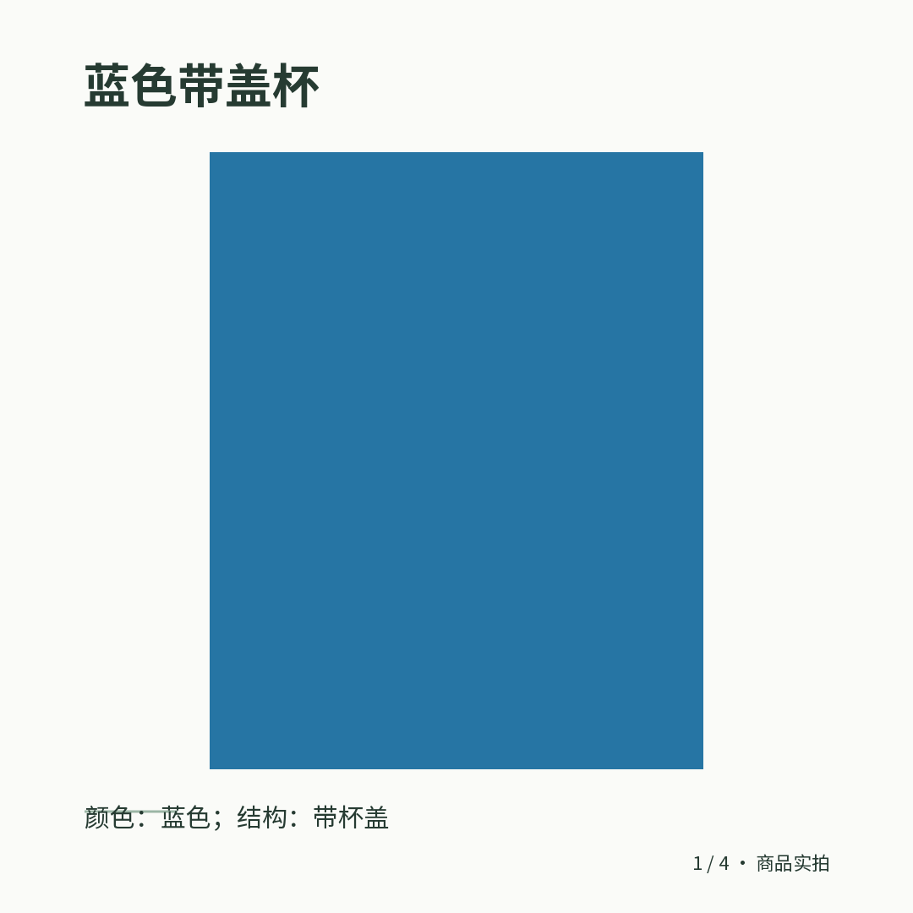
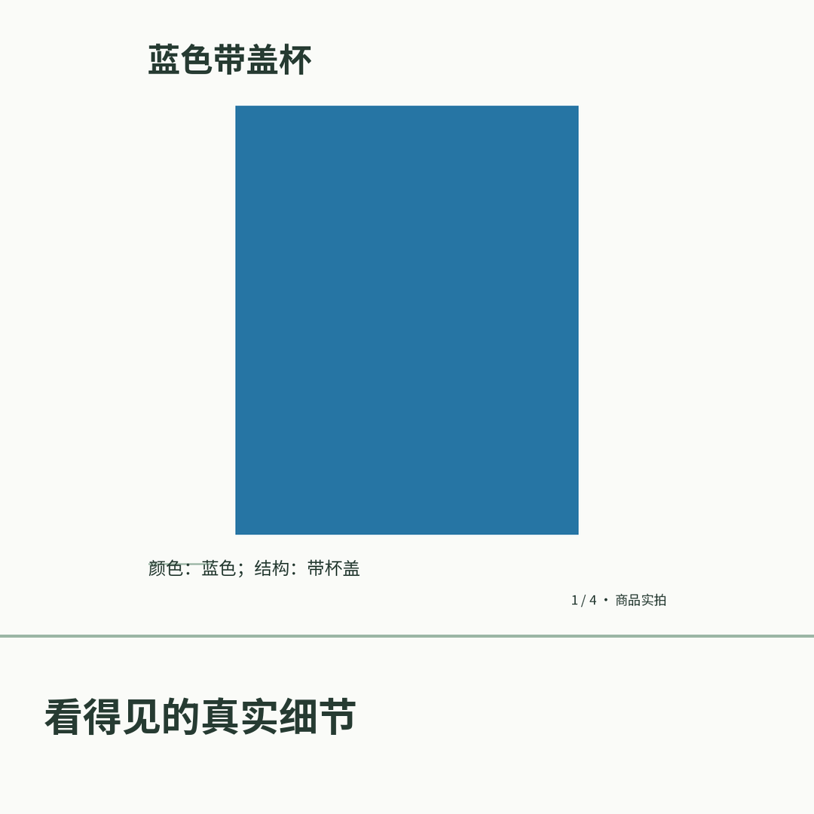

# 图片加字：实际共享组件与交付图片 / Actual image-title revision





[MP4](walkthrough.mp4) · [原始WebM](walkthrough.webm) · [交付前](01-delivered-pack.png) · [选择加字](02-image-title.png) · [新版本](03-new-image-delivered.png) · [摘要与来源](capture-manifest.json) · [实现细则](../../实施/图片加字与实际素材售后-v1.0.md)

430×932真实Edge录制，使用未改动的双小程序共享LimitedRevision组件、实际HTTPS API、原生数据库和五阶段Worker；生成真实新PNG并核对下载SHA、原到期时间和清单轮询。外围记录壳用于显示当前图片和版本，不是完整小程序宿主或Plus。5项检查、8媒体文件，当前源码`bc77e6cf`。全部浏览器页面/上下文与所属API/数据库池已关闭。

The real shared mini-program revision component submits an authorized IMAGE_TEXT request to the native HTTPS API. The worker produces a new PNG, runs fresh QC and independent reviews, then the component loads manifest revision 2. The original picture remains complete in a smaller upper region and the short title is rendered in a bottom panel. This is not image redraw or replacement of text already inside a picture.

商品色块、身份、语义批准和计量是合成夹具，不是实际商品生成效果、真实Codex质量、宿主真机或生产证明；全部官方方案仍禁售。The fixture uses synthetic product imagery, identities, semantic verdicts and usage. No live service, native device, commercial or full-product acceptance is claimed.

复录在项目根目录执行，需先完成原生本机初始化和当前server/preview构建，并已有项目内Playwright媒体工具。启动器必须指定项目内缓存；录制脚本finally释放全部所属资源：

```powershell
$env:PLAYWRIGHT_BROWSERS_PATH = Join-Path (Get-Location) 'runtime/playwright-browsers'
$env:TEMP = Join-Path (Get-Location) 'runtime/tmp'
$env:TMP = $env:TEMP
.\runtime\tools\node\node.exe --import tsx docs/media/image-text/capture.mts
```

源码：[capture.mts](capture.mts)。第一次直接启动未指定项目缓存，随后记录壳导航/媒体传输修正；这些均未修改业务源码或放宽权限，详情见[尝试记录](../../verification/image-text-attempts.json)。
