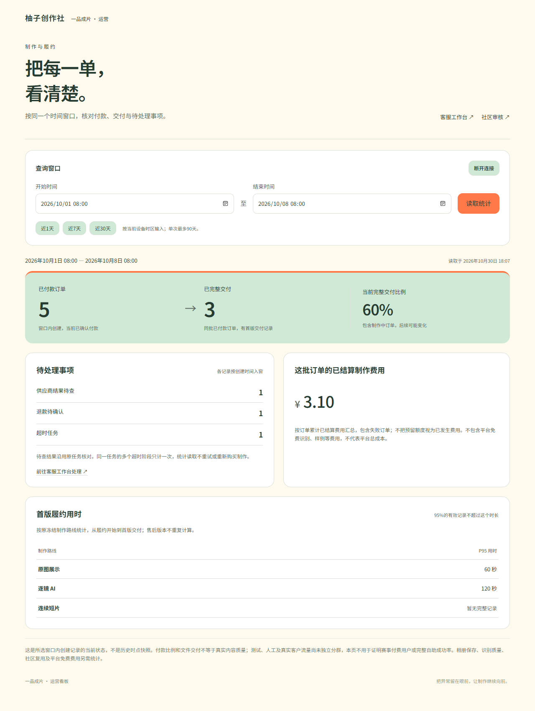
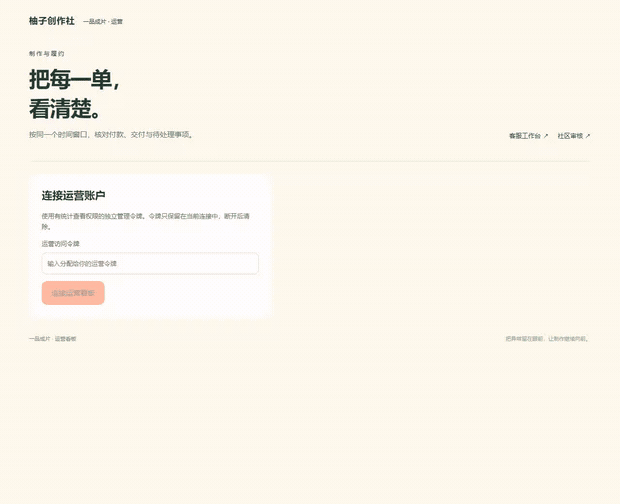

# 运营看板 · 实际页面录制

本目录为 `/ops/metrics` 的实际浏览器截图和录制，使用当前构建、真实本机 API 与独立原生 PostgreSQL 测试schema。付款、交付清单、费用、退款与运营身份均为明确的合成元数据；不代表真实付款/账单、商业质量、生产身份或小程序真机验收。

[实现与口径](../../实施/运营看板与窗口一致统计-v1.0.md) · [当前证据](../../verification/metrics-dashboard-source.json) · [文件SHA及准确源码版本](capture-manifest.json)。既有录制和C设计留存原字节与各自原版本。

| 页面 | 内容 |
| --- | --- |
| [独立登录](01-independent-login.png) | 无令牌不显示聚合数据 |
| [窗口统计](02-windowed-overview.png) | 原窗口的付款/首版交付、费用、待处理事项和三路线用时 |
| [读取失败](03-read-error.png) | 清除旧统计并重试原窗口 |
| [空窗口](04-empty-window.png) | 零计数，未知比例与暂无完整记录 |
| [窄屏页面](05-narrow-screen.png) | 390像素宽下保留输入与指标说明，无横向溢出 |

[MP4录屏](walkthrough.mp4) · [原始WebM](walkthrough.webm)。无音轨。录制覆盖连接、原窗口查询、一次网络读取失败及原窗口重试、空窗口、窄屏和断开清理。

复录：先构建当前源码，再按照实现文档配置项目内浏览器缓存，执行 `pnpm docs:metrics`。脚本关闭所有自己创建的页面、浏览器、API与数据库连接；不关闭开发主库或其他用户进程。
