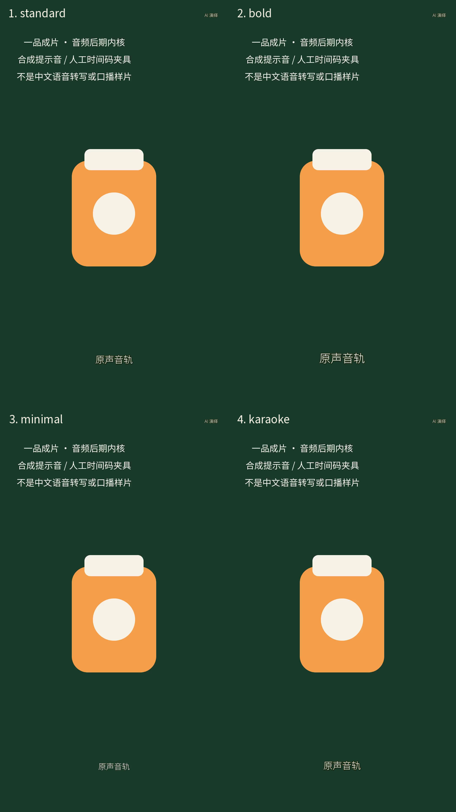

# 原生有声后期内核演示 / Native audio kernel demonstration

[中文项目](../../../README.md) · [English project](../../../README.en.md) · [实现细则](../../实施/原生音轨字幕与配乐后期内核-v1.0.md) · [来源与文件摘要 / Provenance](capture-manifest.json)

这是实际原生 FFmpeg/PCM/AAC/字幕处理的输出，不是页面或小程序宿主录屏。源视频为自绘商品插画、合成 660Hz 提示音，字幕为人工指定的中文时间码夹具；未执行中文语音识别。karaoke 版本额外叠加有登记测试许可的合成 220Hz 背景音，按原声信号压低。真实 ASR、中文讲解、听音复核、订单交付与生产准入均未完成。

These are actual native media-processing outputs, not page or native mini-program recordings. The source uses an original illustration, synthetic 660Hz tones and manually timed Chinese text. No Chinese speech recognition occurs. The karaoke clip adds a registered synthetic 220Hz bed with actual ducking. Real ASR, speech quality, independent listening, order delivery and production admission remain unverified.



| 样式 / Style | 实际视频 / Actual video | 实际取帧 / Actual frame |
| --- | --- | --- |
| standard | [4 秒 MP4 / 4-second MP4](standard.mp4) | [PNG](standard.png) |
| bold | [4 秒 MP4 / 4-second MP4](bold.mp4) | [PNG](bold.png) |
| minimal | [4 秒 MP4 / 4-second MP4](minimal.mp4) | [PNG](minimal.png) |
| karaoke | [4 秒 MP4，含压低配乐 / with ducked bed](karaoke.mp4) | [PNG](karaoke.png) |


GIF 无音；试听请播放 MP4。[原始合成视频 / Synthetic source](source.mp4) · [测试背景音 / Synthetic bed](synthetic-bed.wav)。这不是官方 15 秒人物讲解样片，也不能证明字幕文字实际被说出。The GIF has no audio. These are not official 15-second presenter samples and do not prove that the displayed Chinese words were spoken.

复录 / Recapture：在项目根目录执行下列命令。脚本使用独立原生测试库，删除自身 schema/临时目录，不打开浏览器，不访问外部模型。

```powershell
.\scripts\run.ps1 docs:audio
```

The script uses an isolated native PostgreSQL test schema, closes the pool and removes its schema and owned temporary directory. It opens no browser and calls no external model. The manifest records exact file/source/font hashes, actual output properties, waveform checks and explicit fixture limits. Raw processing proofs stay in ignored `runtime/test-results/native-audio-capture/`.
