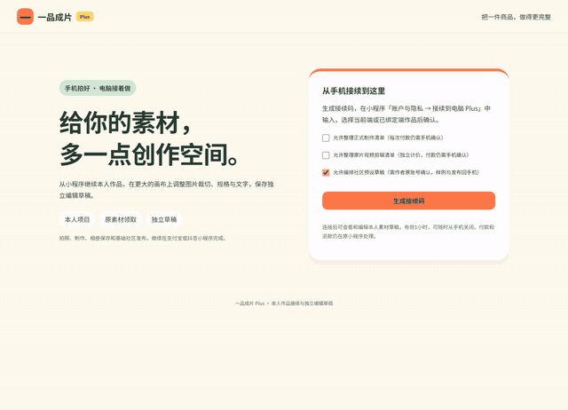

# Plus预设编排截图与录制 / Preset composition media

实际编译后的Plus界面通过原生HTTP处理器和临时PostgreSQL保存、读取及修订草稿；平台身份、既有订单/QA和商品PNG为合成夹具。不是仅在界面中修改状态的演示。没有执行真实宿主登录、模型生成、样例制作、授权或发布。

Actual compiled Plus UI with HTTP handlers and native PostgreSQL. Native identities and fixture order/QA/PNG are synthetic. This recording does not claim provider, sample, publication, real-device or cloud acceptance.

[MP4录屏](walkthrough.mp4) · [WebM原录制](walkthrough.webm) · [媒体SHA256及具体检查](manifest.json) · [功能与使用](../../实施/Plus社区预设编排与云端续编-v1.0.md)

| 编号 | 截图 | 内容 |
| --- | --- | --- |
| 01 | [明确作者权限申请](01-explicit-authoring-request.png) | 单独申请原账号预设编排 |
| 02 | [组合与清单](02-composition-and-checks.png) | 主风格、叙事、节奏、多规格和兼容检查 |
| 03 | [回执未知](03-save-acknowledgement-unknown.png) | 数据已提交后网络中断，保留原意图 |
| 04 | [云端已保存](04-cloud-saved.png) | 同一份草稿供手机和电脑继续 |
| 05 | [修订冲突](05-revision-conflict.png) | 原生手机写入引发真实冲突，当前修改保留 |
| 06 | [窄屏](06-narrow-viewport.png) | 同一功能的窄屏布局 |
| 07 | [撤销](07-native-revocation.png) | 原账号手机撤销后工作台清空 |

录制完成后关闭本次页面、上下文、浏览器、预览服务和临时数据库模式，保留已有原生开发数据库。原方案C及历史媒体按原字节保留。
