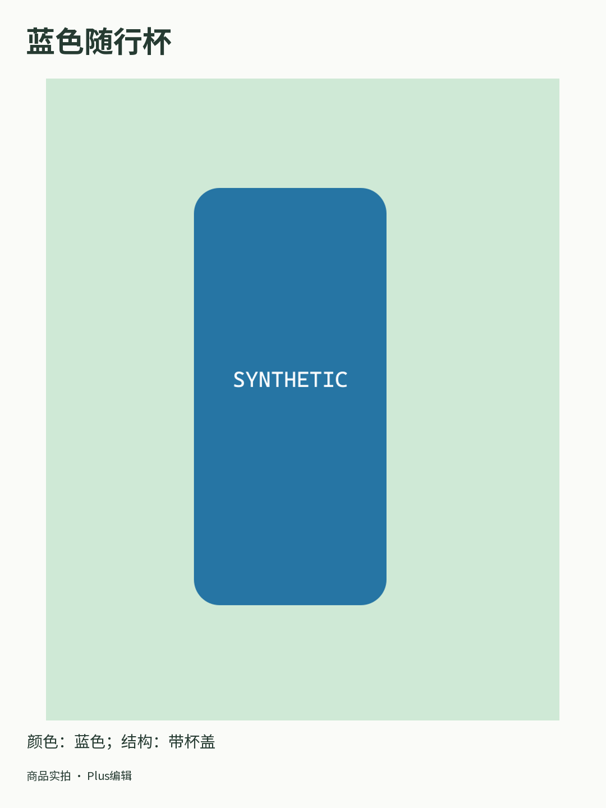

# Plus 单图制作演示 / Plus single-image production

实际访问本机 HTTPS、PostgreSQL 和私有 PNG，执行 CONTENT、制作、后期、QC、双复核及原子交付。原订单的付款/审核元数据、模型回复、支付事件、语义结论与进程身份为合成，示例图片明确写有 SYNTHETIC；不代表真实模型质量、支付、隔离或宿主小程序验收。手机确认与报价使用原生服务接口，录像显示电脑操作；本轮没有另行录制手机宿主页面。

Actual local HTTPS, PostgreSQL, MCP and PNG execution, with synthetic original paid metadata, inference, payment events, semantic verdicts and process identity. Native APIs perform phone approval and fee/order confirmation; the recording shows the computer UI. This is not real-service or native-device acceptance.

| 编号 | 文件 / File | 内容 |
| --- | --- | --- |
| 01 | [明确申请制作权限](01-explicit-production-scope.png) | 新权限需要手机明确批准 |
| 02 | [独立编辑与价格](02-edited-size-and-separate-price.png) | 已保存的1080×1440版本和独立费用 |
| 03 | [手机付款交接](03-native-payment-handoff.png) | CONTENT清单完成，回原小程序核对费用 |
| 04 | [双复核后完成](04-reviewed-production-complete.png) | 新素材已正式交付 |
| 05 | [新私有素材包](05-new-private-image-and-copy.png) | 新图片、文案与领取入口 |
| 06 | [实际新PNG](06-actual-edited-image.png) | 实际渲染文件，非页面截图 |

[MP4录像](walkthrough.mp4) · [WebM原始录像](walkthrough.webm) · [GIF演示](walkthrough.gif) · [来源及SHA清单](capture-manifest.json) · [实现与限制](../../实施/Plus独立图片正式制作与手机付款交付-v1.0.md)。

本轮6项浏览器检查通过，全部所属页面、浏览器、API和连接池已关闭。历史媒体与C设计原件保持原字节。
