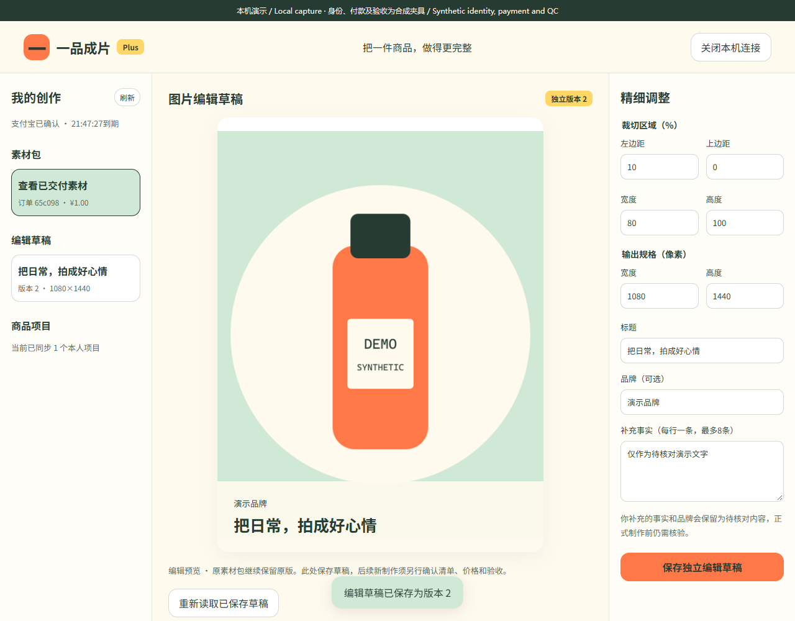

# Plus工作台截图与录制 / Plus screenshots and recording

电脑页面实际访问本机HTTPS API、PostgreSQL和私有PNG；身份、付款、验收语义使用明确合成夹具，PNG为自绘DEMO商品。手机截图是双端共享UI的合成回复回放，不是宿主真机或真实授权/付款证据。电脑录制中的批准、读取、保存、撤销使用真实本机接口和事务；手机UI回放是另一个独立演示连接。

The desktop uses actual local HTTPS, PostgreSQL and private PNG bytes, with synthetic identity/payment/QC metadata. The phone view replays the shared mini-program UI with synthetic replies. This is not native-device, actual generation, payment or production acceptance.

| 编号 | 截图 / Screenshot | 内容 |
| --- | --- | --- |
| 01 | [电脑接续码](01-browser-approval-code.png) | 手机主动确认前 |
| 02 | [本人素材包](02-owned-delivery.png) | 实际后端读取 |
| 03 | [独立编辑草稿](03-versioned-edit-draft.png) | 实际PNG、裁切/规格/文字、版本2 |
| 04 | [共享手机确认页](04-shared-mini-explicit-approval.png) | 合成回复UI回放 |
| 05 | [共享手机关闭连接](05-shared-mini-revoke.png) | 合成回复UI回放 |
| 06 | [撤销后清空电脑](06-revoked-browser-cleared.png) | 实际后端撤销及拒绝 |

[MP4](walkthrough.mp4) · [原始WebM](walkthrough.webm) · [SHA256、检查和清理记录](capture-manifest.json) · [需求和技术细则](../../实施/Plus手机确认与独立编辑草稿-v1.0.md) · [原始证据](../../verification/plus-workspace-source.json)。

6张PNG及MP4/WebM/GIF共9份媒体。录制结束关闭所有所属浏览器页面、浏览器、临时API及数据库连接池，清理专用测试schema，保留本机开发数据库。旧153媒体、C设计稿和历史原件保留原字节。Plus只保存编辑草稿，正式渲染和单独购买/验收未完成。
