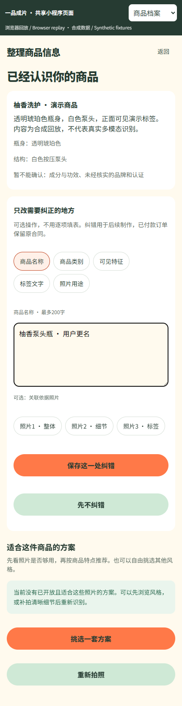

# 商品档案 · 可选轻量纠错录制

本目录是实际共享 React/Taro 小程序页面的浏览器截图和录制。商品档案、纠错结果与一次“已处理但回执丢失”均为明确的合成回放，不代表真实视觉服务、小程序真机或正式订单验收。真实原生数据库接口有独立专项证据。

[实现与使用](../../实施/商品档案轻量纠错与同版续制-v1.0.md) · [当前验证](../../verification/profile-correction-source.json) · [准确源码、文件SHA及录制范围](capture-manifest.json)。

| 截图 | 内容 |
| --- | --- |
| [默认流程](01-no-required-form.png) | 自动识别摘要及方案选择，无纠错必填项 |
| [可选纠错](02-optional-correction.png) | 一次选择一个字段及当前商品依据照片 |
| [原提交核对](03-original-intent-retry.png) | 丢失回执后冻结表单，沿用原提交 |
| [来源保留](04-user-source-preserved.png) | 新名称与“用户纠错待复核”，未知项保留 |
| [窄屏页面](05-narrow-screen.png) | 390像素宽下可继续使用，无横向溢出 |

[MP4录屏](walkthrough.mp4) · [原始WebM](walkthrough.webm)。无音轨。复录命令为 `pnpm docs:profile`，先构建当前网页并配置项目内浏览器缓存。录制结束关闭本次页面、浏览器和预览服务。历史录制及C冻结设计留存其原字节与原版本。
