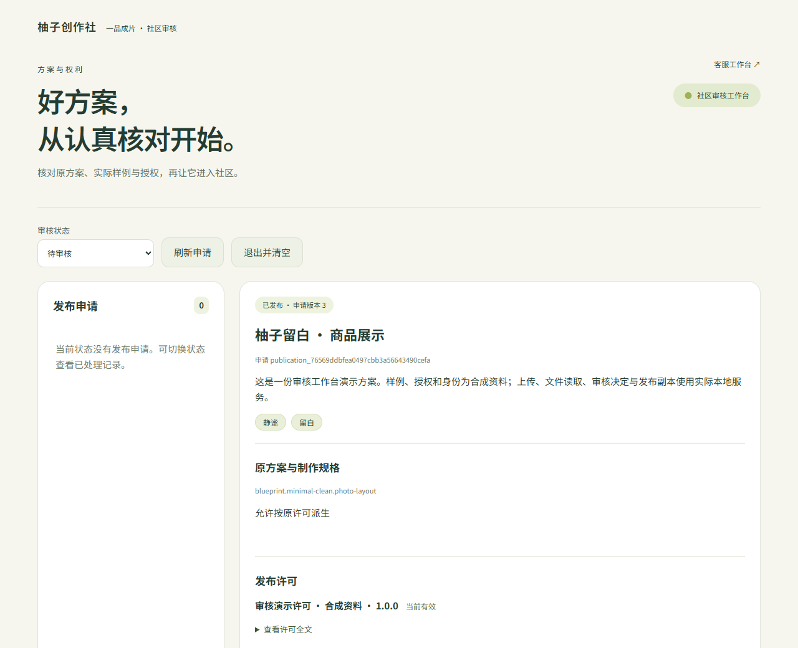

# 社区审核工作台 · 实际页面录制 / Community review workbench

本轮使用实际原生 HTTP、PostgreSQL、文件上传与私有 PNG/MP4，记录原申请读取、证据核对、审核回执丢失恢复、独立公开副本和社区发布。作者、工作人员身份、商品档案、权利/许可及 READY/QC 输入为明确标注的合成资料；不证明真实授权、生成质量或生产准入。7 项关键浏览器检查及每个媒体的摘要见 [capture-manifest.json](capture-manifest.json)。

Actual browser capture with native HTTP/PostgreSQL, uploads, PNG/MP4 reads, original-operation retry and independent public-copy/publication effects. Author/operator identities, profiles, rights/license and READY/QC inputs are synthetic. This is not real-rights, generation-quality, host-device or production-admission evidence. Owned browser contexts, tabs, API and database pool were closed.

| 编号 | 文件 | 内容 / Content |
| --- | --- | --- |
| 01 | [登录](01-independent-review-login.png) | 独立管理令牌 / Independent management login |
| 02 | [样例与证明](02-private-sample-and-evidence.png) | 原申请私有图片及权利声明 / Private sample and rights |
| 03 | [原操作恢复](03-original-review-pending.png) | 已提交但回执丢失 / Committed operation awaiting acknowledgement |
| 04 | [独立发布](04-independent-publication-without-sale.png) | 发布社区且保持禁售 / Publication with sales disabled |
| 05 | [MP4](walkthrough.mp4) | 实际操作录像 / Browser walkthrough |
| 06 | [WebM](walkthrough.webm) | 原始浏览器录屏 / Original browser recording |
| 07 | [GIF](walkthrough.gif) | README 操作预览 / README preview |

[实现说明](../../实施/社区审核工作台与原申请证据核对-v1.0.md) · [准确验证来源](../../verification/review-console-source.json)
