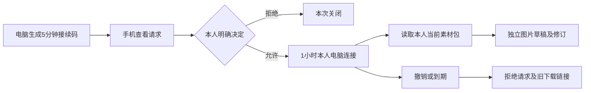

# Plus 手机确认与独立编辑草稿 v1.0

2026-10-30快速功能收口：[Plus独立图片正式制作与手机付款交付](Plus独立图片正式制作与手机付款交付-v1.0.md) · [准确证据](../verification/plus-render-source.json)。电脑保存图片编辑修订并经手机明确授权整理独立清单，冻结来源/裁切/尺寸/文案/风格/价格，再回原小程序确认费用并主动付款；CONTENT、制作、后期、QC、事实和风格独立复核后交付新 PNG 与文案。原素材与原订单权益保留，旧电脑连接不会自动获得制作权限。新增036迁移、4接口；518源码/36迁移/95业务38管理、296schema80实体、42契约/Skill槽位和4字体资源，仍为17个小程序页面。新权限/报价/付款/实际交付4项最终源码专项、类型/server/preview/本机启动和6浏览器检查通过；早期7项单元及首轮中7项工作台断言保留原源码差异，8次初始失败及类型诊断不改标。新增9媒体，总171，旧162媒体和方案C原件保持。付款/模型/审核结论/进程身份为合成；全面测试与宿主真机未执行，真实服务和销售关闭，完整产品/生产/云端false。Plus视频、字幕、批量和复杂作者工具、长期双平台身份绑定及完整验收仍待。

以下记录保留历史来源，当前状态以本轮说明与准确证据为准。

本轮交付一个实际连接原生 API 和 PostgreSQL 的网页工作台：本人在支付宝或抖音小程序主动确认后，电脑可访问该身份名下的商品、订单及当前素材包，领取原图，创建并保存独立图片编辑草稿。沿用方案 C「柚子创作社」，没有把基础制作流程迁移到电脑。

这是 F18 / F24 的部分实现。正式渲染、单独报价与复核交付、视频字幕编辑、批量商品、复杂预设作者工具、支付宝与抖音长期账号绑定仍待实现；58 项完整需求继续保留。本轮不改变生产准入结论。

## 用户操作

1. 启动项目当前构建，电脑打开同一 HTTPS 域名的 `/plus/`，点击「生成接续码」。页面显示8位码，5分钟有效。
2. 已登录的小程序进入「账户与隐私 → 接续到电脑 Plus」，输入该码，先查看请求，再明确允许或拒绝。查看请求本身不会授权。只确认自己正在操作的电脑。
3. 电脑等待确认后显示「我的创作」、素材区和编辑区。连接有效1小时；权限仅包括本人项目读取、原素材领取和编辑草稿。付款、退款、制作下单和账号隐私删除仍走原小程序。
4. 打开已交付的素材包，选择图片「继续编辑」。可设图片裁切百分比、输出像素、标题、可选品牌及每行一条的补充事实；裁切保持原图比例，不拉伸商品。预览与保存对象为编辑草稿，不冒充已完成的新成品。
5. 保存后产生独立修订号，可从草稿列表重新读取。另一个编辑器已更新时返回版本冲突，用户先读取再编辑；相同内容重试不增加版本。已付订单和原交付清单不被覆盖。
6. 手机列表可关闭任何本人的电脑连接；电脑可关闭自身连接。撤销后请求失效，已经签发的 Plus 原图下载地址也失效。刷新遇到失效会清空电脑私有视图；已经下载的文件无法远程收回。重新载入或关闭页面不会在浏览器存储保留凭据。

基础拍照、自动识别、十套官方风格与社区选型、付款、制作、相册保存仍可完全在小程序完成。Plus 里可选品牌与事实不构成基础商品表单，也不会升级为机器观察事实。

## 状态与权限

| 数据或操作 | 小程序原身份 | Plus 电脑连接 |
| --- | --- | --- |
| 查看、批准接续请求 | 允许；必须有效原生会话 | 禁止 |
| 管理电脑连接 | 本人全部有效连接 | 仅关闭自身 |
| 读取商品、订单、当前交付 | 既有本人权限 | 本人范围只读 |
| 领取原素材 | 既有规则 | 本人、当前连接有效，签名绑定连接 |
| 创建、读取、保存图片草稿 | 当前由 Plus 使用 | 本人且原素材仍有效 |
| 付款、退款、下单、发布、隐私删除 | 既有流程和权限 | 禁止 |

接续继承批准会话的原平台身份，不推测合并昵称、手机号或另一个平台账号；不复制付款渠道、售后权益或可修改次数。当前仅解决到 Plus 的显式短期接续，不宣称完整双平台长期绑定。

## 接口与数据

新增11个业务操作，完整请求和响应以[当前契约](../../assets/development/v1.1/contracts/endpoint-catalog.md)为准。

| 方法 | 路径（统一前缀 `/v1/p01`） | 用途 |
| --- | --- | --- |
| POST | `/plus/links` | 生成码及独立高熵轮询密钥 |
| POST | `/plus/links/inspect` | 原生会话查看待确认请求 |
| POST | `/plus/links/decision` | 原生会话允许或拒绝 |
| POST | `/plus/links/{link_id}/poll` | 仅持有轮询密钥的电脑领取状态和固定会话 |
| GET | `/plus/session` | 当前电脑连接 |
| GET | `/plus/sessions` | 原生身份列举本人有效连接 |
| DELETE | `/plus/sessions/{plus_session_id}` | 撤销连接 |
| POST | `/plus/edit-drafts` | 从当前已付图片建立草稿，自然键去重 |
| GET | `/plus/edit-drafts` | 本人有效草稿分页 |
| GET | `/plus/edit-drafts/{draft_id}` | 重验原素材并读取 |
| PUT | `/plus/edit-drafts/{draft_id}` | 预期修订号比较后保存 |

迁移035新增 `plus_links`、`plus_sessions`、`plus_edit_drafts`、`plus_edit_versions` 四表。旧001—034迁移保留原字节。码和随机密钥只存摘要，电脑令牌只存摘要并绑定原身份；轮询密钥不是业务 Bearer。并发领取返回同一令牌和原到期时间，已撤销/到期不会因重试恢复。每个账号最多5个有效电脑连接，最多100份草稿。

所有业务调用在事务内先检查电脑操作白名单和有效会话，按同一用户锁与撤销、隐私删除和编辑串行。签名下载在读取私有对象前后都验证电脑连接；连接撤销不依赖重新生成素材包。生成、检查和轮询分别有限流，响应不缓存且不泄露来源。

草稿绑定原订单、商品、清单与修订号、图片及 SHA256。来源必须属于本人、付款确认、当前交付、领取期内、商品存活且媒体未撤销。跨人草稿返回不可见，来源清单更新要求从新版本建立草稿。商品删除或订单媒体撤销会物理清除草稿及其修订；保留原付款合同记录。

裁切矩形必须完整在原图内且宽高不少于1%；画布每边256—3840像素，总像素不超过8294400；标题80字、品牌60字、事实最多8条且每条200字。补充事实固定标记 `USER_PROVIDED_UNVERIFIED`。修订不可变，保存后不改原订单预算、模型、Skill、已付权益或原成品。

## 代码与构建

| 层 | 实现 |
| --- | --- |
| 双端共享确认页 | `src/shared/ui/plus-connections.tsx`，按需展开 |
| Plus 界面与内存凭据 | `src/web/main.tsx`、`client.ts`、`plus.css` |
| 入口 | `src/preview/plus.html`，同源 `/plus/` 和静态资源 |
| 会话和操作边界 | `src/api/modules/plus-access.ts`、`identity.ts`、`app.ts` |
| 编辑持久化 | `src/api/modules/plus-edits.ts`、迁移035 |
| 契约生成源 | `scripts/plus_contracts.py` 与原生成入口 |
| 针对性检查及录制 | Plus 客户端单元、原生接口专项、`scripts/record-plus-workspace.ts` |

React / TypeScript / Vite 实现网页；Taro 共享支付宝、抖音界面；Fastify / PostgreSQL 沿用现有后端。网页与API同一HTTPS来源；浏览器凭据只存内存，不写 cookie、localStorage、sessionStorage 或 URL。页面离开会清理内存；被撤销后首次请求清空私有视图。正式发布仍需要既有平台、付款、存储、模型和隔离准入，不由本轮自动开启。

## 验证与后续

采用快速收口：3项客户端状态、7项原生接口/数据库检查；类型、服务端、网页与本机启动分别留存结果。原生专项检查实际数据库事务和实际PNG字节，身份、付款、验收标记仍为显式合成夹具。浏览器中的电脑工作台实际访问本机HTTPS API/PG和私有PNG；手机页面是共享小程序界面的合成回复回放，不能当宿主真机或真实支付验收。原失败尝试不删除或改标为通过。

[准确来源与原始摘要](../verification/plus-workspace-source.json) · [截图和录像/GIF](../media/plus-workspace/README.md) · [启动](../guides/QUICKSTART.md) · [完整待办](../guides/STATUS.md)。本轮不跑全面测试、双小程序重编或宿主真机，真实服务与销售继续关闭，完整产品/生产/云端均为false。

| 编号 | 下一步 | 完成判定 |
| --- | --- | --- |
| P01 | 草稿正式制作 | 独立版本/报价/明确支付、完整规划到双复核与私有新成品 |
| P02 | 深度编辑 | 视频字幕、布局、批量隔离与复杂预设作者工具 |
| P03 | 长期跨平台绑定 | 双平台分别证明控制权、解绑与历史权益/原渠道处理 |
| P04 | 真实上线准入 | 实际生成/计量/付款、生产隔离、并发与失败恢复 |
| P05 | 58项完整验收 | 保留原需求编号、双端宿主真机及完整业务证据 |
