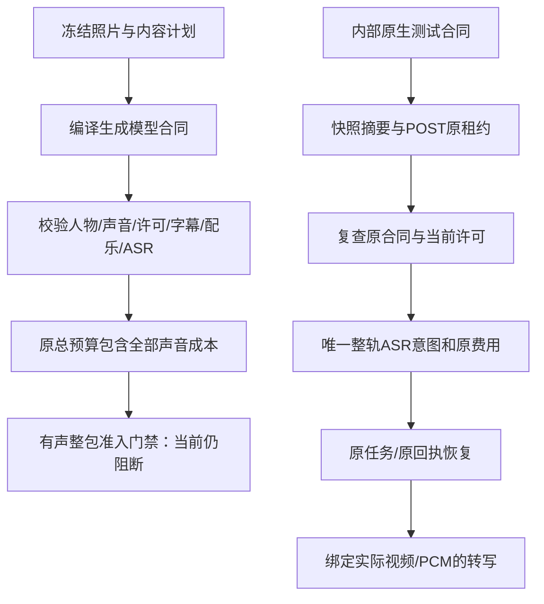

# 原生声音合同与原订单费用 v1.0

2026-10-29｜需求 v3.1 / 开发契约 v1.1 / C 设计 v1.0。内部合同编译与原订单费用约束已有源码；**有声报价未开放、订单工具与完整产线未接通、生产未准入**。本文件补充[持久异步转写](异步音频转写与原任务回执-v1.0.md)和[原生音轨后期内核](原生音轨字幕与配乐后期内核-v1.0.md)。

用户仍只需拍照、选择社区方案。人物、原生声音、台词、字幕与配乐属于平台从方案和内容计划冻结的制作条件，不新增用户填表或手工转写步骤。字幕必须依据实际声音转写，不能拿计划台词伪造识别结果。

## 1. 本次实现与边界

| 编号 | 内容 | 已有源码 | 尚未代表的能力 |
| --- | --- | --- | --- |
| 01 | 音频合同 | `YPCC-NATIVE-AUDIO-CONTRACT-1`，结构及语义验证、报价编译入口、快照摘要 | 可出售的有声报价或官方人物准入 |
| 02 | 人物与声音 | 原人物版本＋声音 ID＋视频模型版本＋有效期＋证据 SHA，分别绑定两类许可 | 实际真人/声音授权审查、多人逐镜说话人设计 |
| 03 | 字幕与后期 | 四种样式、固定字体、原声单位增益、48kHz双声道、处理与压低策略版本 | 订单后期调用、独立听音、音画语义一致性验收 |
| 04 | 配乐 | 明确无背景音乐，或固定许可/资源、音量、压低和循环策略 | 对未接入动作声、任意背景音乐资源的支持 |
| 05 | 成本 | 原总预算内一次整轨 ASR 上界＋预付许可固定分摊；售后额度保留 | 外部版权采购付款、供应商真实用量验证 |
| 06 | 恢复与撤权 | 订单/快照/原 ASR 关联、原次数限制、付款及恢复时复查、撤权退款意图 | 实际支付渠道退款到账、有声 QC/封存/原子交付 |

三路线、10风格/14变体、58需求/52项P0范围不变。官方两个原生口播变体仍不能启售。本次分别测试 `PER_SHOT_AI` 与 `REFERENCE_FILM` 合同结构；当前计划只表达一个主人物/声音组合，不能据此称官方多人讲解已实现。

## 2. 冻结内容与数据位置

主实现：[音频合同](../../src/worker/audio/contract.ts)、[快照编译](../../src/worker/compiler/snapshot.ts)、[执行上下文](../../src/worker/compiler/order-context.ts)。

| 冻结项 | 内容 | 验证规则 |
| --- | --- | --- |
| 原方案 | 引擎、变体、音频策略及字幕/字体/配乐组件摘要、计划 SHA、完整帧数 | 同一订单不得更换组件或时间轴 |
| 主人物/声音 | 唯一 `YPCC-CHARACTER-VOICE-1` 准入记录，中文、无二次TTS、原视频模型版本 | 精确组合匹配；有效期内；不得仅凭声音 ID 存在放行 |
| 许可 | `NATIVE_CHARACTER`、`NATIVE_VOICE`，可选 `MUSIC`；资源版本/资源 SHA/许可记录/许可版本/全文 SHA/固定分摊 | 许可正文1–50000字符且 SHA 匹配、允许商业生成广告、已准入、未撤销/过期 |
| 字幕 | `standard` / `bold` / `minimal` / `karaoke`，现有 Noto Sans SC 字体及许可 | 不接受任意字体、样式或计划台词替代实际时间码 |
| 配乐 | 无配乐为 `null`；有配乐固定线性增益和转换后 dB、压低、循环与许可 | 例如0.15对应约−16.478175dB；范围仍受内核−36至−6dB限制 |
| 原声 | 保留实际原生音轨、0dB单位增益、48kHz双声道 | 不能静音履约、二次TTS覆盖或把完整音轨称为分离人声 |
| ASR | 唯一冻结模型/能力摘要/原协议/费率/上界，完整整轨策略、最多一次、秒数向上取整 | 只支持当前已实现的单声道/完全相同双声道识别路线 |
| 处理版本 | 现有音轨内核版本＋确定性配乐压低策略 SHA | 后续恢复不能按当前配置悄悄换算法 |

合同存于已有 `quotes.private.contract`，订单复制其完整原始合同及 SHA。`execution_snapshots` 新增 `native_audio_contract_hash`；`audio_policy.music_license_ids` 和 `ducking_enabled` 从该合同派生，不再对有声方案统一写空值。JSON schema 的新字段结构上可选，以保留原无声合同；执行层对原生声音严格要求它与完整合同、声音、音乐策略一致。开发契约生成源与产物同步更新，未修改 v1.0 历史产物。

许可正文保存在 `resource_licenses.data`，已售合同冻结摘要和固定费用。字体沿用原有许可结构。本次只对新增的 `audio_rights` 许可与 `native_audio_admissions` 人物结构实施额外不可变保护，不把旧字体或历史资源夹具强行当作声音授权。

## 3. 编译、付款和恢复逻辑



1. `createQuote` 在原权限、方案/模型/Skill准入、字体和生成合同检查后编译音频合同，再检查生成预算与执行准入。当前仍有 `NATIVE_AUDIO_NOT_ADMITTED`，已有合同编译代码不等于开放下单。
2. `createOrder` 验证原报价合同摘要，并锁定复查原人物/声音许可。许可失效不新建订单，已有消费过的报价仍恢复原订单。
3. `confirmPayment` 先保留已验证的原付款事实。仅在原订单仍可制作时复查音频合同；已取消/超时/脱敏订单直接沿原退款分支处理，不重读或重建已删除合同。若原许可在到账前撤销/过期或人物退役，订单不进入制作，按 `AUDIO_RIGHTS_UNAVAILABLE` 创建唯一退款意图；重复回调恢复原退款。数据库/协议错误仍失败重试，不能把未知技术错误一律视为已退款。
4. `bindSnapshot` 冻结合同 SHA 及派生音频策略。执行恢复校验订单、计划、快照和音频合同，再复查准入/许可；退役或撤销不能用当前新版本补位。
5. 内部 `SpeechGateway` 必须使用本订单 POST 租约和登记私有视频。完整帧数必须与声音合同相同，不能把一段镜头当成整轨消耗唯一识别机会。
6. 首次创建 ASR 意图时，原事务锁定订单与许可，记入预付许可分摊并预留 ASR 上界。所有 ASR 记录共同占用原订单一次整轨额度，原来源 ID 恢复同一任务；换来源、换租约代次或重建调用不能补充额度。
7. 提交前、恢复和结果完成沿用原订单执行与撤权检查。网络回执未知只恢复原任务/费用，不新购。已结算的许可分摊不会因会话重建或重复工具调用再扣一次。

当前该服务尚未注册为 Codex 有声订单 MCP，也未和整包后期、听音、QC及交付连通。示意图中的内部测试入口不是公开接口或绕过生产准入的方法。

## 4. 费用语义与数据库约束

原始生成预算下限为图片/参考帧上界＋视频上界＋Agent上界＋售后预算＋修复预算；本次再加入 **ASR上界＋人物/声音/配乐固定分摊**。费用统一使用整数微单位和原订单总账，不另建可反复充值的音频预算。

`PREPAID_ORDER_ALLOCATION` 仅表示已经预付的许可成本在订单上的固定会计分摊。它不是向版权方新发起的外部付款，也不证明真实授权或采购到账。正数和零元均记录一次，意图为原租户/订单/资源组合；在本次原生测试中，两个授权分摊20＋30微单位，可选配乐40，ASR预留100。以上均为合成费率，不是产品价格或外部真实报价。

原预算不足时整笔事务回滚，不留下部分许可结算或可重试补充的新 ASR 意图；售后保留额度由原预算检查保护。ASR实际费用继续依原提交/查询回执结算，缺失用量保留UNKNOWN，不把许可零元或HTTP失败等同于识别免费。

[迁移023](../../src/api/db/migrations/023_native_audio_rights.sql)新增以下约束，不新增客户私有表或放宽删除范围：

- 已登记音频许可的正文、证据、资源、版本和固定分摊不可改删；到期时间可收紧，撤销不可撤回；准入只可ADMITTED→RETIRED，不得复活或移除状态。
- 已登记人物/声音组合、模型及证据不可改删；准入只可退役。新的证据或组合应登记新版本，已售合同不会自动升级。
- 原生声音 ASR 的订单唯一索引及合同摘要不可变。既有经过授权的私有内容脱敏路径保留；脱敏不赋予订单重新执行或重复购买权限。

## 5. 本地运行与审查

按[原生快速启动](../guides/QUICKSTART.md)准备 Node、PostgreSQL、FFmpeg；禁止 Docker、WSL、虚拟机。所有命令均在项目根目录执行：

```powershell
.\scripts\run.ps1 exec tsx scripts/dev-setup.ts
.\scripts\run.ps1 db:migrate
.\scripts\run.ps1 typecheck
.\scripts\run.ps1 exec vitest run --config vitest.integration.config.ts tests/integration/audio-contract.test.ts tests/integration/speech-gateway.test.ts
.\scripts\run.ps1 verify:implementation
.\scripts\run.ps1 verify:docs
.\scripts\run.ps1 verify:publication
```

[23项合同专项](../../tests/integration/audio-contract.test.ts)使用原生PostgreSQL、实际AAC/PCM与私有文件，人物/声音/配乐许可、识别响应/用量/HTTPS和付款事实明确为合成。覆盖两个引擎、四种字幕、配乐参数、合同改动拒绝、许可全文/摘要/时效、禁止二次TTS、费用/售后保护、并发一次性分摊、零分摊、不可变/退役、许可失效到账退款、换源并发ASR、原任务恢复、丢失ACK和部分镜头拒绝。类型检查和完整回归结果以[实现索引](../../assets/implementation/current.json)与[验证来源](../verification/README.md)为准。

首次全量回归暴露已脱敏迟到付款的合同访问顺序问题，并发现旧支付夹具漏写原报价已有的合同SHA；已修正前者并补齐夹具，保留严格报价摘要门禁。该次串行原生集成触及900秒整套命令上限，日志留存本地；整套上限调整为1200秒，单例120秒、hook60秒、所有业务预算/截止和断言不变。后续全量重新执行，不沿用不完整或失败结果。

随后一轮324项断言虽通过，Vitest仍捕获受限修改测试夹具的未处理心跳拒绝，因此整轮保留为失败。已将受限修改及媒体阶段夹具的心跳限制在处理阶段、串行续期、捕获并传播失败、提交前停止并等待在途查询，与生产Worker的既有处理/提交边界一致；媒体夹具失败中止角色，仅附加工具状态/错误码，保留原错误类型及错误码。未屏蔽测试器错误或更改断言。最终通过结论以全新完整回归为准。

其后一次完整运行中媒体阶段测试Worker以`0xC0000374`异常退出，只有313/324项完成，该报告仍按失败留存。单独媒体复测和不完整报告不拼接为全量通过；后续再次执行完整回归。该原生异常尚不提供根因结论，长期Windows原生稳定性和生产准入仍待验。

本地开发库在编写期间先应用了尚未提交的023草稿。仅对本机开发、全部付费开关关闭、零音频登记/零启售且旧SHA精确匹配本轮草稿的数据库，事务替换了本轮新建的空音频约束并重新核对全部迁移SHA和三个触发器；客户数据行修改为0。正式迁移器的已应用SHA保护保持严格，新克隆直接运行最终023。本次开发修复日志留在忽略的runtime中，不提供绕过生产迁移校验的入口。

本轮只改服务端合同与开发说明，沿用现有页面截图/录屏/GIF和声音内核媒体原始SHA。声音媒体仍是正弦提示音＋人工时间码，不能改标成真实中文ASR、人物或本轮商业授权样片。本轮未打开浏览器，C设计25份及冻结归档不改动。

## 6. 后续接入条件

| 顺序 | 待实现 | 完成证据 |
| --- | --- | --- |
| 01 | 订单有声工具与整轨组装 | 原单阶段/合同/预算、实际全部音轨、受控调用、后期检查点恢复 |
| 02 | 独立听音与有声QC | 独立Codex实例可听实际声音，逐字/说话人/商品事实/字幕/声画一致性检查，失败拒绝或原额度修复 |
| 03 | 原子有声交付 | 完整成品与许可/转写/后期/QC证据封存、最终双复核、实例释放后发布 |
| 04 | 真实供应商及授权 | 真实中文ASR/字级时间码/用量、视频原声与人物声音组合、实际音乐许可、OSS及外部删除 |
| 05 | 官方全部变体与售后 | 多人逐镜声音绑定、动作声、资源SAMPLE、完整有声修改/平台纠错及官方14变体验收 |

## English implementation summary

The private audio contract now freezes the primary character/voice/video-model combination, authorization version and digest, caption style/font, explicit no-bed or licensed-music policy, native unit gain, processing version, and exactly one ASR request over the complete assembled track. Its digest and derived audio policy are bound to the original execution snapshot. A changed registry entry cannot replace sold inputs.

All audio costs fit the original generation/Agent/repair/aftercare ceiling. Prepaid-license allocation is once-only internal accounting, not an external copyright purchase. The ASR gateway serializes original-order creation, rejects partial clips and replacement source purchases, and resumes the original task and receipts. Revoked rights stop execution; a verified payment received after revocation is recorded and produces one refund intent. Migration023 protects evidence, prices, retirement and the original ASR binding.

Twenty-three native fixtures use real PostgreSQL/media/files but synthetic authorizations, ASR transport/transcripts/usage and payment facts. Neither real rights nor real-provider speech quality is certified. The primary binding does not implement multi-presenter routing. Public audible quotes, scoped order tools, independent listening, full audio QC/delivery and production remain blocked; all official variants stay disabled. No UI/media provenance or frozen C design was changed.
