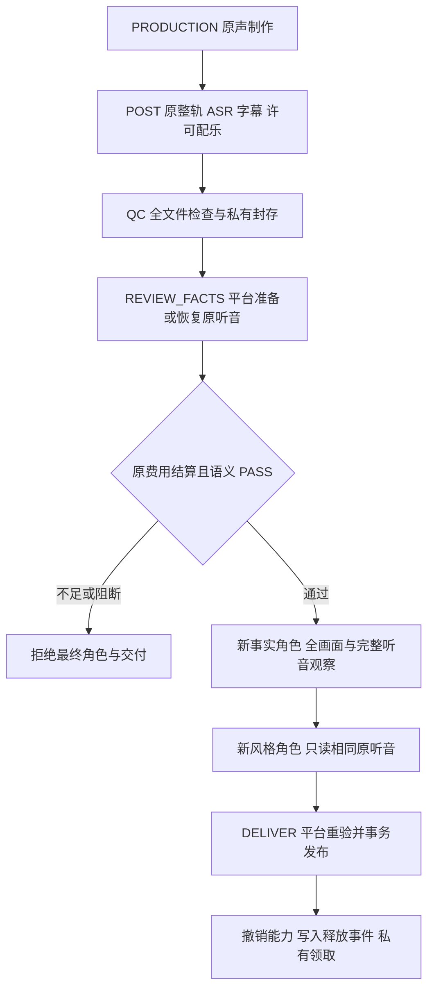

# 原生声音最终双复核与事务交付 v1.0

日期：2026-10-29。需求 v3.1、开发契约 v1.1、C 设计 v1.0 均不变。本文接续[独立听音协议与原订单回执](独立听音协议与原订单回执-v1.0.md)，描述私有订单内部接入，不是商业准入说明。实际验证结果以[实现索引](../../assets/implementation/current.json)及[公开验证记录](../verification/README.md)为准。

## 1. 范围与不变目标

`PER_SHOT_AI`、`REFERENCE_FILM` 在已有制作、完整整轨 ASR、后期和文件 QC 之后，共用一份原始听音结果完成最终事实、风格双复核，再由平台事务发布素材包。小程序仍是客户的拍照、选方案、查看进度和领取入口；不增加需要客户填写的听音表单，不开放买家或社区作者提交审核 PASS 的接口。

保留 58 项需求、三条制作路线、10 套官方风格和至少 14 个执行变体。网页 Plus 为 P1。所有销售开关保持关闭，公开有声报价和订单仍拒绝 `NATIVE_AUDIO_NOT_ADMITTED`；完整产品、生产准入和云端部署不因本次接入改变。

## 2. 一次准备、两次独立复核



1. 听音购买仅由平台在原 `REVIEW_FACTS` 阶段租约内执行，复用租户、订单、审查包对应的唯一原意图。角色工具不提供购买、重试购买或结算方法。
2. `REVIEW_STYLE` 只读取原听音。原结果缺失或 `UNKNOWN` 时等待原任务，不制造第二次请求；`BLOCK/INSUFFICIENT` 不会启动最终复核角色。
3. 两个角色各有独立线程、实例和进程身份，预加载原 SkillBundle。参考帧身份核验与最终事实复核仍属不同阶段，不能互相替代；原角色次数、总输入/输出、费用与截止共同约束。
4. 原文件 QC 和后期内核的 `PENDING`、`NOT_PERFORMED` 是生成时的技术事实。后续审批单独关联，不回写或美化这些原件。

## 3. 只读听音证据的重验

`readNativeListening` 使用不包含购买、恢复结算方法的读取器。调用方可以传入当前数据库事务，在同一上下文验证：

| 项目 | 实际要求 |
| --- | --- |
| 原订单 | 原租户、所有者、商品、订单及执行快照一致；照片/媒体访问仍有效，原截止未到 |
| 原审查包 | SEALED、REVIEWING 或 PASSED，且发布决定仍 PENDING；当前输出和完整封存证据不变 |
| 完整输入 | 重编译完整原声与成片双声道 WAV、全部实际 PNG/时间码画面及商品事实，比较原请求与准备摘要 |
| 原制作链 | 原生成和后期文件实际 SHA、原成功 ASR/费用、许可配乐、人物声音资源及私有对象登记均有效 |
| 原请求和响应 | 从私有登记读取实际字节，核对归属、保留期、删除状态及 SHA，重新解析原 SSE 和严格结果 |
| 原计费 | 原预算预留 SETTLED，原意图、费率快照、预留上界及实际结算微单位均与原用量一致 |
| 语义批准 | 严格结果为 PASS；完整连续的两轨覆盖、五项观察无问题，并且两轨都具有实际中文语音观察 |

`SUCCEEDED` 本身不表示语义批准。全音乐、全静音、纯英文或不确定段不能满足当前中文商品口播的 PASS 格式要求。这些结构约束仍不能证明模型听对，真实听感须另行验证。

## 4. 输入、推理、工具与报告绑定

`ListeningEvidence` 包含原 submission、审查包、合同、请求、响应及结果摘要、供应商请求 ID 和完整逐段观察。完整对象进入两个角色的 `input.json`、实际上下文及私有 `review_input.native_listening`；所有原照片和封存实际画面继续作为原始图片进入视觉推理。

| 边界 | 校验与持久证据 |
| --- | --- |
| 角色构建 | 原听音对象与实际角色输入一致，只允许 ORDER 最终事实/风格角色携带 |
| 付费推理前 | 只读重验同包原听音；实际请求必须包含完整冻结上下文与全部图片，原费用限额仍生效 |
| 推理回执 | `review_listening_hash`、完整 `review_image_binding_hash`、全部图片 SHA 和原包 SHA 同时保存 |
| 受控工具 | `extract_review_evidence` 返回相同完整听音及 `native_listening_hash`，成功工具结果作为持久读取证明 |
| 报告保存 | 核对同一原听音、工具证明、每条成功推理、独立身份和不可变报告，`evidence_hash` 覆盖完整角色输入 |
| 阶段提交 | 重新验证原报告及原证据，只允许已成功提交的父阶段报告参与最终共识 |

只给 ASR、计划台词、摘要、换包后的旧结果或缺少工具证明均不可授权交付。恢复已持久成功角色时复用原运行和原结果，不重新购买听音或推理；旧租约仍不能提交。

## 5. 有声交付事务

发布前使用 `NativeOrderMediaPipeline` 检验实际有声媒体，原图及无声生成路线继续使用对应验证器。重新检查完整后期、来源、原转写、字幕/配乐和授权，不以无声标准放宽有声要求。

提交事务再次重验听音、两份独立报告、当前原件/成片 SHA、模型和资源许可、原费用、订单/退款状态、绝对截止及当前租约。中途撤权、文件替换或费用回到 UNKNOWN 均回滚，不产生 manifest。

最终 manifest 的私有字段关联 `native_listening_hash`、原 submission ID、请求/响应 SHA 及结果 SHA；客户公开领取契约不新增听音全文。沿用原领取期限、冻结照片保留、撤销角色能力和 `ReleaseRequested`，下载继续验证实际文件 SHA。交付阶段不重新生成、转写、听音或推理。

新增完整听音输入位于已有私有 `agent_runs.private`、工具私有结果及推理上下文中，沿用主库脱敏和私有对象删除边界；manifest 只增加关联摘要。外部模型、副本/WAL/备份删除与真实受限身份清理仍需生产准入。

## 6. 源码与验证入口

| 位置 | 职责 |
| --- | --- |
| `src/worker/audio/listening-gateway.ts` | 平台唯一准备与只读原响应、原费用重验 |
| `src/worker/review/listening.ts` | 最终阶段和推理出口的只读绑定 |
| `src/worker/review/stage.ts` | FACTS 准备、STYLE 只读和双角色实际材料 |
| `src/worker/codex/runtime.ts`、`inference.ts` | 完整输入、原图片、原听音及推理费用证明 |
| `src/worker/tool-gateway/review-tools.ts`、`src/worker/review/reports.ts` | 受控读取证明、不可变独立报告与提交重验 |
| `src/worker/review/publication.ts` | 有声文件检查、事务发布与释放关联 |
| `tests/integration/native-order.test.ts` | 两路线控制流程、故障与恢复回归 |
| `tests/unit/listening.test.ts` | 协议、计量、完整输入和中文语音格式门禁 |

```powershell
.\scripts\run.ps1 test tests/unit/listening.test.ts
.\scripts\run.ps1 test:integration tests/integration/native-order.test.ts --testNamePattern='synthetic native final review'
.\scripts\run.ps1 verify:implementation
.\scripts\run.ps1 verify:docs
.\scripts\run.ps1 verify:publication
```

定向测试含跳过项，不代表完整套件通过。新增正向控制用例的实际音频仍为合成提示音，中文/语义 PASS 响应是刻意构造的测试输入，用于检验授权绑定、原计费、恢复、文件和交付事务；**不是模型识别提示音为中文，也不是人工 PASS 可供生产提交的接口**。原提示音的负向听音用例仍返回 INSUFFICIENT。测试合同的较大输入额度在冻结前显式设定，不能据此增加已售订单额度或宣称官方高分辨率全套容量已验。

新增完整场景遵循真实 Worker 的边界：只在处理/准备期间续租，停止并等待在途心跳后执行 `completeStage` 的原租约/代次/截止核验。避免成功提交后的心跳因阶段已结束而被误判为丢失租约；不放宽原 45 秒租约、不忽略提交异常。首次全量运行暴露的测试时序问题及修正后的定向回归保留于验证来源，最终全套另行全新运行。

## 7. 后续准入

真实中文/口型/字幕事实与听感评估、真实模型及缓存账单、商用人物/声音/配乐授权、官方多人逐镜资源、每个官方变体的完整输入容量、生产隔离/独立回收、生成式样例/售后、宿主真机与支付仍须完成。公开销售门禁不因控制测试变更。

本轮没有前端视觉变更，既有截图、WebM/MP4/GIF 及声音内核样片保留原来源和字节。声音样片继续标注人工时间码/合成提示音，不改标为真实中文 ASR 或最终审查样片。C 冻结 25 文件与归档不变。

## English implementation boundary

Both private generated-order routes now bind final facts/style review and transactional publication to the same original listening response. FACTS prepares or recovers the once-only platform request; STYLE and report/publication paths only read and revalidate original bytes, complete stereo/visual input, frozen rights/model/rates and settled cost. Full observations reach both fresh roles, metered inference and persistent tool proofs; immutable report evidence and the private delivery manifest preserve the same binding. Publication uses the native-audio verifier and rechecks revocation/fencing without buying any new media, transcription, listening or inference.

Positive integration responses deliberately fabricate Chinese semantic PASS over actual synthetic tone/video fixtures to test control logic. They do not certify listening accuracy, real billing, official multi-presenter variants, production isolation or mini-program device behavior. All sales and public audio ordering remain disabled; complete product, production admission and cloud deployment remain unverified. Existing screenshots/recordings/GIFs and frozen C design retain their original provenance.
