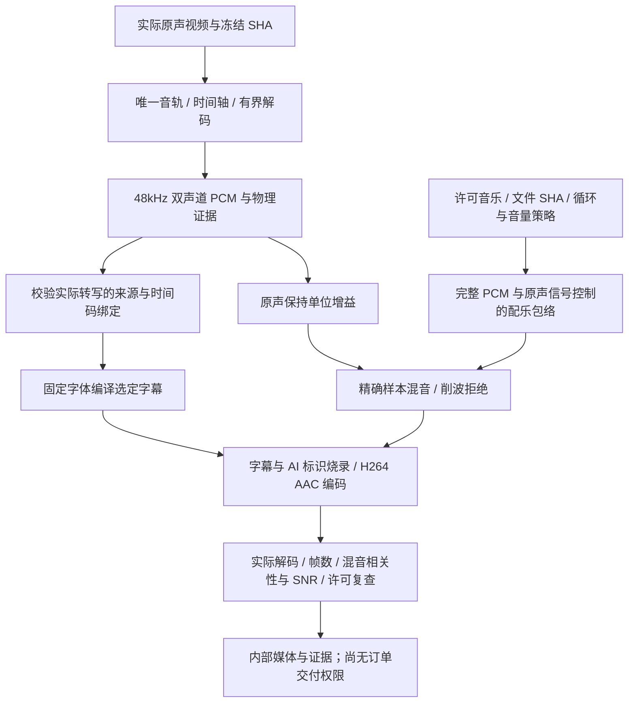

# 原生音轨、字幕与配乐后期内核 v1.0

2026-10-29｜需求 v3.1 / 开发契约 v1.1 / C 设计 v1.0

本轮实现的是可独立调用的原生媒体处理内核，不是讲解类订单产线。它接收实际视频、绑定实际 PCM 的转写时间码和已登记资源，生成实际有声 MP4 与检查证据。真实中文识别、听音复核、人物/声音准入、ASR 持久费用和订单接入尚未实现；`NATIVE_AUDIO_NOT_ADMITTED`继续生效，官方方案全部禁售。

## 1. 对应需求与范围

[生成管线规范](../开发/05-云端任务与生成管线.md)要求保留中文生成原声、按实际音轨对齐字幕、应用许可配乐与 ducking；[交付门禁](../开发/17-交叉核验与交付门禁.md)要求独立听音，不能用脚本代替听音。四种字幕词表来自[方案组件规格](../设计/方案组件与执行变体规格-v3.0.md)。本轮没有减少三路线、10 套风格、14 个变体、58 项需求或 Plus P1 范围，也没有修改冻结的 C 设计资源。

| 编号 | 能力 | 当前实现与边界 |
| --- | --- | --- |
| 01 | 实际原声提取 | 唯一音轨、采样率/声道/起点/时间轴、完整有界解码、实际 PCM 哈希与 20ms 信号窗口 |
| 02 | 字幕绑定 | 文件 SHA、PCM SHA、音频证据摘要、识别器/模型/费率/原回执摘要、片段/词级时间码 |
| 03 | 实际字幕烧录 | standard / bold / minimal / karaoke；固定 Noto Sans SC、字符覆盖检查、实际 ASS 烧录和 AI 标识 |
| 04 | 原声与配乐 | 原声单位增益；仅配乐跟随原声信号压低；许可/文件摘要/循环策略检查，实际采样混音与 AAC 编码 |
| 05 | 编码后验证 | 真实画面规格/帧数、音轨解码、与精确 PCM 混音对比，保留相关性/SNR/削波/时长证据 |
| 06 | 时限和清理 | 沿用调用方绝对截止，传播取消，原生子进程隐藏运行；只移除本次独立临时目录 |
| 07 | 尚未接入 | 没有真实 ASR、听音 Codex、原生人物/声音准入、订单音频工具、费用恢复、QC 封存及有声交付授权 |

## 2. 内部调用与逻辑



源码入口为 [native-audio.ts](../../src/worker/media/native-audio.ts)、[native-captions.ts](../../src/worker/media/native-captions.ts)、[native-audio-post.ts](../../src/worker/media/native-audio-post.ts)。`renderNativeAudioPost(db, cfg, input)`返回文件字节、实际文件检测、字幕脚本与证据；它没有公开 API/MCP，也不会改变订单、发布 manifest 或购买任何外部模型。

输入必须明确给出实际视频路径和 SHA、原目标帧数、原绝对截止、取消信号、固定资源列表、绑定实际音频的转写和字幕风格。可选音乐必须给出资源/许可记录、实际文件、音量、是否允许循环及是否压低；这些参数将来应来自已售快照，不接受终端或 Agent 自由构造滤镜/命令。现有 `Snapshot.audio_policy` 尚未扩展成完整可售音频合同，不能靠人工修改快照或登记模型绕过准入。

## 3. 原声与时间轴约束

- 内核处理 30fps 下 1–3600 帧；这只是资源上界，不代表官方 15 秒讲解已验收。
- 原始文件最多 512MB，只从项目 runtime 内读取，检查实际路径和字节 SHA；单独工作目录使用唯一名称，FFmpeg 不覆盖原文件。
- 必须有唯一画面与唯一音轨；支持 8–96kHz、单/双声道、接近零的起点。音轨时长及完整解码样本必须覆盖原时间轴，容差不超过一帧。
- 统一解码成 48kHz、双声道、16bit PCM。只截去时间轴末端编码填充，不补缺失原声，不调用 TTS，不通过时间拉伸或换台词补齐。
- 缺声、全静音、无可测信号、严重削波、时间轴不足均失败。20ms RMS/峰值窗口描述物理信号，不代表人声、中文、可懂度、口型或说话人相同。
- 每条原生命令和整体任务均受原截止与取消控制；探测也使用同一取消信号。超时或取消不重新计时，不换新外部请求。

## 4. 字幕与转写信任边界

`NativeTranscript`必须绑定 `source_sha256`、`pcm_sha256`和`audio_evidence_hash`，并保留识别器、实际模型、登记版本、费率和原回执 SHA。时间码为整数毫秒，片段有序、不重叠、不越界，至少 100ms；字幕主要落在无信号区时拒绝。每段最多 48 个字符，总量有界；不支持的字形、控制字符或 ASS 指令字符会失败，不静默替换实际文本。

standard / bold / minimal 使用实际片段起止；karaoke 必须有实际识别得到的词级时间码，不能按字符均分或根据计划台词估算。词序、时间与句文本必须一致。ASS 时间量化为 10ms，固定字体和版式由平台编译，AI 标识覆盖全片。

**字段和摘要一致仅证明绑定，不能证明转写真实。** 当前内核不读取一个已准入 ASR 的持久原回执，也没有真实中文识别适配器；传入一个声称正确的 SHA 不会获得订单权限。公开演示刻意使用人工时间码和正弦提示音，不能用这些字幕当作实际说出了对应汉字。

## 5. 配乐、压低与原声保留

音乐必须命中传入的资源列表、数据库有效许可及实际文件 SHA；混音前后均复查许可，撤销时失败。音乐不得包含画面，最多 64MB，过短且未明确允许循环时拒绝。音量限制在 -36 至 -6dB，原声不做自动归一化降音量。

当前采用 `YPCC-PCM-BED-DUCK-1.0.0`：在实际双声道 PCM 的 20ms RMS 窗口上检测信号，阈值 0.02，配乐压低 18dB，10ms attack / 200ms release 平滑恢复。仅音乐包络变化，原声采样始终单位增益；相加将削波时拒绝，不压低人声掩盖问题。信号控制不是语音活动识别，持续环境声也可能触发，仍需真实听感校准。

这里保留的是完整原声音轨，包括其中已有的环境声或配乐；没有执行人声分离，也不把解码结果当作干净对白 stem。原轨已含音乐时是否继续追加配乐，需要在后续音频规格和独立听音准入中明确。

开发实验发现多流 FFmpeg 压缩/分流图在该构建中的尾部输出不足。最终实现先完整解码许可配乐，核对精确样本数，再以有界 PCM 运算执行包络和混音，避免以补静音掩盖尾部不足。没有保留实验中的多输出混音图。

FFmpeg 将实际混音编码为 AAC，同时烧录字幕与 AI 标识，交付规格为 1080×1920 / 30fps / H.264 / yuv420p。随后完整解码输出，并与精确 PCM 混音比较：相关性至少 0.98、SNR 至少 18dB、原样本数容差不超过一帧。这些是内核物理检查阈值，不是完整生产质量准入。参考：[FFmpeg ASS 字幕滤镜](https://ffmpeg.org/ffmpeg-filters.html#ass)、[FFmpeg 官方文档](https://ffmpeg.org/ffmpeg.html)。

## 6. 验证与复现

```powershell
.\scripts\run.ps1 exec vitest run --config vitest.integration.config.ts tests/integration/native-audio.test.ts
.\scripts\run.ps1 docs:audio
```

需先按[本地启动说明](../guides/QUICKSTART.md)准备原生 PostgreSQL、FFmpeg/ffprobe 与项目 Node。测试和媒体复录建立独立测试 schema 并关闭付费/生成/发布开关，不调用 Docker/WSL、浏览器或任何外部 ASR。脚本结束删除测试 schema 和自身临时目录，原证据日志仅在被 Git 排除的 runtime 下留存。

[专项测试](../../tests/integration/native-audio.test.ts)覆盖实际音轨提取，缺声/静音/短轨/多轨拒绝，错绑/重叠/静音区/指令注入拒绝，四种字幕实际像素与出现/消失时点，实际编码后波形与频率，许可配乐压低/恢复、明确循环、削波拒绝、执行中许可撤销、原截止、取消和目录清理。商品插画、提示音、模型名称及时间码均为显式夹具，不包含客户数据。

[媒体清单](../media/native-audio/capture-manifest.json)绑定源码、字体、实际 MP4/PNG/GIF/SHA 和四种结果摘要；[演示说明](../media/native-audio/README.md)区分页面录屏与本次后期内核输出。GIF 无音，原声/配乐需播放 MP4。全部测试与源码计数以[当前实现索引](../../assets/implementation/current.json)为准。

## 7. 有声产线后续接入顺序

| 顺序 | 尚待完成 | 不能由本轮证明替代的内容 |
| --- | --- | --- |
| 01 | ASR 适配与持久调用 | 准入实际模型/费率/原回执，原订单预算内预留、UNKNOWN 查询原任务、复用原回执与隐私登记 |
| 02 | 人物/声音与冻结合同 | 权利记录、原生音频能力、字幕/配乐/压低/循环参数、实际时长和费用上界共同冻结，报价前拒绝不可履约规格 |
| 03 | 制作/POST 工具与检查点 | 生成原声保留、私有对象登记、有声媒体恢复、能力/租约代次及原预算/原截止，无新开角色或重购兜底 |
| 04 | QC 封存与独立听音 | 原音、实际转写、字幕和混音证据纳入不可变封存包；事实/风格 Codex 通过已准入听音工具读取实际音轨，独立复核可懂度、台词、口型与体验；不能假定所选 Codex 模型天然支持音频输入 |
| 05 | 事务交付及扩展路径 | 最终重验许可/原声/全部文件/报告，原子 manifest、撤权、释放；再扩展生成式 SAMPLE、售后、有限修复与资源方案 |
| 06 | 产品完整验收 | 四生成式变体、14×30 整包基准、52P0/58需求、四组真机、真实 Codex/供应商/隔离/回收、隐私恢复与 Plus P1 |

本轮证据始终保留 `semantic_review=NOT_PERFORMED`、`order_pipeline_connected=false`；这些字段不能被当成可售有声服务的通过结果。
