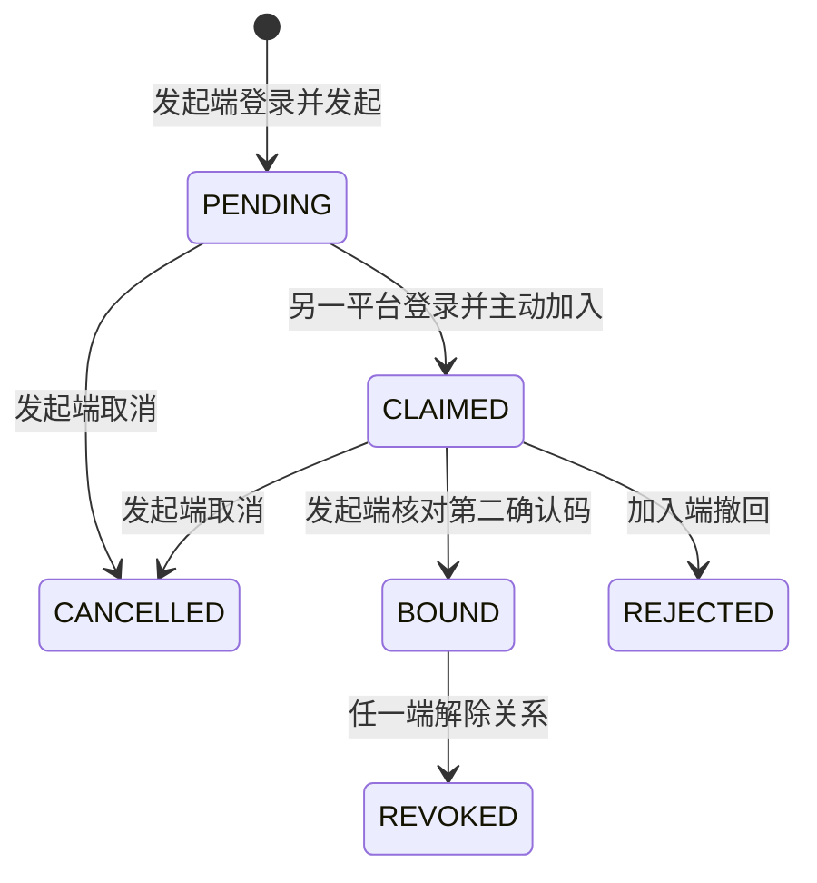

# 双平台本人账号绑定与共享作品 v1.0

本轮实现 P01-F24 的长期主动绑定与 Plus 接续：支付宝、抖音两端分别登录，由一端发起邀请、另一端主动加入，发起端亲自核对双方确认码后才建立关系。用户可在“我的素材”领取已绑定端的已交付作品，也可在手机批准电脑连接时显式选择作品来源。任一端解除后，派生连接和已有领取链接失效。

主流程仍是小程序拍照、自动识别、选择社区预设、核对清单与费用、制作和相册领取。绑定是可选入口，不增加制作前的必经步骤；电脑继续承担深入编辑。复用方案 C 的既有设置、素材库、按钮、卡片和色彩，没有修改设计原稿或增加小程序页面。

## 1. 用户交互与边界

| 编号 | 场景 | 操作与结果 |
| --- | --- | --- |
| U01 | 发起 | 账户与隐私 → 绑定支付宝与抖音账号 → 本端发起绑定，展示8位码，有效5分钟 |
| U02 | 另一端加入 | 在本人另一平台小程序中输入8位码，查看邀请并主动加入；此时还没有作品权限 |
| U03 | 最后确认 | 两端显示同一第二确认码，发起端亲自核对后确认；每个身份同时仅能绑定一个另一端身份 |
| U04 | 恢复与终止 | 设置恢复本人未完成请求；发起端可取消，加入端可撤回；过期请求不续期，不替换对方身份 |
| U05 | 领取另一端作品 | 我的素材 → 查看已绑定端作品 → 打开来源平台作品 → 查看素材包 → 保存图片/视频或复制文案 |
| U06 | 电脑接续 | Plus生成接续码，手机查看请求后选择“当前小程序”或“已绑定端”，明确批准；电脑标明实际作品来源 |
| U07 | 解除 | 任一端在账户设置解除；本绑定产生的临时浏览和电脑连接同时撤销，旧邀请/轮询/签名链接不能重新启用 |
| U08 | 原渠道交易 | 新增付费制作、原单查款与退款留在作品来源的原小程序；不转移余额、订阅、已购权益或退款义务 |

绑定双方必须控制实际合法登录后的会话，不能靠同名昵称、手机号猜测、作品ID或任意作品二维码合并。页面没有要求填写新的商品表单。输入码只用于主动账号绑定或电脑接续。

共享入口提供作品、编辑草稿及明确授权的制作清单能力。它不将两个租户合并，不搬迁商品、订单或素材，不自动授权社区发布、隐私删除、付款、退款或另一轮绑定。保存到相册调用现有宿主下载和保存接口，收到设备成功回执才显示成功；浏览器回放不能证明真机相册写入。

## 2. 状态和存储

`REVOKED`是绑定关系状态，不回写请求的`BOUND`。未完成请求到期对外投影为`EXPIRED`，保留原五分钟截止。确认重试返回同一关系，不延长任何时间；已解除的旧请求返回失效。重新绑定生成新关系ID，无法复活旧连接或旧下载。

迁移039新增`account_binding_requests`和`account_bindings`；为`plus_links`、`plus_sessions`增加绑定ID与批准人身份。原1–38迁移保持字节不变。两个部分唯一索引限制每个身份仅一条有效关系；触发器固定身份、请求证明、状态转移、原截止时间和不可逆撤销。数据库核对两端实际平台，防止相同平台写入。

邀请与第二确认码使用不同域的服务端HMAC，邀请仅保存摘要。第二码包含请求与已加入身份，第三方抢先加入不能跳过发起端最后核对。码、身份、访问令牌不写入公开运行记录。Plus领取另需原独立高熵轮询秘密。

## 3. 接口与权限

| 编号 | 方法与路径（前缀 `/v1/p01`） | 用途 |
| --- | --- | --- |
| A01 | POST `/account-bindings/requests` | 新建或恢复本人未过期请求 |
| A02 | POST `/account-bindings/inspect` | 查看邀请，不获得项目权限 |
| A03 | POST `/account-bindings/claim` | 另一平台证明控制权并加入 |
| A04 | GET `/account-bindings/requests` | 恢复本人最近最多5条未结束请求 |
| A05 | GET `/account-bindings/requests/{request_id}` | 双方查询本人请求 |
| A06 | POST `/account-bindings/requests/{request_id}/decision` | 发起端确认/取消或加入端撤回 |
| A07 | GET `/account-bindings` | 本人当前关系及最近最多20条历史 |
| A08 | DELETE `/account-bindings/{binding_id}` | 任一端解除并撤销派生连接 |
| A09 | POST `/account-bindings/{binding_id}/project-session` | 建立独立15分钟作品浏览连接 |

新增接口要求有效原生会话，在业务事务内再次核对身份；Plus访问令牌不能发起、加入、确认或解除账号绑定。写操作通过关系/请求状态和原ID恢复，不依赖改变原截止时间的重复购买逻辑。

手机共享作品使用单独的`ApiClient`和15分钟Plus范围令牌，仅驻留组件内存，不替换当前原生登录或本地恢复记录；关闭入口会尝试主动撤销。电脑接续仍最长1小时，手机明确选择来源及图片/视频清单权限。每个来源最多5条有效连接，手机最多列出本人来源与本人批准的另一来源共10条，并能关闭任一条本人有权关闭的连接。

所有能力沿用来源租户/用户/平台身份，交易接口继续拒绝Plus权限。绑定ID与来源/批准人必须精确匹配：鉴权、事务内能力检查、制作权限、领取签名和旧轮询均重新检查有效关系。撤销在两个来源的媒体归属锁下更新关系与连接，已有事务完成后才生效；多归属锁按稳定顺序取得，避免反向加锁。单来源编辑/领取与原媒体删除继续使用同一归属锁。

账号绑定元数据属于控制与撤销记录，媒体删除仍处理原来源媒体，不隐式删除另一个账户，也不把“删除媒体”解释为“合并/删除身份”。用户通过独立解除操作终止绑定。

## 4. 源码与契约

业务实现在`src/api/modules/account-bindings.ts`与`plus-access.ts`，路由在`src/api/routes/business.ts`；共享界面在`src/shared/ui/account-bindings.tsx`、`plus-connections.tsx`，Plus来源提示在`src/web/main.tsx`。契约扩展源是`scripts/account_binding_contracts.py`，通过既有开发契约与类型生成器生成API、端点和DTO，不手改生成类型。

当前结构为39迁移、115业务接口、38管理接口、328 schema、84逻辑实体，两端仍各17页面。生成器中的`DESIGN_NOT_IMPLEMENTED`是保留的设计产物分类，不替代本轮源码和验证记录。修改前的6份当前设计契约已按原字节保存在[契约基线](../verification/account-binding-contract-baseline-0248cd6/index.json)，原方案C、官方风格/Skill与旧媒体不被覆盖。

## 5. 本轮重点验证与交付

| 编号 | 验证 | 范围与事实 |
| --- | --- | --- |
| V01 | 6项新增原生专项 | 双平台证明、固定截止、无提前权限、错误码/陌生人、并发确认、实际PNG领取、资金权限、Plus来源、双向撤销、旧链接及重绑、过期/取消/撤回/不可逆数据库约束 |
| V02 | 7项既有Plus回归 | 原生批准、独立轮询、固定会话、权限限制、独立草稿/原图、并发修订与撤销/媒体删除 |
| V03 | 必要构建与实际界面 | 以[当前构建](../delivery/current.json)、[精确证据](../verification/account-binding-source.json)和[新媒体清单](../media/account-bindings/manifest.json)记录实际结果 |
| V04 | 可复现录制 | 设置`PLAYWRIGHT_BROWSERS_PATH=runtime/playwright-browsers`后执行`node --env-file=.env.local --import tsx scripts/record-account-bindings.ts`，使用匹配当前源码的网页构建，结束后关闭所属标签、浏览器、预览服务和临时数据库模式 |

13项专项使用原生PostgreSQL事务与HTTP处理器、实际生成/读取的PNG。平台身份、已付款订单与QA元数据为显式合成夹具；不验证真实登录提供方、支付网关、模型或云环境。浏览器录制复用实际共享界面并调用真实处理器，不能替代支付宝/抖音开发者工具、手机登录和相册验收。本轮不运行全面测试。

首次支付宝编译超过360秒，其原始[候选记录](../verification/account-binding/initial-build.json)及日志保留；仅重试该目标。浏览器回放的输入框补齐`ariaLabel`到`aria-label`的映射，随后重做类型和网页构建；服务端、抖音的实际编译输入与产物保持，最终记录分别标明来源，不重跑未变业务链路。开发数据库已应用039迁移。

录制器最初漏设项目内视频缓存，随后错误拦截了小程序回放域名而非Plus实际同源API；两次诊断均保留，并关闭当次所属浏览器与服务。修正录制脚本后再次核对类型，所有应用及已编译字节保持，最终来源记录区分原编译快照与录制器修订。

末尾解除演示的精确文本选择器还把含“重新接续”按钮的提示容器排除；实际界面已经断开并显示正确提示。原失败和只读DOM诊断保留，录制器改为核对提示容器与恢复后的欢迎按钮，未改动业务代码或重新执行未变编译。

## 6. 完成与待办

| 编号 | 已完成 | 状态 |
| --- | --- | --- |
| C01 | 双端主动证明、二次确认、恢复/过期/取消/撤回 | 源码及重点验证完成 |
| C02 | 关系约束、共享素材库、短会话和显式Plus来源 | 源码及重点验证完成 |
| C03 | 双向解除、既有签名与连接失效、原渠道交易隔离 | 源码及重点验证完成 |
| C04 | 文档、媒体、必要构建和更新包 | 实际结果见交付记录 |

| 编号 | 待处理 | 完成条件 |
| --- | --- | --- |
| P01 | 双平台宿主实测 | 合法真实AppID、域名和登录，开发者工具及iOS/Android绑定/相册/解除验收 |
| P02 | 实际云端和生产服务 | 专用原生隔离身份/启动器、真实Codex与多模态/生成/听音/支付/存储及用量费率准入 |
| P03 | 完整产品与扩展 | 58项完整验收、质量/成本/容量；高级作者工具、多轨与视频批量按后续范围实施 |

真实服务和销售默认关闭，完整产品、生产和云部署标志保持`false`。
