# 异步音频转写与原任务回执 v1.0

2026-10-29。需求 v3.1 / 开发契约 v1.1 / C 设计 v1.0，全部 58 项需求继续保留。本文补充[声音后期内核](原生音轨字幕与配乐后期内核-v1.0.md)，不改变冻结设计或启售状态。

本专项实现内部 `SpeechGateway`：原订单 POST 租约 → 实际视频/PCM → 私有单声道 WAV → 百炼异步文件转写 → 原任务查询 → 原始结果落盘 → 有来源和真实字级时间码的 `NativeTranscript`。它尚未注册订单工具或接入正式有声整包；真实供应商、中文识别准确率、听音复核、完整音频合同/QC/交付均未通过。

The internal gateway persists an original POST transcription intent, private audio, task ID, raw receipts and the original order's cost reservation. Tests use native PostgreSQL/FFmpeg/private files with synthetic provider responses. This is not real-provider certification, independent listening review or an admitted audible-order pipeline.

## 1. 已实现的边界

| 编号 | 源码 | 责任 |
| --- | --- | --- |
| 01 | [dashscope-asr.ts](../../src/worker/providers/dashscope-asr.ts) | 冻结协议、精确端点/域名、异步提交/查询/下载、绝对截止、用量/任务绑定、原字级转写解析 |
| 02 | [input.ts](../../src/worker/speech/input.ts) | 原 POST 租约/合同/模型绑定、登记视频读取、实际解码、单声道 WAV 派生、临时目录回收 |
| 03 | [gateway.ts](../../src/worker/speech/gateway.ts) | 原意图/费用预留、不可变发送标记、ACK/查询/结果回执、恢复/转存/撤权检查、存储回执维护 |
| 04 | [022 迁移](../../src/api/db/migrations/022_speech_submissions.sql) | 既有 `provider_submissions` 增加 `ASR` 类型；复用 021 的不可变绑定和追加式回执保护 |
| 05 | [storage.ts](../../src/api/storage/storage.ts) | OSS 单对象 HTTPS V1 签名读取，期限不得超过原任务或两小时；本地存储不伪造公网 URL |
| 06 | [媒体维护入口](../../src/worker/lifecycle/media-maintenance-main.ts) | 独立扫描 ASR 已存回执；不重新提交、不续签 URL、不下载新媒体、不交付 |
| 07 | [17 项专项](../../tests/integration/speech-gateway.test.ts) | 原生数据库/音视频/私有文件配合显式合成的转写、用量与网络响应 |

仍为 77 个业务 / 26 个管理接口、229 个业务 schema、71 个逻辑实体。迁移共 22 份；本专项没有增加公开接口、客户内容表或独立可补充的费用账本。Ark 网关、媒体输出与维护查询明确限定 `IMAGE/VIDEO`，避免误读 ASR 协议。

## 2. 供应商协议依据

本实现依据[百炼 Qwen-ASR 官方 API](https://help.aliyun.com/zh/model-studio/qwen-asr-api-reference)，核对日期 2026-10-29：选择 `qwen3-asr-flash-filetrans` 异步协议，以 `input.file_url` 提交，显式开启 `enable_words`；沿原 `task_id` 查询，取得 `output.result.transcription_url` 后保存原结果。官方说明结果 URL 有效期为 24 小时，不能把外部链接当作永久素材存储。

私有 URL 签名遵循[OSS V1 官方规范](https://help.aliyun.com/zh/oss/add-signatures-to-urls-14)。与现有 OSS 存储适配保持同一签名版本；真实桶/地域的签名支持、生命周期、版本回收和供应商访问尚须实测，不以签名字符串测试替代准入。

当前只允许核验过结构的北京地域 API 域名，真实启用还须平台登记模型证据、冻结请求模型/实际模型映射、注册版本、费率快照、能力证据 SHA、有效期、输入/结果精确域名和字节/秒数/查询上限。异步响应没有强制要求提供模型字段；`recognizer.actual_model` 来自登记证据与原请求绑定，不是额外的供应商响应模型证明。

官方示例包含 HTTP 结果 URL，本实现严格拒绝 HTTP、跳转、凭据 URL、IP 地址和未许可域名，不自动改写协议。真实供应商必须证明可用的 HTTPS 结果路径，否则保持未准入。

## 3. 交互与逻辑位置

客户仍只拍照、选方案、确认并领取，不填写转写文本或时间码。ASR 是后端后期能力，不能让小程序携带密钥、指定供应商 URL、上传伪造识别结果或自行确认质量。

```mermaid
flowchart LR
  A[原订单 POST 租约] --> B[读取本订单登记视频并核对 SHA]
  B --> C[原生解码与 PCM 证据]
  C --> D[单声道 WAV 私有登记]
  D --> E[预留原订单费用与冻结请求]
  E --> F[不可变发送标记与唯一提交]
  F --> G[保存原 ACK 与任务 ID]
  G --> H[有上限地查询原任务]
  H --> I[私有保存原结果回执]
  I --> J[绑定视频/PCM/WAV/字级时间码]
  J --> K[内部 NativeTranscript]
  K -. 待接入 .-> L[订单后期与独立听音 QC/交付]
```



`submit(lease, sourceWriteId, signal)` 只接受登记对象的逻辑 ID；`resume(lease, submissionId, signal)` 只恢复同订单、同阶段、同输入和同截止的原任务。完成结果再次读取要核对原视频授权、输出登记和实际字节摘要。调用本服务不赋予最终交付权限。

## 4. 输入与声音保真

1. 只接受本订单/本人/本商品的 `STORED`、未删除、未过期 `MEDIA`；实际视频 SHA 必须与登记值一致。
2. 原视频必须为 30fps、在冻结的 1–120 秒内。实际原声音轨由已有内核解码，保留原视频 SHA、48kHz 立体声 PCM SHA、实际采样数、时长和信号窗口。
3. 单声道解码后的左右样本相同，允许生成一份 48kHz / s16le / 单声道 WAV。立体声仅在左右全部样本完全相同时允许；否则抛出 `ASR_STEREO_REVIEW_REQUIRED`。不默认丢掉右声道、不混音抵消、不假称已完成多声道识别。
4. 原声/解码 PCM 与派生 WAV 分别记录摘要；WAV 不冒充原立体声 PCM。未加入静音、TTS、变速或事后补对白。
5. 原视频、WAV、请求和结果均纳入现有私有对象登记。每个临时作业目录在成功/失败/取消后删除。

供应商仅识别 `[0]` 声道，中文 `zh`，不开 ITN，要求真实字级时间码。多声道、其他语种/语言自动选择和更长输入仍待扩展准入。

## 5. 请求、回执和恢复

| 节点 | 不可变/持久依据 | 恢复方式 |
| --- | --- | --- |
| 原意图 | 租户/订单/POST/源对象 ID | 重复调用取得原 submission，不创建新购买 |
| 原输入 | 模型合同 SHA + 视频/PCM/WAV 证据 + 原截止 | 不能更换源视频、协议、价格或延长截止 |
| 发送前 | 私有 WAV、原请求字节 SHA、发送标记 | 标记前可补齐相同原文件；不确定 `WRITING` 先由维护器核对原字节 |
| 提交 | 原响应完整字节、SHA、HTTP 状态、原任务 ID | ACK 丢失时先核对原文件；无法确认则停留 UNKNOWN，不重复 POST |
| 查询 | 逐次追加的原请求意图/响应回执、下次查询时刻 | 只查同任务；次数/间隔与原截止不重置 |
| 结果 | 原下载回执、原 `file_url`、视频/PCM 摘要 | 已落盘结果恢复后不重复下载；输出摘要与登记一致 |
| 停止之后 | 原回执和原费用事实 | 维护器只恢复已存回执；不重新推理、续签或发布内容 |

PostgreSQL 的已有触发器保护任务、请求、源证据、回执序列、发送标记、终态和输出；不能覆盖旧回执或换任务“续做”。私有 URL、音频和转写均留在私有载荷，不写进公开日志。

外部任务完全丢失 ACK 且没有原回执时，源码会保持阻塞，当前没有供应商按客户端幂等键查找任务或人工对账入口。这个限制不会被解释成可重新购买。

## 6. 费用、截止和撤权

费用使用原 `budget_reservations` 与订单总预算，售后预留仍由既有规则保护；不新开预算。费率为冻结的整数秒单声道计费，向上取整微单位。成功终态必须给出与实际 WAV 时长取整一致的 `usage.seconds`，且不超过原上限，才可结算并生成转写结果。

HTTP 错误、FAILED、UNKNOWN 或缺少/超限用量都不能推导为免费，也不释放未知费用。未知购买的请求与回执受现有回收保护；主库脱敏仍须等待原预算核对。缺失终态用量或供应商失败未提供费用时，目前需要外部原账单/后续人工对账能力，不能自动补造用量。

网络调用的绝对截止在 DNS/传输前开始，调用者取消与原期限同时约束等待；底层未及时回应取消时，上层也按原截止返回，原发送标记仍阻止重购。处理租约代次、源对象授权和实际摘要在发送、转存及完成事务边界重复核验。

逻辑撤权会立即阻断本平台完成转写/后续交付；已发出的 OSS 签名 URL 在过期或物理删除之前仍可能被供应商读取。供应商保留、真实 OSS 版本/复制副本和完整隐私删除继续未准入，不能把本平台拒绝交付等同于外部已物理清除。

## 7. 字幕语义与时间码

结果必须指向原 WAV URL、唯一第 0 声道、中文句子；原全文、句子与字级文本必须一致，原标点保留。词/字必须有有界、递增、不重叠的实际毫秒时间码；不接受预写脚本、缺失时间码后的均分或 ASS 控制指令。

长句仅按实际字/词边界拆为最多 48 字符片段，保留原时点；真实片段不足 100ms 则拒绝，不伸长时间。原句空格可附着原字级文本保留，例如 `USB C` 不拼成 `USBC`，不会为其捏造新的时间码。输出总上限为 300 个片段 / 6000 字符。

`NativeTranscript` 同时绑定原视频 SHA、原 PCM SHA、音频证据 SHA、登记的模型/版本/费率和原结果回执 SHA。它可以交给已有四字幕内核继续校验/编译；专项包含这种内部契约衔接。ASR 文本一致性不等于说话人身份、事实正确、语音自然或音乐体验合格，仍须真实中文语料与独立听音复核。

## 8. 配置、复现与验收

`.env.example` 新增 `ASR_SERVICE_ENABLED=false`、`ASR_BASE_URL`、`ASR_API_KEY`、`ASR_ALLOWED_HOSTS`。独立凭证不会借用视觉或图片/视频密钥。公开报价尚未冻结正式音频合同，默认路径不产生 `speech_contract`；没有合法冻结合同会拒绝调用。设置环境变量本身不能启售。

```powershell
.\scripts\run.ps1 exec tsx scripts/dev-setup.ts
.\scripts\run.ps1 exec vitest run --config vitest.integration.config.ts tests/integration/speech-gateway.test.ts
.\scripts\run.ps1 verify:implementation
.\scripts\run.ps1 verify:docs
.\scripts\run.ps1 verify:publication
```

17 项专项覆盖真实音频/单声道 WAV、四字幕契约、原预算、三个丢失 ACK 场景、HTTP/用量未知、错订单/租约/截止、不同立体声拒绝、源字节变化、下载中撤权、DB 不可变保护、网络截止/取消/域名/密钥边界、长句和空格、禁用后的原回执对账/回收保护以及 Ark/ASR 分流。测试场景允许显式 `APP_ENV=test` 的合成模型登记和传输出口，不向公网购买识别服务。

当前 12 个声音 MP4/PNG/WAV/GIF 与 20 个页面媒体仍保留既有 SHA 和来源；页面无改动，无新浏览器调用。已有声音媒体采用人工时间码和合成提示音，不能在本专项完成后改标为真实 ASR 样片。

## 9. 后续顺序

| 编号 | 待完成 | 验收依据 |
| --- | --- | --- |
| 01 | 音频/配乐/声线许可、正式报价合同与费用总上界 | 冻结完整原生声音策略、所有资源与模型映射，保留原销售门禁 |
| 02 | 真实 ASR/OSS 与中文语料 | 实际录音/生成语音、原费用/任务恢复、HTTPS 结果与准确时间码；不是合成响应 |
| 03 | POST 受控工具、检查点与实际声音整包 | 输入/输出逻辑 ID、原角色/原预算/原截止、唯一原生后期，不另造旁白 |
| 04 | 独立听音审查包与双复核/原子交付 | 使用已准入的听音工具/模型，覆盖完整实际声音、字幕、原声保留及配乐体验；不足不能 PASS |
| 05 | 官方有声变体、SAMPLE/售后与完整产品 | 14×30 整包、52 项 P0/全部 58 项，真实 Codex/隔离/清理/支付/真机/隐私，Plus P1 另列 |

`NATIVE_AUDIO_NOT_ADMITTED`、全部 `sale_enabled=false`、`real_provider_verified=false` 与 `full_product_verified=false` 保持。当前完成的是内部可恢复转写能力和夹具证据，完整有声交付仍未完成。
