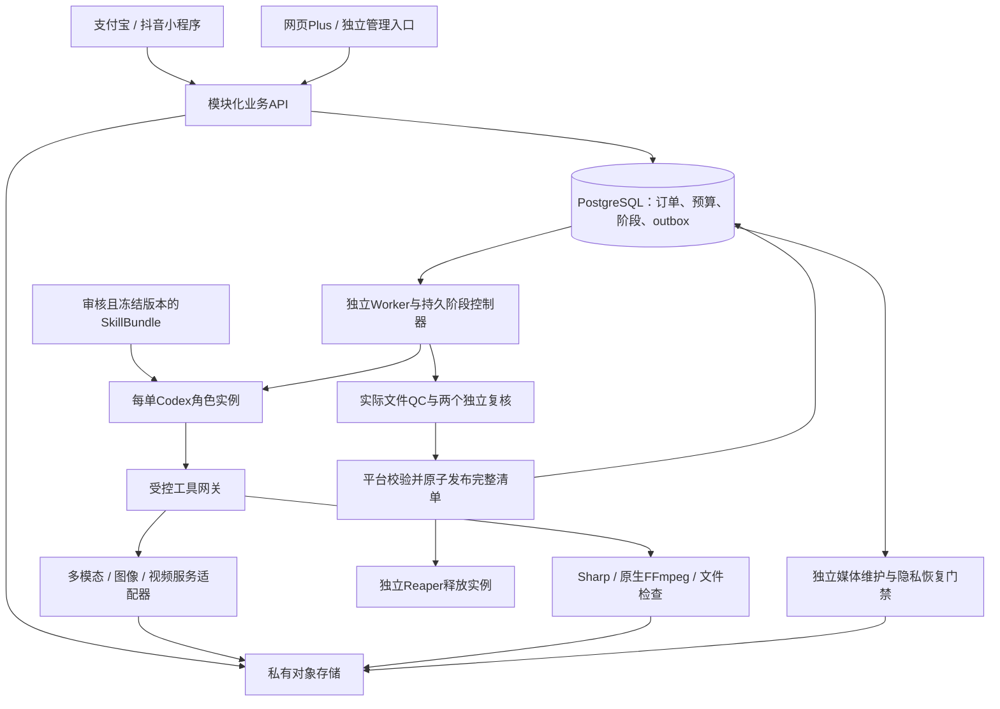

# 一品成片：当前开发方案与技术骨架

2026-10-29最新增补：[原生声音文件QC与封存](原生声音文件验收与审查封存-v1.0.md)已有内部两路线PRODUCTION/POST/QC、原整轨/成片完整双声道WAV、原成功转写/ASS/技术报告、独立混音重算及字幕时点帧；事务检查来源/许可/字节，迁移024。独立听音和最终语义/事实/风格报告与交付尚未接通，INDEPENDENT_AUDIO_REVIEW_REQUIRED和公开声音订单门禁保留；历史QC未接入描述按本条区分技术QC和完整听音准入。

2026-10-29｜需求 v3.1 / 开发契约 v1.1 / C 设计 v1.0｜应用 IN_PROGRESS。

当前采用“小程序优先、方案驱动、云端异步制作”的架构。支付宝和抖音是普通用户的核心入口，网页Plus承担后续复杂编辑和批量操作；平台将照片自动分析为商品档案，再按官方或社区预设生产完整素材包。本文描述目标结构及当前边界，不改变58项需求、52项P0；实际测试与构建以[实现证据](../../assets/implementation/current.json)为准。

2026-10-29进一步新增[持久异步转写](异步音频转写与原任务回执-v1.0.md)，以原订单POST租约读取登记视频，实际解码私有WAV并保存原购买/任务/回执/用量和绑定原PCM的字级转写。17项原生专项、迁移022与ASR/Ark分流已有；供应商仍为合成响应，真实中文ASR/OSS、受控订单工具、独立听音/QC与交付继续待完成。下文历史“持久ASR未实现”按本段区分内部能力与准入，不改变官方全部禁售。

随后[原生声音合同与原订单费用](原生声音合同与原订单费用-v1.0.md)补齐内部报价编译、原人物/声音/模型与许可、字幕/配乐参数、一次整轨ASR、成本/售后保留和快照摘要，付款及恢复复查许可、失效到账唯一退款意图。迁移023、原次数/分摊与23项原生专项已有；授权/识别/用量/付款为合成。公开有声报价、多人逐镜声音、订单MCP与整包后期/听音/QC/交付继续待完成，不能据此启售。

2026-10-29新增[原生声音/字幕/许可配乐后期内核](原生音轨字幕与配乐后期内核-v1.0.md)。它可独立完成实际PCM提取、四字幕烧录、保留原声的精确混音、仅背景压低与编码后检查，使用原截止/取消和本次临时目录。15项原生专项及实际合成音MP4/PNG/GIF已有；真实ASR、听音Codex、音频费用/快照/QC/交付尚未连接，未注册有声订单工具，禁售不变。此项不改变双小程序优先的产品交互，也不要求用户填写转写文本。

最新实现补充：[生成式无声整包编排](生成式无声整包与阶段编排-v1.0.md)已接入两路线参考生成/独立核验释放、唯一制作角色/实际生成整包、POST、专属QC、最终全包双复核和事务交付。参考与最终事实复核共享原额度；原角色完成后接管与购买/查询丢失回执恢复不重购、不增加预算或期限。7项新专项使用实际原生数据库/媒体/协议和合成模型/隔离；有声、官方全变体、生成式样例/售后、真实服务和生产准入仍待验。下文历史未接入描述按本段及最新状态指南补充。

2026-10-28更新：[生成式购买门禁与MCP](生成式购买门禁与MCP工具接入-v1.0.md)已接入原独立身份报告/实际生成帧/实例释放与视频意图绑定，3个受控工具恢复平台冻结参数，POST仅只读原制作完成结果。同阶段同代次同角色唯一约束和原次数/总费用仍有效；阶段间续跑、两条完整生成式整包/后期/QC/最终双复核/交付仍待完成。此项不代表真实模型、原生隔离或完整产品准入。

## 1. 产品与交互

普通用户拍摄3–5张商品照片，多模态LLM自动判断商品名称、可见特征、照片用途和未知项。用户选择方案、查看交付清单与报价、付款后等待制作，再保存图片/短片到相册、复制文案。正常流程不要求填商品表、编写提示词或逐阶段审批。底部导航为“拍照制作 / 方案社区 / 我的素材”。

官方保底10套不同风格和节奏、至少14个执行变体，社区通过平台注册组件扩展。界面统一沿用C「柚子创作社」的果橙、奶白、深绿墨与照片印样；成品风格跟随用户所选预设。作者使用独立工作台管理草稿、自己的商品与授权、私有样例和发布申请，不接触买家照片、档案和订单。

## 2. 技术栈

| 层 | 当前选型 | 当前边界 |
| --- | --- | --- |
| 双小程序 | Taro 4.3.1、React 18.3.1、TypeScript 5.9.3 | 两个宿主壳、17个共享页面；原生登录/支付/上传/相册分别适配，尚未真机验收 |
| Plus / 管理网页 | React、TypeScript、Vite 8.3.5 | 界面和构建入口待完成，管理API已有处理入口 |
| 业务API | Node 24.22.1、Fastify 5.12.7 | 模块化服务，77业务/26管理接口的契约与处理入口；接口存在不等于全业务验收 |
| 数据与任务 | PostgreSQL 17.6、pg、事务、JSONB、阶段队列/outbox | 保存业务真相、预算、意图和任务；首版不依赖Redis |
| 媒体 | Sharp 0.35.5、原生FFmpeg/ffprobe | 原图版式、编码、文件检查和封存已有原生证据；完整生成式/音频仍待完成 |
| Agent | Codex app-server、stdio JSON-RPC、受控MCP、可信SkillBundle、计费Responses出口 | 四阶段目标；PLAN与原图制作/后期/独立复核已有合成角色集成，真实服务未准入 |
| 存储 | 私有对象存储，OSS优先；本地开发存储 | 媒体与数据库分离，签发短期授权；真实OSS仍待验证 |
| 实例与媒体维护 | 独立Reaper、独立media-maintenance、删除日志与恢复门禁 | 原生入口/故障和受控恢复测试已有；生产受限身份、完整进程树与外部副本待验证 |
| 契约与测试 | OpenAPI 3.1.1、JSON Schema 2020-12、Ajv 2020、生成式TS类型、Vitest | 229个业务schema、71个逻辑实体；原生PG/Sharp/FFmpeg测试，Web检查预留Playwright |

开发依赖与版本以[package.json](../../package.json)和pnpm-lock.yaml为准。实际模型、费率、售价、云区域、资源规格与获准交易协议仍待验证，不由依赖锁版推定。

## 3. 服务结构



API负责身份、归属、商品、社区、报价、交易和领取入口。长任务由独立Worker执行，用户离开页面不会中断服务端制作。PostgreSQL保存可恢复状态，实际媒体存私有对象存储。外部调用必须经过平台适配器，客户端和社区配置都不持有模型或支付密钥。

Codex负责分析、规划、调用受控工具、诊断和复核。工具执行前检查角色、资产归属、冻结快照、预算、截止和租约代次。付款确认、退款、预算变更、最终交付与清理完成由平台核定，不能由Agent文字直接推进。

Skill分平台规则、阶段职责、预设风格、目标素材规范；预加载只复用已核验的只读资源。每单工作区、会话和短期权限独立，两个复核使用新的进程与上下文。交付后释放实例，成品按权益保留7天；实例释放与成品到期删除分别处理。此处是产品运行架构，不表示开发时启动了子Agent。

## 4. 逻辑骨架

1. 输入：宿主登录换取平台会话 → 私有照片上传 → 解码、尺寸、重复与EXIF处理 → 固定照片集版本。
2. 内容梳理：多模态识别 → 带照片证据的ProductProfile → 商品身份锁 → 选择方案/变体 → Codex形成结构化文案与时间轴。未知材质、功效、价格等不编造成事实。
3. 交易：检查输入、方案、资源与可售能力 → 固定报价 → 原订单支付 → 服务端确认 → 冻结商品、方案、模型/声音、输出清单、时间轴、预算与截止，建立持久任务。
4. 实际制作：按冻结路线执行；付费调用先记录意图并原子预留成本。结果不明确进入UNKNOWN，查询原任务，不重新购买。
5. 后期：按计划完成版式、节奏、声音、字幕和编码；有声变体按实际音轨对齐，不能用脚本文字代替音画验收。
6. 预验收：确定性检查实际文件，再由事实/规格、风格/体验两个独立角色复核同一封存包。缺件或硬门禁失败不交付；目标最多一轮自动修复，沿用原预算和绝对截止。
7. 交付：完整manifest一次生效 → 用户领取、逐文件保存/复制 → 撤销制作权限并释放实例。相册状态、支付、制作、退款分别记录，不能互相冒充完成。

三条制作路线都属于完整P0：PHOTO_LAYOUT保留原商品照片并排版/动效；PER_SHOT_AI先验参考帧与商品身份再生成镜头；REFERENCE_FILM利用原生连续视频能力制作后显式后期。四个生成式变体覆盖AI质感、生活场景、中文单镜讲解、连续多镜讲解，当前尚未全部实现。

社区链路为“草稿 → 本人商品与授权 → 每种规格私有样例 → 许可全文确认 → 提交 → 内容/权利审核 → 不可变发布版本 → 独立商业准入”。发布与可售分开。作者名称/说明只是数据，执行仅引用平台允许的组件、资源和Skill；派生保留父版本和许可，买家数据不进入作者工作台。

公开展示另取最多30天授权：审核后由持久任务复制已经验收的成品，使用独立公开样例ID与存储登记，原SAMPLE始终私有。作者可在发布记录撤回，许可/资源撤销或到期也停止分发和新制作；私有输入自然到期不延长，也不自动撤回另行批准的公开权。主动删除商品/账户则一并撤回，签名删除重放保留这个区别。

## 5. 工程目录

```text
src/
  mini-alipay/   支付宝宿主入口与原生适配
  mini-douyin/   抖音宿主入口与原生适配
  shared/        共享类型、客户端、恢复、17个页面与C主题
  api/           身份/资产/商品/方案/交易/交付/社区/管理
  worker/        持久队列、预算、Codex、工具、媒体、支付恢复与回收
  web/           Plus与管理界面（待实现）
assets/          版本化方案、设计、Skill、资源、契约与实现证据
scripts/         契约生成、迁移、构建和核验
tests/          单元、原生集成与后续设备/全产线验证
runtime/         本项目日志、缓存、临时媒体、原生数据库与构建产物
```

所有工作位于本项目目录，本地仅用Windows原生进程，禁止Docker、WSL、虚拟机及间接依赖。浏览器调用结束关闭本次无用标签。生产真实凭证、买家媒体、数据库和原始支付报文不进入源码交付。

## 6. 当前进度与后续次序

生成式后续基础见[持久调用与媒体转存](生成服务持久调用与媒体转存-v1.0.md)：图片/异步视频内部适配、冻结协议与预算、原购买/任务/回执、独立生成凭证、实际媒体检查和独立维护扫描已有源码。当前未注册生成式制作工具，逐镜视频仍须接通参考帧实际身份复核；完整生成式整包、原生声音、真实模型/费用与销售准入均未完成。

后续已接入[原图本人预览](本人预览执行与私有恢复-v1.0.md)：使用完成计划生成首图私有PNG，标明非最终素材包；同版复用/每日5次、冻结输入与原键恢复、真实下载校验、截止及删除迟到回收、双端确认页入口已有源码和专项。生成式效果预览、真实Codex与真机仍待完成。

[受限修改与新版本交付](受限修改执行与新版本交付-v1.0.md)继续接入原图无声五阶段、实际配套文案/素材包封面/展示排序、新包与三个新合成角色、原总预算内售后费用、失败原版保留及同到期关联新清单和双端面板。15项修改与3项内部限流专项已有本地证据。视频内/生成式/有声修改及平台免费纠错未完成，不据此将F12或完整三路线标记通过。

已有API、数据库、Worker入口/维护/租约/预算、支付恢复、识别适配，以及PLAN、原图PRODUCTION/POST/QC/独立双复核/DELIVER的运行证据。原图无声合同通过合成角色、实际HTTPS/MCP、原生数据库和媒体工具贯通；双小程序17个共享页面有构建证据。这仍不能证明真实模型语义质量、生产隔离或完整产品完成。

新增[社区许可与发布申请](社区许可与发布申请接入-v1.0.md)：商品照片版本授权、许可全文与确认、当前样例/蓝本覆盖、实际样例字节校验、资源/组件摘要、审核复查和退役停售已有源码及12项专项，该专项的READY/QC样例明确为测试夹具。

后续[社区样例独立制作与复核](社区样例独立制作与复核接入-v1.0.md)已实现七个SAMPLE阶段、独立冻结预算、原图无声完整规格/显式后期/文件QC、五角色与完整画面双复核，以及原检查点恢复和实际私有交付证据。[公开副本与撤回](社区公开样例独立持有与撤回-v1.0.md)继续接通真实PNG/MP4样例的审核、独立复制、发布和公开下载，并验证撤权、自然到期、迟到写入、UNKNOWN和保留来源的日志重放。Codex/用量/隔离身份仍合成；生成式/有声/自定义资源样例、社区生产Bundle及完整资源/成本准入仍待完成。

最新完整命令、数量和摘要见[实现证据](../../assets/implementation/current.json)。本轮公开副本24项发布协议和13项实际样例专项已通过有边界的本地验证；C视觉基线未改动。完整产品、真实Codex/模型/交易、生产受限身份和清理、设备与云部署仍未通过验收。

历史本人预览轮整套检查：类型检查、50项单元、187项集成、服务端与双小程序构建均PASS；258个源码/测试/构建配置、42份运行契约及4项字体资源共304个摘要一致。最新修改轮数量、全部命令和摘要以实现索引为准，文档/契约结果见最新报告。通过仅覆盖已实现源码与明确的合成/原生测试范围。

当前受限修改轮整套检查已通过类型、50项单元、205项集成、服务端和双小程序构建；实现索引登记270个源码/测试/构建配置、42份运行契约和4项资源。最终摘要和C留存复核见`runtime/test-results/final-audit.json`。这些检查没有运行真实Codex/模型/交易，也没有执行手机或云端验收。

后续继续按20个工作包落实：验证真实Codex、原生隔离/费用边界和双端宿主能力，贯通生成式/有声路线、样例及有限修复，完成恢复/社区/运营和Plus，再做完整质量、设备、运维与部署验收。14变体各30次整包、独立质量负例、Agent故障及两端iOS/Android四组设备证据仍为发布要求。所有真实付费开关默认关闭，尚未部署云服务。

专项索引：[源码进度](源码实现进度-v3.1.md)、[社区工作台](社区界面与作者工作台接入-v1.0.md)、[原图制作与后期](原图制作与后期阶段接入-v1.0.md)、[文件QC与封存](文件验收与封存审查包接入-v1.0.md)、[独立复核与交付](独立视觉复核与原子交付接入-v1.0.md)、[实例回收](独立实例回收与冻结输入保留-v1.0.md)、[媒体回收](私有对象登记与媒体物理回收-v1.0.md)、[主库脱敏](主库私有内容脱敏与原回执对账-v1.0.md)、[删除日志与备份恢复](数据库外删除日志与原生备份恢复-v1.0.md)。受控本地/恢复测试不代表生产外部副本、财务恢复和完整隐私已通过。

开发依据：[技术决策](../开发/01-技术选型与架构决策.md)、[四阶段编排](../开发/14-Codex内核与分阶段编排.md)、[Skill预载](../开发/15-Skill预载与风格生产规范.md)、[实例隔离与释放](../开发/16-实例隔离与释放协议.md)、[交叉核验](../开发/17-交叉核验与交付门禁.md)。
