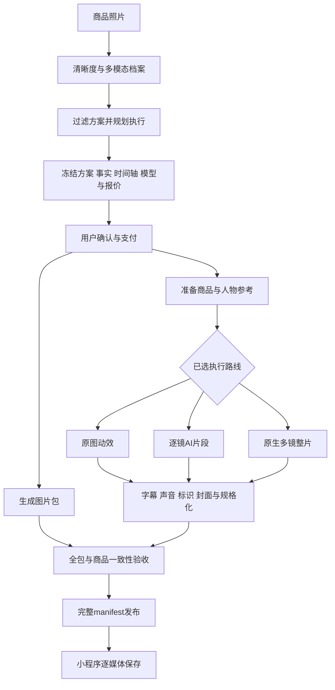

# 一品成片：方案驱动的云端服务与小程序封装

2026-10-27｜随需求v3.0深化的云端专项设计。蓝本固定提交1aab133；描述待建服务，未接通模型/云端/小程序。当前范围、接口、时限/预算和50项验收以 [主技术规格](../03-架构数据与接口.md)、[变体规格](../设计/方案组件与执行变体规格-v3.0.md) 为准；案例观察见 [案例深析](../评估/方案案例与生成流程深析-2026-10-27.md)。

## 1. 产品目标与封装单位

把仓库的广告创作配方封装为可购买、可自动执行、可验收的“成片方案服务”。支付宝和抖音小程序是普通用户的核心入口；后台持有模型配置、执行生成与合成，网页Plus承担改脚本、精调镜头和复杂批量创作。

普通用户路径仍是：拍3–5张商品照 → 多模态自动识别 → 选官方/社区方案 → 看到整套交付与价格并确认 → 后台制作 → 保存相册。商品名、品类、外观、可见标签与卖点由多模态整理；未知参数不要求买家补齐表格，也不编造。

v3.0明确把商品质感、生活场景、中文单镜讲解和连续多镜四类生成式变体列为P0，与10套基础图文变体组成至少14个官方执行版本。保留原10套ID/名称/媒体数量/时长；每个变体通过实测准入，不能把设计状态写成已经可用。

平台售卖的单位是“方案版本＋执行变体＋完整素材包合同”，而非一段提示词，也不是供应商的一次视频调用。生成九宫格、下载原片只是中间步骤；用户最终取得约定的图片、海报/封面、短片、文案与保存清单。

## 2. 把创意配方补全为服务合同

需要分清三份对象：

| 对象 | 用途 | 生命周期 |
| --- | --- | --- |
| SourceRecipe | 上游名称、scriptHint、脚本风格、形态、Look、运镜、compose，及固定提交/行号/许可来源 | 只读研究素材，不直接售卖 |
| PublishedRecipeVersion | 审核后的创意、输入条件、事实策略、引擎能力、声音、资源许可、输出槽位与质量约束 | 不可变发布；变更生成新版本 |
| OrderExecutionSnapshot | 本次用户照片/商品档案版本、具体脚本、时间轴、实际模型与能力快照、价格、资源版本、重试预算 | 报价绑定，订单执行全程固定 |

云端编译不能只复制 `styleType/videoMode`。每个发布版本至少具备：

| 字段组 | 必须冻结的内容 | 解决的具体问题 |
| --- | --- | --- |
| 创意 | 叙事策略、镜头角色、节奏/停留时间、Look、运镜、字幕排版、CTA规则 | 避免product_pov把“商品展示”误解释为“商品开口说话” |
| 输入 | 照片数量、正面/侧面/细节充分性、额外输入是否确有必要 | 不让三张正面图被自动理解成背面/内部结构证据 |
| 商品锁 | 本体、包装、主色、结构、文字/标识、单位、附件及各自证据 | 避免咖啡瓶变小杯、单品变礼盒 |
| 执行 | 引擎、已验证能力、模型版本/接口、参考图额度、时长与画幅 | 原仓库videoMode不能区分所有执行需求 |
| 声音 | 原生人声、TTS、动作声、音乐、字幕对齐与音量规则 | 口播不重复配音，ASMR不能只有“无BGM” |
| 交付 | 每个图片槽位的内容/尺寸，短片总帧数/编码，文案与manifest | 把“一个广告配方”变成完整可保存素材包 |
| 费用与失败 | 可报价状态、供应商费率快照、成本上限、重试限额、失败退款规则 | 不把模型调用成功等同于用户交付成功 |
| 发布 | 作者、派生来源、版本、样例授权、依赖资源、能力验收结果 | 社区方案只调用准入能力，不能上传任意服务端代码 |

已生成 [v3机器可读映射](../../assets/blueprints/云端方案映射.v3.json)：保留10套交付规格，映射来源组件，定义10基础＋4生成变体。全部禁售、模型/价格待验证。旧v1映射留作早期研究，不用于当前报价。

### 2.1 商品身份锁与事实来源

`ProductIdentityLock` 应包含 `product_form/package_form/count_unit/structural_anchors/colors/text_regions/accessories/evidence_refs/unknowns`。例如观察到单瓶装冷萃，就锁定瓶体轮廓、盖型、标签区域和瓶装单位；没有杯装/礼盒证据时，不能在关键帧或收尾镜头补出它们。

“圆柱形瓶体、黑色瓶盖”可来自画面；“冷萃咖啡”可以来自可读标签并标注来源；“零糖、提神8小时、月销10万、39元活动”必须有相应证据。标签OCR也可能误读，应保留识别置信度和冲突，不能把不确定文字直接做成大标题。

所有台词/卖点绑定事实ID；形容风格与叙事推断不能升级为参数/效果。生成后查文案是否出现档案之外的数值、功效、附件、套装、价格和消费者体验。没有来源时使用中性展示，仍然能自动完成制作，不让买家替系统填表。

人物设定另有CharacterLock：外观、服装、声音、人设、各镜角色。AI演员可以介绍商品；不冒充真实买家、专家实测或长期使用者。人物、声音、音乐和字体由平台准入库提供，普通用户无需配置API或上传真人参考。

## 3. 三条执行路线与适用方案

三条路线共用方案目录、商品档案、订单和素材包，但分别验证质量、成本与耗时。报价前选定路线；模型不可用时重新报价或终止，不能付费后悄悄改交另一类成片。

| 路线 | 具体流程 | 适合方案 | 能力与限制 |
| --- | --- | --- | --- |
| PHOTO_LAYOUT | 原图主体/裁切 → 版式 → 确定性轻运动/转场 → 字幕/音乐 → 输出 | pack_flatlay、slide_deck，以及微距/极简的原图保真变体 | 快、成本可控；不能承诺真转台、AI演员、未拍背面或真实浅景深重建 |
| PER_SHOT_AI | 脚本 → 每镜关键帧/原图 → 每镜I2V或人物片段 → 原声/TTS → 时间轴合成 | 商品质感、生活场景、单镜口播、需要单镜重试的广告 | 镜头可独立恢复；需控制多镜商品/人物一致性及多次调用成本 |
| REFERENCE_FILM | 脚本/商品/人物锁 → 统一分镜图或独立参考 → 各镜引用/时间码 → 一次生成多镜原声片 → 后期 | 咖啡演示式人物多镜、送礼、连续动作叙事 | 一次整片不等于必然成功；受模型时长/参考数/原生语音能力约束，失败可能整片重做 |

`live_presenter` 不强制多镜：单镜口播可走PER_SHOT_AI，只产生一个原生语音片段。`graphic_montage` 也不总能走PHOTO_LAYOUT，例如scene_grow要生成环境。用显式 `required_capabilities` 路由，而不是只看目录名或videoMode。

### 3.1 原图排版路线

从pack_flatlay/slide_deck借鉴“每卡一个信息点、短停留、大字与平铺构图”，用照片、事实文案和受控组件编译成精确帧时间轴。开头钩子、商品全貌、细节、收尾CTA的时间明确；节拍对齐来自实际音乐时间点，不能只把“卡点”写在提示词里。

图片包直接由同一套商品档案与版式生成，保留原图商品形态。已有照片不足以支持独立角度时，换用已拍角度的合规排版，不生成伪背面；需补拍时在报价前提示，允许回到拍照页。

### 3.2 逐镜生成路线

先为每镜冻结素材策略：原图、商品锁定生图、场景生成、人物原声片段。先验关键帧，再花视频成本。部分镜头可沿用真实照片，部分镜头生成场景，但只使用发布版本允许的混合方式。

角色/商品参考通过明确资产ID交接，不能从当前浏览器设置取。多镜关系选择固定参考或前镜尾帧，记录依赖；重做前镜若改变后镜参考，下游相关镜头需重新验收。可复用的有效镜头保存为阶段产物，用户不需要手动逐镜点“生成”。

对白采用原生语音时，保留原声并对齐字幕；没有原生语音的执行变体必须已有经验证的配音/口型方案。人物张嘴视频不能仅叠一条TTS就视为合格口播。

### 3.3 九宫格与原生整片路线

参考仓库流程：同一人物/服装/场景/灯光/商品 → 一张分镜图 → 行列索引裁切 → 参考编号映射 → 时间码/台词 → 整片生成。云端可保留该方法，也应允许独立高分辨率关键帧；九宫格不是所有方案的强制输入。

原实现最多9镜，裁图有约2%边缘内缩；人物定妆图会占参考名额。服务端需按实际模型的参考总数与单镜细节质量判断可用，不能默认“9镜＋1人物”一定可提交。多格图若参考细节不足，报价/规划阶段改用允许的独立关键帧方式，不在已经售出的任务里随意增费。

原实现有模型替换、时长检查、dry-run和供应商回执持久化的有用思路。迁移后将实际模型、swappedFrom、最大时长/参考数、原生声音和报价快照全部落在订单中；所谓兼容模型必须经过产品效果准入，不能只凭模型名包含reference-to-video判断等价。

仓库整片提示默认为UGC手机质感且不生成字幕/BGM。云端需按方案显式注入影棚或生活Look策略，并把后期设为必经节点。保持演员原声 → 字幕/必要AI演绎标识 → 有权使用的音乐与ducking → 商品卡/封面 → 编码/QC，不能再套一遍TTS盖住原声。

## 4. 10套官方保底方案怎样吸收仓库内容

下表为创意映射，不是把上游配方当作已经授权、已经实测的上线方案。既有的主图/角度/细节/海报输出槽位保持；“生成扩展”表示另一个需要验收的执行变体。

| 官方方案ID/名称 | 既定图＋片规格 | 对应仓库蓝本 | 拟吸收内容与条件 |
| --- | --- | --- | --- |
| minimal-clean 极简纯净 | 4图＋10秒片 | bullet_time_white、turntable_hero | 白底留白、商品为主角、少字；原图版只做轻动效，AI转台需角度与结构验证 |
| warm-handmade 自然手作 | 5图＋15秒片 | craft_hands、cottage_craft | 暖光、纸感、慢节奏和细节；仅照片时不伪造工厂/手作流程，真实工艺展示另需素材 |
| quiet-luxury 轻奢细节 | 5图＋15秒片 | macro_texture、luxury_hero | 灰调/窗光、微距、克制字幕；保留商品颜色，生成场景不能改材质与标识 |
| fresh-daily 清新日常 | 4图＋12秒片 | lifestyle_seed、day_in_life | 明亮日常、连续使用情境；图片基础版不承诺生成人物，场景扩展逐镜验证 |
| appetite-flash 食欲快闪 | 4图＋10秒片 | food_crave、pack_flatlay | 近景、俯拍、明快节奏；只拍包装时不用虚构切面/配料/热气 |
| home-calm 家居留白 | 5图＋18秒片 | ambiance_mood；ai_room_preview为后续条件化候选 | 居家氛围与慢停留；只有房间预览变体才需要房间图 |
| feature-cards 特征卡片 | 5图＋15秒片 | three_reasons、slide_deck、clean_label | 编号信息卡、一卡一点；标签可读才讲配料，不强凑未经证实功能 |
| color-pop 色彩撞击 | 3图＋8秒片 | pack_flatlay、flash_sale | 高对比色块、快节奏拼贴；没有活动数据不用虚假价格/倒计时 |
| launch-story 上新叙事 | 5图＋20秒片 | new_drop、ritual_unboxing | 揭幕、整体/细节/收尾；没有新品差异证据就用商品亮相，不伪造旧款对比和附件 |
| portrait-social 竖版种草 | 3图＋15秒片 | presenter_talk、ai_ugc_actor | 基础图文与AI单镜/多镜变体清晰区分，AI须人物/声音/原生口播准入 |

10套既定时长中有18/20秒，不能因演示视频15秒或某模型只有15秒就直接截短；对应模型不支持时，该执行变体不可报价。基础图片/动效版本与AI场景/演员版本共享创意，也可以具有不同服务价格，但各自合同须明确。

上游391条适合形成社区的创意参考库。正式公开时优先展示已验证版本；其余保留内部研究状态。社区创作者用官方准入的叙事块、镜头块、Look和合成块组合，提交样例与版本；不能改变模型密钥、任意URL、执行命令或买家数据访问范围。

## 5. 小程序的具体交互与载体

### 5.1 首页与识别

首页主按钮为“拍商品做一套素材”，次入口为“逛方案”。拍摄提示覆盖整体、斜侧、细节；上传后先查清晰度/主体是否同一商品，再由多模态产出档案。识别阶段会填充品类、主体、可见文字、外观、适用方案和未知项。

用户只看到简短摘要，例如“已识别：瓶装冷萃咖啡；可见：深色瓶身、黑色瓶盖”。“识别有误”是可选纠错，默认不强制逐字段确认。标签不清时提示补一张背标，仍以拍照完成输入。

### 5.2 方案卡与详情

方案卡展示有权使用的样片/封面、官方或社区作者、风格节奏、图片＋视频数量、是否AI演员/场景、价格和所需照片。样片明确标示为效果示例；不能把该咖啡演示包装成用户商品的预览。

推荐先按当前照片是否充分、品类与能力条件过滤，再排风格偏好和匹配度。仓库的关键词推荐可参考，但没有获得足够信息的性能测试、真实访谈等方案不应排进“只拍照可做”的结果。

普通买家不需要选模型、调seed、写提示词或排列时间轴。若同一风格有保真展示和AI讲解版本，卡片以最终可见效果命名，让用户明确选择与付费；不把三个内部引擎名放进购买流程。

### 5.3 制作确认、后台任务与领取

确认页一次说明这套会得到哪些图、多少秒短片、声音/AI演绎、金额、预计时间区间和领取期限。照片识别与输入检查完成后才能确定可售方案；收费时主动确认，不因选中方案就暗扣费。

进度页显示排队、准备画面、生成视频、加字幕/封面、验收等真实阶段。切后台、关闭小程序或换设备不影响服务端执行；回到“我的作品”可继续查看，不依赖本机localStorage推进任务。

成品页按用途排列主图、细节、海报、视频，并提供“保存整套”“只存图片/视频”“单项保存”和“复制文案”。保存基于每个媒体文件，不要求用户解压ZIP；下载/相册权限失败只重试保存，不重新生成、不再次收费。支付宝和抖音的登录/交易/相册使用各自适配，具体接入以真机和官方审核验证。

Plus在电脑上继续复杂编辑：替换台词、逐镜换图、比较A/B、调字幕/音乐/横版。小程序完成的原订单可正常领取，不能以升级Plus为交付前提。

## 6. 云端怎样执行，避免依赖网页点按钮

### 6.1 模块迁移对应

| 仓库蓝本 | 云端职责 | 需要改变的交接方式 |
| --- | --- | --- |
| ad-templates/look/camera/caption/style-packs | RecipeCatalog＋RecipeCompiler | 从只读来源提取，审核发布并补齐输出/声音/能力合同 |
| script-engine/prompts/templates | EvidenceScriptPlanner | 事实带来源、风格无歧义、精确帧时间轴，不从示例照搬价格/功效 |
| presenters与人物参考 | CharacterService | 准入人物/声音与版本，不使用买家未授权肖像 |
| storyboard-grid＋裁图 | ReferenceFrameWorker | 私有对象资产、参考索引、商品锁/人物锁QC与幂等阶段产物 |
| 单镜模型适配与任务轮询 | ClipGenerationWorker | 供应商提交/回执先持久化，续查与恢复，不绑HTTP请求存活 |
| storyboard-film＋模型/时长/成本检查 | FilmGenerationWorker | 实际模型和声音能力快照、参考额度与成本上限，整片产物先不公开 |
| FFmpeg合成、字幕、声音和封面 | PostProductionWorker | 原生服务调用，不通过网页页内状态，确保配方compose实际被执行 |
| composition/example展示 | DeliveryQC＋PackPublisher | ffprobe实测规格与全槽位验收，完整manifest原子发布 |

前端原有的Look全局设置、项目localStorage和“进入视频页时应用一次合成配置”，都改为服务端Snapshot。不能要求买家打开某个网页页面来触发下一步。业务API调用领域服务，Worker读持久任务，不让内部HTTP链条或请求超时控制生成生命周期。

建议新增能力目录放入既定 `src/worker/compiler/`、`src/worker/renderers/`、`src/worker/qc/` 下；模型适配在 `src/api/adapters/` 或独立共享后端模块。现有目录尚无这些生产代码，本文没有迁入上游实现。

### 6.2 一次订单的任务图

首版可以用PostgreSQL任务表/租约和独立Worker，不为这次方案研究额外搭分布式基础设施。开发与有界验证均用Windows原生进程；不调度本地Docker/WSL/虚拟机。生产计算是后续配置的云端资源，当前没有部署或开通收费资源。

### 6.3 面向小程序的最小服务操作

以下是API设计名称，沿用现有架构的鉴权/幂等/所有权规则，尚非已上线接口：

| 操作 | 作用与关键返回 |
| --- | --- |
| `POST /v1/p01/assets` | 本用户/项目照片上传授权与校验 |
| `POST /v1/p01/products/{id}/analyses` | 多图识别任务；返回档案与证据 |
| `GET /v1/p01/presets` | 按输入/能力过滤已发布方案/变体、示例和清单 |
| `POST /v1/p01/plans` | 校验脚本/精确时间轴、冻结变体，不提交视频付费生成 |
| `POST /v1/p01/quotes` | 绑定plan_hash、输出、实际模型/费率、金额/期限 |
| `POST /v1/p01/orders` | 有效报价建单，按宿主接入支付 |
| `GET /v1/p01/jobs/{id}` | 真实阶段/恢复状态，不泄露供应商密钥 |
| `GET /v1/p01/orders/{id}/deliverables` | 验收后的完整槽位与领取权益，短链另按权益发放 |
| `POST /v1/p01/save-sessions/{id}/receipts` | 设备保存体验记录；失败不重做或收费 |

识别与规划可能产生LLM费用，由平台按首版免费额度/滥用限制管理；“未提交视频生成”不等于规划绝对零成本。报价不应创建未经用户确认的供应商视频任务。模型提交后的超时先查回执，不盲目重复购买，细则沿用既有交易与恢复设计。

## 7. 报价、耗时与失败边界要从配方推导

成本模型按阶段估算：识别/脚本＋人物/关键帧或多格图＋逐镜视频或整片视频＋语音/动作声＋语义检查/有限重试＋后期/存储。每个可售版本用实际样本记录成本分布与p50/p95耗时，再决定价格、并发和超时；本轮没有供应商实付实验，不能给出可信的每条几元/几十秒承诺。

九宫格可能减少关键帧调用次数，但不自动证明整片最便宜：参考失败、商品变形、整片重做、字幕/声音后期都在成本里。逐镜路线的优势是失败可局部处理，必须和整片路线用同品类、同合同对比后决定。

每个阶段有最大重试/花费预算。事实/商品锁失败可以在预算内换参考或重试同一路线；仍失败则不给用户错误成片，走已定失败/退款机制。用户只因相册保存失败时不进入此流程。供应商变更模型、声音、时长上限或费率，影响未成交报价；已成交订单不能因此无声改规格。

## 8. 方案级验收，而非只检查文件存在

| 验收层 | 必须检查 | 不足时如何处理 |
| --- | --- | --- |
| 输入/事实 | 主体一致、图清晰、可见文字/参数来源、没有混入示例商品事实 | 收费前补拍或换可做方案；不要求填长表 |
| 关键帧 | 商品容器/结构/颜色/标识，人物/场景一致，手持比例和附件 | 在视频付费前有限重试；锁定错误不往下生成 |
| 视频内容 | 商品形态跨帧变化、角色/声音稳定、动作可用、没有新增包装或假证言 | 有界修复/重做；失败按合同处置 |
| 声音与字幕 | 应有音轨、原生口播不重复配音、字幕与实际话语一致、无大段截断 | 对实际音轨做对齐/检查，不相信shots里有voiceover就视为有声 |
| 规格 | 用ffprobe读尺寸/帧率/帧数/时长/编码/音轨；不能使用展示页1080p标签 | 明确重编码与画幅适配；源是720p不能宣传原生1080p |
| 整套 | 全部必交槽位、事实文案、封面和manifest完整，主体与购买方案一致 | 全包完成前不发布可领取状态 |

视频检测需采用覆盖全片的时间采样＋场景/主体变化触发的补采样，避免只看首帧/尾帧。自动视觉检查有漏检，不能声称保证零幻觉；上线前用人工标注的形态错误/标识错误样本评估误放与误拒，发布版本按评测结果准入。这里人工用于平台测试和质量校准，不变成每位买家制作前必经审核。

输出合同继续按既有预设：PNG对应槽位，短片1080×1920、30fps、H.264/yuv420p，总时长±1帧。若生成源分辨率低于交付尺寸，合同需明确“原生生成规格”和“交付编码规格”；转码放大只能满足文件尺寸，不能替代清晰度验收。生成时长不精确时应在规划保留可裁切停留/镜头余量，不能靠截断台词凑帧数。

## 9. 第一轮实施与验证，原图与四类生成式服务

先选有权用于测试的2–3类商品：单瓶咖啡（杯装是另一个SKU，不能混用）、蓝色榨汁杯、具有纹理细节的包袋。每类拍同一商品整体/侧面/细节照片，不直接把上游演示当作可投放资产。

| 验证服务 | 蓝本 | 第一轮要证明的核心能力 |
| --- | --- | --- |
| 快闪图文包 | pack_flatlay / slide_deck / 纸巾结构 | 照片自动识别、信息卡、图＋片全包、精确规格与相册保存 |
| 商品微距展示包 | macro_texture / turntable_hero | 主体材质/颜色/包装不变；原图版与生成版清晰区分，不能造未拍结构 |
| AI生活场景包 | lifestyle_seed / scene_grow | 生成周边环境、商品结构/包装不变、比例和使用方式可接受 |
| AI单镜讲解包 | presenter_talk / 咖啡单镜 / 榨汁杯单镜 | 人物持正确商品、事实台词、可懂语音、字幕对齐与连续表情 |
| AI连续多镜包 | 咖啡多镜 / ai_ugc_actor创意 | 一致参考、分镜/时间码、人物/商品跨镜稳定、原声保护与统一后期 |

先按路线做有预算上限的样本验证，记录成功/失败、实际商品错误、成本和耗时；不要只挑一条最好看的视频。随后将通过的组件扩展到10套官方风格，逐套完成相应交付验收，再开放社区复用这些已准入能力。

建议以同一批素材对逐镜和整片路线做对照，覆盖正常图、反光标签、遮挡/手持、侧面不足、超长台词、模型无声/异常帧率、供应商超时和仅部分图片成功。首轮用于比较方案与发现问题，不将少量样本通过率外推为391条全部可用。

可审查的完成条件依次是：字段/方案编译可复现 → 原图＋四类生成式原型后台跑通 → 商品/声音/规格失败拦截与恢复 → 双端真机交易/保存 → 官方10套/14变体各30次、总≥420次准入 → 社区发布/派生。时限/预算按v3主需求分路线冻结，旧基础范围的120秒/10分钟不覆盖全部AI。

## 10. 仍需用实现和实测消除的不确定性

当前已经确认配方内容、调用关系、演示文件与若干内容偏差。尚未确认的是各供应商当前可用模型/价格、原生语音和多参考的真实效果、商品锁通过率、多语言可懂度、成本/耗时分布，以及双小程序真机能力和审核结果。

这些属于下一阶段能力验证与实施工作，不能从仓库演示直接推断。本轮没有新模型调用、没有修改上游仓库、没有创建收费云资源。配方研究数据和执行草案已经落盘，可据此启动具体实现。
