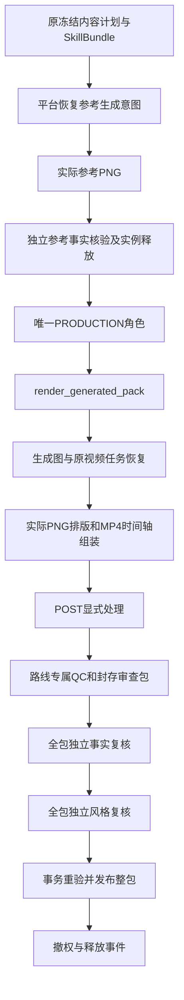

# 生成式无声整包与阶段编排 v1.0

2026-10-28。本专项接续[参考购买门禁与MCP](生成式购买门禁与MCP工具接入-v1.0.md)，将两条生成式路线接入制作、显式后期、文件QC、最终独立双复核与事务交付。需求v3.1的58项/52项P0、三路线、10风格/14变体和Plus P1均保留。当前实现与夹具覆盖以[实现索引](../../assets/implementation/current.json)为准，全部官方预设仍禁售。

## 调度和角色

平台按已冻结的Codex内容计划生成参考，独立参考角色结束并释放后才启动制作角色。制作角色通过受控整包工具执行计划，没有在串行工具消费者中嵌套等待另一个角色。保留同阶段、同代次、同角色唯一索引；没有新增迁移或通过重开角色绕过约束。

原合同必须已经容纳至少5次推理、每角色至少2次、至少12次工具调用及完整视觉输入。参考事实核验和最终事实复核共享原`REVIEW_FACTS`额度，不新建费用桶，不增加原单次数/预算/截止。报价和执行均提前拒绝不支持的QC规则、视频比例/时长和不足的角色/视觉额度。

## 两条路线的实际文件

| 路线 | 参考和视频 | 最终处理 |
| --- | --- | --- |
| `PER_SHOT_AI` | 每镜独立参考PNG，经同一完整参考报告逐帧/逐锚点核验，再按原镜头生成视频 | 从原视频逐段转为1080×1920、30fps、原冻结帧数，按原镜头顺序拼接 |
| `REFERENCE_FILM` | 一张整片参考PNG和完整时间码计划，报告通过后生成原整片任务 | 使用原整片MP4转为冻结规格，完整后期/QC/最终双复核 |

图片素材槽位调用实际图片生成协议，再由平台使用已冻结字体/标题/文案排版；视频必须来自登记的实际生成MP4，不使用原图推拉冒充。素材包附带原计划的实际文案文本。当前仅接受无口播、无配乐合同，视频音轨被显式排除；这不构成原生有声能力。

每段实际视频必须提供完整冻结帧数，拒绝短片补帧或静默拉长。最终文件继续检查完整解码、编解码器、尺寸、帧率、帧数和无音轨。两条路线使用独立规则`YPCC-QC-GENERATED-SILENT-1.0.0`，执行版本为`YPCC-GENERATED-SILENT-1.0.0`，不沿用原图路线的合格标记。

## 来源绑定与恢复

所有供应商意图沿用原订单和原制作阶段。参考、图片槽位和视频分别使用平台确定的逻辑键，工具参数只接受冻结快照摘要。待完成视频返回待恢复状态，原工具意图恢复原任务；首次购买回执或原状态查询丢失时，已经持久化的未决意图必须继续待恢复，不能让普通异常直接退休订单/制作角色。未知购买保留原预留，不能重购。已完成角色而阶段尚未提交时，租约接管复用原角色、回执和费用。

非文案产物新增`generation_sources`和`reference_approval_hash`，记录原提交ID、逻辑键、实际SHA和参考核验摘要。后期继承这些字段。每次检查同时校验原模型/费率/请求摘要、终态费用证据、登记对象权限/到期、实际PNG/MP4字节和原独立报告；生成文件撤权或摘要变化阻断交付。

来源凭证保存在既有`artifacts.spec_json`中，继续属于现有主库受控逻辑脱敏范围；供应商请求/回执仍在原私有图谱和登记对象中。未新增数据库迁移，也未增加公开供应商地址。此处是字段覆盖说明，完整物理/外部隐私准入仍待完成。

最终事实与风格角色是全包独立新运行，参考通过不能替代最终检查。交付器在预检查和发布事务内重新核对来源与完整双报告；预检查后撤销原生成文件时，事务回滚，不能留下部分manifest。发布后继续使用现有带授权下载、实际SHA检查、撤权与释放事件机制。

## 代码入口

| 职责 | 文件 |
| --- | --- |
| 原计划请求与参考前置 | [requests.ts](../../src/worker/generation/requests.ts)、[prepare.ts](../../src/worker/generation/prepare.ts) |
| 原未决调用调度 | [execute.ts](../../src/worker/generation/execute.ts) |
| 原生成文件和来源凭证 | [outputs.ts](../../src/worker/generation/outputs.ts) |
| 实际整包与后期 | [generated-pipeline.ts](../../src/worker/media/generated-pipeline.ts) |
| 调度与限定工具 | [media-stage.ts](../../src/worker/codex/media-stage.ts)、[production-tools.ts](../../src/worker/tool-gateway/production-tools.ts) |
| 规则和事务交付 | [qc.ts](../../src/worker/review/qc.ts)、[publication.ts](../../src/worker/review/publication.ts) |
| 原生专项 | [generated-production.test.ts](../../tests/integration/generated-production.test.ts) |

## 验证与剩余范围

专项使用原生PostgreSQL、实际HTTPS/stdio/MCP、Sharp及FFmpeg产生的真实PNG/MP4。两条完整无声夹具分别验证参考→制作→后期→QC→全包事实/风格复核→交付→实际下载，并从最终下载文件取帧验证红蓝源片段顺序及60帧规格。覆盖原角色完成后真实租约过期/接管、旧租约提交拒绝、发布预检查后原视频撤权回滚、原额度/费用不重置、FAIL/UNCERTAIN参考阻断、规格/视觉/次数不足和UNKNOWN不重购。最终执行数量与结果见实现索引，不以文档描述代替执行证据。

模型判断、用量与OS隔离身份仍为显式合成夹具，2秒无声测试合同不是四个官方生成式变体的验收。真实Codex/供应商/隔离与清理准入、真实语义质量、原生口播/声音/配乐/字幕、生成式SAMPLE/售后、14变体各30次整包、宿主真机及完整产品均待完成。未修改小程序页面，本轮沿用已留存截图/录屏/GIF；C冻结25文件及归档不变。
