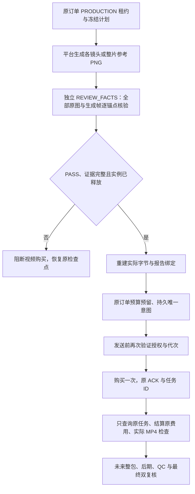

# 生成式购买门禁与 MCP 工具接入 v1.0

2026-10-28｜需求 v3.1 / 开发契约 v1.1 / C 设计 v1.0。

## 解决的问题

原内部网关仅对逐镜视频保留拒绝逻辑，参考整片仍可以直接引用原照片购买视频。现在两条路线均须先生成参考帧、由独立身份角色通过核验并完成实例释放，才允许预留和发送视频购买请求。原图不能在核验后替换回视频输入；单个通过结果也不能代替整包双复核。

当前为购买边界和受控工具接入。Worker 的生成式整包阶段、显式后期、QC、最终独立双复核及交付编排仍未完成，`MediaStageService` 继续拒绝尚未实现的生成路线。官方方案仍禁售。

## 顺序与冻结关系

1. `PER_SHOT_AI` 的 `reference:<shot_id>` 必须覆盖冻结计划内全部镜头；视频 `video:<shot_id>` 只接受该镜头对应的生成帧。
2. `REFERENCE_FILM` 新增 `reference:film`，视频节点保持 `film:original`，只接受该整片生成参考帧。
3. `readReferenceApproval` 不启动新模型、不接受调用者提供的 PASS。它恢复原阶段唯一完成的身份角色，重读全部实际 PNG、原照片和商品锚点，重新核验报告、图片推理、Skill、受控工具与释放证据。
4. 核验绑定包含 `run_id`、`packet_hash`、`report_hash` 及全部参考帧的 ID/SHA/节点；与供应商请求摘要一同存入不可变的 `provider_submissions.private.prepared`。沿用迁移 021 的保护，不新增数据库迁移。
5. 预算预留、发送前、恢复原任务及媒体写入/完成提交都复核绑定。照片、生成帧、报告或私有对象状态变化即阻断。查询和写入并不把旧 PASS 视为永久权限。
6. 重试与 Worker 接管复用同一提交/ACK/任务，不重新购买；UNKNOWN 保留原费用预留。历史费用对账仍可恢复已发生的资金事实，即使生成能力撤销或无有效业务授权，也不能借对账发布新媒体。
7. 参考整片预算额外计入至少一次参考帧生成。既有订单的合同、角色次数、总费用和绝对截止时间不重置、不扩大。

## 受控 MCP

工具已注册到 Worker 的订单工具集合。模型仅提交下面的逻辑标识，真实提示词、商品证据、照片/生成帧、模型、费率、分辨率、音频策略与租约由平台从已售快照恢复。

| 工具 | 参数 | 当前作用域与行为 |
| --- | --- | --- |
| `generate_reference_frames` | `shot_id`：冻结镜头 ID，整片用 `film` | 原订单 PRODUCTION；由平台构造原图参考和冻结风格/内容提示词，返回实际生成 PNG 标识 |
| `submit_video` | `shot_id`：冻结镜头 ID，整片用 `null` | 原订单 PRODUCTION；强制恢复通过的独立参考核验，再引用对应生成帧购买一次 |
| `query_original_submission` | `submission_id` | PRODUCTION 只恢复原阶段任务；POST 只读原订单已完成 PRODUCTION 的实际成品，不能查询未决供应商或另购任务 |

所有额外参数均拒绝，包括自定义 prompt、URL、密钥、价格、任意参考帧列表与其他订单租约。视频规格从冻结模型能力选择，必须匹配已售输出比例；没有匹配项时以 `GENERATION_VIDEO_SPEC_UNAVAILABLE` 阻断，禁止静默换比例。工具结果只返回提交 ID、状态、SHA 和实际媒体检查信息，不向角色暴露对象键或供应商下载地址。

独立身份角色必须由阶段编排器在参考生成和视频阶段之间启动。不得在单线程 `ToolConsumer` 的某个工具处理器内同步启动另一个依赖相同队列的角色，否则会阻塞该角色的核验工具。完整编排还须在售前验证参考阶段、独立核验、视频阶段与最终双复核能够共同满足冻结的逐角色/整单推理次数和预算；不能在运行中追加免费或无限角色。

## 验证与后续

- `generation-gateway.test.ts`：35 项原生数据库/实际媒体专项，保留原调用、费用、截止、恢复、隔离与故障测试，增加两路线未核验拒绝、FAIL/UNCERTAIN、生成帧绑定及篡改恢复。
- `generation-tools.test.ts`：6 项实际 stdio + HTTPS/MCP 工具协议专项。测试角色使用明确的合成驱动与仅测试的观察结果持久器，不生成整包完成证明、不推进父阶段。同阶段同代次同角色的唯一约束保留；参考生成后的视频协议测试经真实租约过期/接管继续执行，原次数和费用仍共同累计。不能据此宣称同代次多阶段角色续跑已实现。
- `reference-identity.test.ts`：15 项独立核验核心专项继续有效。
- 原生 PostgreSQL、Sharp PNG、FFmpeg/ffprobe MP4 和受控协议实际执行；模型输出、费用回执、进程隔离身份仍为合成。当前结果与摘要以 [实现索引](../../assets/implementation/current.json) 为准。

下一步是完整生成式制作阶段的持久编排、参考审查后的原视频恢复、整包组装与显式后期/QC/双复核/交付，再完成有声和真实服务 G0。此轮未修改小程序页面，原 [截图/录屏/GIF](../guides/DEMO.md) 的字节与合成演示标注继续保留。

English: Both generative routes now require a completed and released independent identity review before video purchase. The gateway binds the immutable report and actual generated PNGs to the original paid intent and revalidates them on recovery and publication. Three scoped MCP handlers derive provider inputs from the frozen order; POST can only read completed original results. Protocol tests use actual native database/media and HTTPS/MCP with synthetic inference and isolation assertions. Complete generated pack orchestration, post-processing, final reviews, native audio and real provider/isolation admission remain incomplete; sales stay disabled.
