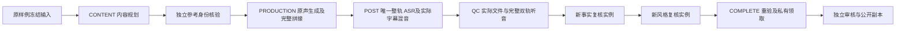

# 社区原生声音样例与平台声音账本 v1.0

本增补接通 `PER_SHOT_AI`、`REFERENCE_FILM` 的有声社区样例。作者仍使用既有创建样例、查看进度、下载、提交审核与发布入口；普通商家仍优先通过支付宝、抖音小程序拍照选方案。这里新增的是云端样例制作能力，没有新增付费订单、前端表单或独立客户端。

验证与交付信息以本轮完成后写入的 [专项来源](../verification/native-sample-source.json) 为准。历史无声样例及推荐组件证据保留原版本，不升级为本轮全量验收。

## 1. 制作目标与边界

| 编号 | 能力 | 约束 |
| --- | --- | --- |
| N01 | 冻结有声样例 | 沿用原商品、照片、身份锁、作者授权、方案版本、Skill、模型、费率、原截止与平台额度 |
| N02 | 自动内容计划 | 平台蓝本须预设已准入的人物、声音和视频模型组合；根据可观察商品证据生成建议台词，CONTENT 在证据范围内完善 |
| N03 | 实际原声制作 | 原视频生成结果形成完整时间轴；逐镜拼接保留原声 0 dB，制作中间文件使用 ALAC |
| N04 | 实际转写字幕 | 唯一完整制作视频转换为受限 ASR 输入，保存原请求、原任务、原响应、词级时间与转写文件；不使用第二次 TTS |
| N05 | 实际声音后期 | 原声保留、固定字幕字体、实际 ASR 时间码、可选已许可配乐及冻结压低策略，生成 AAC 成片 |
| N06 | 独立整轨听音 | 完整原声和交付音轨以 48 kHz 双声道 WAV 送检，并配实际图片、视频采样、商品事实和转写文本 |
| N07 | 双独立交叉核验 | 事实与风格角色使用新实例、已加载的原 Skill、实际画面、ASR 和原听音结论；两份报告都绑定完整音频证据摘要 |
| N08 | 私有交付与公开副本 | 原下载权限和公开副本流程保留；发布前重新读取原生成、ASR、听音、费用及许可，交付后释放实例 |
| N09 | 公开许可撤回 | 公开副本单独冻结声音许可；许可撤销立即拒绝访问，维护任务撤回发布；有效期取原 30 天上限及声音许可最早到期 |

`PHOTO_LAYOUT` 继续使用原无声路线。旧样例不会获得新增声音能力，不能静默替换声音、人物、配乐、生成来源或收费请求。声音样例完成也不自动授予社区商业销售资格。

## 2. 状态和执行骨架

沿用七个 SAMPLE 阶段和原角色限制。两条生成路线实际需要六次新角色运行：CONTENT、参考身份事实核验、PRODUCTION、POST、最终事实复核、最终风格复核。听音属于平台声音服务调用，不增加 Agent 角色额度。每个角色结束后释放原实例。

所有声音请求使用 `sample_id`，`order_id` 必须为空。`032_sample_native_audio.sql` 只增加新约束：SAMPLE 的 ASR 只能属于原 `SAMPLE_POST` 第一次阶段，听音只能属于原 `SAMPLE_QC` 第一次阶段；冻结输入、截止与平台费用摘要必须一致。原迁移 001–031、原订单 ASR 修复次数规则均保持。

## 3. 原预算和故障恢复

原单样例上限按以下项目拆分，不能运行中追加：生成上界 + 声音许可分摊 + 唯一整轨 ASR 上界 + 原听音协议上界 + Agent 上界。声音分摊后仅减少 Agent 可用额度，原每日 `CODEX_SAMPLE` 账户、并发、工具次数、Token、角色次数和绝对截止不变。

声音使用独立 `platform_budget_reservations`，不使用买家 `budget_reservations`。许可分摊为原许可的固定预付分摊；ASR 按原实际音频秒数结算；听音按完整原响应的实际用量结算。缺少实际用量、超出上界或响应不完整时保留未知费用，不能当作免费。

请求体、WAV、发送标记、原任务编号、回执指针和结果逐项冻结。发送前中断可以恢复原字节；发送后的未知 ACK 不再次 POST。查询次数及间隔按原协议，原键恢复不延长截止。维护服务只消费已保存回执，可在撤销或到期后对账，不能重新购买、发布或更新签名链接。

听音输入的事实部分使用项目现有规范序列化，避免数据库 JSONB 字段顺序变化使同一输入出现新的请求摘要。原声及交付 WAV 的 PCM 摘要必须对应原制作及后期证明中的完整实际音轨，不抽取短段、不归一化、不丢弃声道。

## 4. 配置与部署接线

| 配置 | 要求 |
| --- | --- |
| `SAMPLE_COST_CEILING_MICRO` / `SAMPLE_DAILY_BUDGET_MICRO` | 明确平台样例上限，原额度须覆盖全部生成、声音和独立角色 |
| `SAMPLE_MAX_CONCURRENT` / `SAMPLE_DEADLINE_SECONDS` | 沿用原并发与绝对截止，不能由声音任务重新计算 |
| 蓝本私有 `model_version_ids` | 唯一已准入 IMAGE、VIDEO、SPEECH、独立听音 QC；协议、模型能力、费率和有效期一致 |
| 蓝本私有 `sample_native_voice` | `{character_version_id,native_voice_id}`；对应已准入人物/声音/视频模型组合 |
| 声音资源 `audio_rights.sample` | `kind` 对应 NATIVE_CHARACTER / NATIVE_VOICE / MUSIC，`allowed_use=PUBLIC_ADVERTISING_SAMPLE`，`allocation_mode=PREPAID_PLATFORM_SAMPLE_ALLOCATION`，固定 `allocation_micro` |
| 资源原证据 | 原许可正文摘要、登记版本、字节摘要、准入和到期有效；仅有商业广告订单授权不能代替公开样例授权 |
| 可选配乐 | 蓝本原资源绑定、独立 `licensed-resources/` 实际媒体、音量、压低和循环策略全部冻结；作者选定的外部资源不能被忽略 |
| 私有存储 | 原受限 HTTPS 签名读取能力；实际 ASR 输入仅签名原样例 WAV，原链接到期不续签重购 |
| 原生服务 | FFmpeg / 字体、Codex 原生运行及视觉准入、真实模型服务与独立听音准入；不使用 Docker、WSL 或虚拟机 |

源码入口为 [样例声音上下文](../../src/worker/samples/audio-context.ts)、[ASR 服务](../../src/worker/samples/speech.ts)、[原声媒体](../../src/worker/samples/native-media.ts)、[音频证据](../../src/worker/samples/audio-evidence.ts)、[独立听音](../../src/worker/samples/listening.ts)。主 worker、受控工具、最终交付、公开副本及原维护服务已接线。模型密钥、私有请求、签名地址和本机运行目录不进入公开仓库或交付 ZIP。

## 5. 本轮验证范围

按用户要求，仅执行有界类型检查、关键原生链路、相关旧路径、服务端/页面构建及启动检查。未运行全面单元/集成验收、双小程序真机、真实中文口播质量评估或云端部署。

测试使用真实原生 PostgreSQL、HTTP/MCP、FFmpeg、PNG/MP4、文件摘要、费用记录、阶段和进程释放。人物/声音许可、模型生成内容、ASR 文本、听音 PASS、身份、价格和用量为明确合成夹具；实际视频音轨为提示音，不证明真实中文语义或声音质量。导出的媒体仅用于展示控制链路和实际文件格式。

本轮初始类型字段错误、许可不可改写/不可恢复的夹具错误、听音请求顺序问题及临时导入错误均保留各自原日志和源码摘要；不把后续修正后的通过结果回填为早期通过。最终数量、构建摘要、ZIP 和待完成事项见专项来源及 [当前交付](../delivery/README.md)。

## 6. 仍待完成

真实 Codex 隔离与模型/听音/许可准入、双小程序真机、完整社区商业有声准入、任意视频字幕或声音售后改制、Plus 深度编辑、云部署与完整 58 项验收仍独立待办。本增补保持所有真实服务及销售开关关闭，完整产品验证、生产准入、云部署标记保持 false。

## 本轮交付快照

当前459份源码、42份契约/Skill及4份字体资源，摘要 `52416aa969b252c137015e7e8789eca8a4666d18ab61e3b81b74695f7a69383b`。两条原生声音样例、前置门禁、UNKNOWN与兼容性共8项专项通过，56项未选。类型、server/preview、本机自检及启动通过；双小程序重编/真机与全套未执行。早期失败与各自源码快照均在[原始尝试清单](../verification/native-sample-attempts.json)独立保留。

[实际MP4、帧图、GIF及摘要](../media/native-sample/README.md)对应本轮准确来源；实际声音为提示音，不代表真实中文声音或商业质量。原116媒体和方案C原件保持；真实服务与销售继续关闭。
