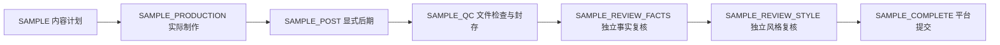

# 社区样例独立制作与复核接入

2026-10-28｜需求 v3.1 / 开发契约 v1.1 / C 设计 v1.0｜应用仍为 IN_PROGRESS。

作者可以用自己的已识别商品、照片版本、商品使用授权与样例公开授权，请求当前草稿的一份私有样例。平台冻结风格、规格、商品证据、Skill、原生运行准入、费用和截止，完成实际媒体制作、显式后期、文件QC及两个独立复核后，才将样例置为 READY。样例使用独立的平台成本域，不建立已付款订单，不占用买家预算。

本次实现范围是 PHOTO_LAYOUT、无配音、无音乐、固定平台字体、无作者自带资源的私有样例。底层蓝本如允许“已授权配乐或合同静音”，本轮明确采用静音合同；不是承诺有音乐后静默移除。生成式、有声、自定义资源样例仍在完整需求内，当前返回不可用，不替换路线。此实现不改变官方10套/至少14变体与完整三路线的验收要求。

## 入口与阶段

沿用现有 `POST /preset-drafts/{draft_id}/samples`、本人样例列表与 `POST /preset-samples/{sample_id}/media-links`，不新增公共接口形状。作者工作台沿用 C 视觉和已有“制作私有样例 / 刷新样例记录 / 提交发布”交互，普通买家的拍照制作流程不增加审批步骤。

入口事务依次检查本人草稿与版本、本人商品档案、照片版本的两项授权、平台注册组件和执行蓝本、生成/Codex开关、60秒内且未停止的 Worker 心跳。心跳必须声明全部七个处理器，不能只声明 SAMPLE。再核对样例额度、并发、真实运行准入和可信 Bundle；任一不满足都不创建样例或阶段，不购买推理。

七阶段使用同一个 SAMPLE 作用域、输入摘要与绝对截止，依赖持久存入 PostgreSQL。五个角色分别启动新的 Codex 会话与进程；QC 与 COMPLETE 由平台执行。当前复核顺序执行，两个复核读取同一封存包，后一个不读取前一个结论。

## 冻结与费用

`public_samples.private.execution` 保存内容寻址的冻结上下文：本人商品档案、照片集/身份锁摘要、草稿版本、配置/编译来源、请求及授权、选中风格的 Bundle、运行与视觉准入、每角色/整次的调用与token上限、费用上限和截止。风格与执行蓝本可分别选择，因此通过 Bundle 摘要解析实际风格，不能把蓝本名字当风格 Skill。

平台成本账户使用 `CODEX_SAMPLE:owner:day`，与 CODEX_PLANNING 分离；整次样例的五个角色共享冻结费用上限。推理出口先登记意图并原子预留，调用和工具都检查作用域、权限、实际照片可用性、授权、代次及截止。传输或计费不明时，推理和对应成本预留在同一事务进入 UNKNOWN，继续占用额度，查原回执，不重新购买。

原角色已经成功但阶段提交丢失时，接管者读取该阶段原角色检查点，核对输出摘要后提交，不启动新角色；UNKNOWN/RUNNING/LOADING_SKILLS 未决原角色只能等待。旧 Worker 不能越过新租约提交。草稿、风格注册或全局额度后续变化不能改写已排队输入。

配置位于 [.env.example](../../.env.example)：

| 配置 | 默认值 | 约束 |
| --- | --- | --- |
| SAMPLE_DAILY_BUDGET_MICRO | 0 | 本人当日样例上限，至少覆盖单次上限；0表示未准入 |
| SAMPLE_COST_CEILING_MICRO | 0 | 单次五角色共同上限；必须为正 |
| SAMPLE_MAX_CONCURRENT | 1 | 每人未完成样例数，1–20 |
| SAMPLE_DEADLINE_SECONDS | 3600 | 入队固定绝对截止，60–86400秒 |

这些配置不提供商业售价或生产准入。真实模型、隔离器、视觉费用上界与社区 Bundle 仍须分别验收；当前完整生产 Worker 的 PREVIEW/REVISION 等阶段门禁继续生效。

## 实际文件与复核

PRODUCTION 读取作者原照片，核对资产归属、照片集版本和实际SHA；按选中风格生成全部冻结图片和短片。POST 显式重编码图片/视频、去元数据并生成实际UTF-8文案。每次原生媒体操作先登记稳定意图；已登记的 STORED 文件读取原字节，WRITING/UNKNOWN 不重复写入。

所有媒体、QC帧和推理SSE写入前登记，绑定本人及商品，不在公共接口暴露对象键。实际输出位于独立的 `tenant/samples/sample_id/` 前缀，不能引用买家或另一份样例文件。临时媒体在本项目 runtime 内，完成后按已校验边界回收。

QC 对全部产物核对清单、解码、实际像素、编码、帧率、帧数、静音与实际文案；短片取帧包含每秒、分镜边界、最后一帧与场景变化。封存包绑定输入、计划、字体、实际文件集和所有审查图片摘要。

事实和风格角色必须把全部封存 PNG 与上下文送入计费出口，不能用文件名、首尾画面或未绑定的缩略图代替。报告覆盖全部素材和帧；PASS 不得附带问题，FAIL 必须标明实际素材与问题。平台重新校验运行/隔离证据、原阶段、已加载 Skill、完整视觉回执、工具读取记录和原输出检查点；报告持久化后不可由另一个结论替换。

COMPLETE 只在五个角色成功、两个报告 PASS、工具与推理全部结清、实例均已 RELEASED、实际文件摘要一致时写 READY、完整私有媒体列表和交付摘要。失败不发布部分素材；有限自动修复仍待完成。测试中的 RELEASED 由显式合成清理端口配合真实进程/目录回收验证，不是生产受限身份和完整进程树的证明。

## 发布、访问和生命周期边界

作者选择 READY 样例提交发布时，平台除原有草稿/蓝本/许可/授权校验外，还重新验证完整制作与双复核证据、原结果检查点、字体许可及实际文件。仅 `qc_passed=true` 或 READY 标记不足以提交。历史发布专项的直接样例夹具必须标注 `test_fixture=true`，只在 APP_ENV=test 中生效。

本人领取入口再次核验完成证据；短期下载对实际文件、登记归属、摘要、有效期及当前授权复查。照片删除/到期、样例撤权或公开授权撤销后，已签发链接也不能继续读取。实例释放和媒体物理删除仍分别由独立回收器与媒体维护器负责。

当前文件仍遵循本人商品和私有对象有效期，不能据此承诺永久公开展示。授权公开样例的独立持有、到期/撤回、下架替换和长期展示策略尚未实现；完整社区发布流验收仍为未通过。也未完成生成式/有声/自定义资源样例、生产 Bundle 商业准入及真机验证。

## 验证与证据

`tests/integration/sample-production.test.ts` 的12项专项使用实际原生 PostgreSQL、Fastify/HTTPS、MCP、Sharp、FFmpeg/ffprobe、登记媒体和真实 Node 子进程；Codex、模型用量与隔离身份断言明确为合成。正常样例采用现有 minimal-clean 原图蓝本的完整10秒规格和 quiet-luxury 风格，不是缩成一秒的官方质量验收。

专项覆盖：七处理器/额度门禁；完整清单与五角色/独立费用；私有下载和实际字节篡改；缺件/错包/伪造报告及交付摘要；测试标记限制；租约接管复用原检查点；费用不足时不提交；UNKNOWN 不重购；字体许可撤回；生成式样例不降级；输入删除；公开授权撤回。另有12项发布协议回归。

全量命令和摘要以[实现证据](../../assets/implementation/current.json)为准。此处不代表真实模型质量、原生隔离、所有14变体/420整包、完整58项需求、生产清理、四组设备或云部署已经通过。原生媒体曾出现的一次 C0000374 仍保留原记录与长期稳定性待验项。

本轮最终检查：50项单元、164项集成、类型检查、服务端与双小程序构建均PASS；文档/契约4322项核验PASS。实现索引绑定250个源码/测试/构建配置文件与42份运行契约，C冻结25文件及原归档未变，未启用任何真实付费或发布能力。

主要源码：[冻结上下文](../../src/worker/samples/context.ts)、[阶段编排](../../src/worker/samples/service.ts)、[媒体执行](../../src/worker/samples/media.ts)、[文件与独立复核](../../src/worker/samples/review.ts)、[完成证据](../../src/worker/samples/completion.ts)、[受控工具](../../src/worker/tool-gateway/sample-tools.ts)。
