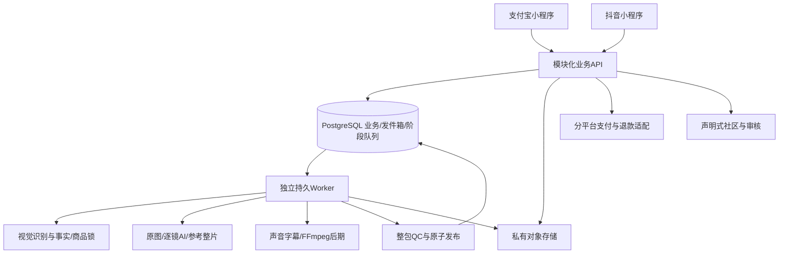

# 01 · 技术选型与架构决策

## 1. 架构

本文件保留原决策及采用条件。当前开发版本已锁入[package.json](../../package.json)：Node 24.22.1、TypeScript 5.9.3、Fastify 5.12.7、Taro 4.3.1、React 18.3.1；原生 PostgreSQL 17.6 已用于集成测试。双端能力、生产模型/账户/费率与 Codex 运行准入尚未完成。各决策的“待验证”不能解释为对应源码不存在，完整边界见[当前方案](../实施/当前开发方案与技术骨架-v3.1.md)。

API负责身份/归属、输入、方案、计划/报价、订单、交付与社区。Worker是独立进程，可分别限流视觉、图像、视频和后期；不在HTTP请求中等待长视频完成。PostgreSQL是业务与执行状态真源；客户端缓存、队列通知和供应商页面不成为订单真源。

## 2. 技术决策

| ADR | 选择 | 状态与采用条件 | 原因/边界 |
| --- | --- | --- | --- |
| ADR-01 | 模块化单体API＋独立Worker | 当前采用的架构约束 | 先把交易/状态一致性做好，模块边界可拆；不预建微服务集群 |
| ADR-02 | Taro＋React＋TypeScript双端壳 | 首选候选，G0验证后锁版本 | 共享UI与业务，原生支付/相册不假定完全统一 |
| ADR-03 | Node.js 24 LTS＋TypeScript＋Fastify | 推荐实现栈，确切补丁/依赖待锁 | API与Worker共享合同；媒体用独立进程隔离，避免阻塞事件循环 |
| ADR-04 | PostgreSQL关系模型＋JSONB快照 | 采用的持久化方向，托管版本待选 | 交易、版本、预算、幂等和发件箱需要事务与约束 |
| ADR-05 | PostgreSQL阶段队列与发件箱 | 首版方向，G0负载/租约实验 | 不引入Redis/BullMQ/Temporal为必选依赖；扩容按证据迭代 |
| ADR-06 | 私有对象存储，OSS适配优先 | 云账号/区域/权限待配置 | 输入与中间产物私有，授权样例独立公开；不把私有桶改公读 |
| ADR-07 | FFmpeg/ffprobe原生进程 | 采用的媒体处理方向，版本/构建/许可待锁 | 后期真实执行、规格独立检测；无浏览器/Electron依赖 |
| ADR-08 | OpenAPI 3.1.1＋JSON Schema 2020-12 | 本套契约格式已定 | 文档/类型/验证从同源生成；不能误当默认Draft 7已兼容 |
| ADR-09 | 本地Windows原生、开发/测试隔离 | 用户硬约束 | 禁止Docker/WSL/虚拟机/Testcontainers；生产资源另行配置 |
| ADR-10 | 供应商适配器＋不可变能力版本 | 采用的业务约束 | 不锁未知模型；报价后实际模型/声音/路线不可静默替换 |

Node官方发布页本次核查列24为LTS；选择24是项目兼容性方向，安装时仍需核查安全补丁和工具链适配。[Node发布说明](https://nodejs.org/en/about/previous-releases)。Taro官方列支付宝/字节小程序平台插件，但这不证明本产品的交易/相册已经可用。[平台插件目录](https://docs.taro.zone/en/docs/codebase-overview)。

Fastify验证可定制，官方示例使用Draft 7并提示schema应视为应用代码；本项目采用2020-12时配置独立Ajv2020校验器，生产响应序列化须用经过契约测试的同源适配，不直接塞入不兼容关键词。[Fastify验证](https://fastify.dev/docs/latest/Reference/Validation-and-Serialization/)、[Ajv版本支持](https://ajv.js.org/json-schema.html)。

## 3. 模块与依赖方向

API模块：identity、assets/products、analyses/profiles、catalog/presets、plans/quotes、orders/payments/refunds、deliverables、community/moderation、privacy/support、audit。各模块通过应用服务/事件调用，不跨模块直接改表或循环依赖。

`shared/contracts`只放公开DTO与schema/枚举，`shared/domain`放纯规则，`shared/mini`放跨端页面与组件，`shared/platform`放接口而非宿主实现。API/Worker不得导入小程序UI；客户端不得导入数据库、密钥、供应商SDK或FFmpeg编排。

Worker模块：analysis、compiler、references、renderers/photo-layout、renderers/per-shot、renderers/reference-film、post-production、qc、queue、lifecycle、adapters。供应商调用只经适配器；引擎实现不自行创建收费订单或改变清单。

## 4. 队列与事务策略

用`FOR UPDATE SKIP LOCKED`在短事务内领取可执行阶段，写租约/领取代次后立即提交；网络请求与转码在事务外执行，回写必须核对租约代次与当前订单状态。该语法适用于队列领取，不替代一般业务一致性读。[PostgreSQL SELECT](https://www.postgresql.org/docs/current/sql-select.html)。

租约过期不代表外部请求从未发生。外部付费副作用先写意图，再调用，再存回执；可查/幂等供应商查原任务，不可查者按UNKNOWN策略对账。只保证受约束的重复处理，不宣称跨数据库和供应商的天然exactly-once。

## 5. 不提前固定的内容

开发包版本已锁定为 pnpm 单锁文件；生产 PostgreSQL 托管版本/扩展、OS/实例规格、地域、真实模型/费率、检测阈值、最终售价及性能容量仍须按实测记录准入，不能从本地测试直接推定。已有每日5个新本人预览额度不因此取消，不使用`latest`或多套API框架并行。

## 6. ADR-11：Codex贯穿四阶段

用户已要求采用Codex内核贯穿内容梳理、实际制作、后期和预验收。当前方向为官方app-server＋平台CodexRuntimeAdapter，每单隔离原生执行、可信SkillBundle、受控MCP、独立双复核和交付后回收。以[专项设计](14-Codex内核与分阶段编排.md)及[验证计划](18-Codex接入验证与实施计划.md)为准；原AI SDK Core单节点候选建议已被取代。已有本机协议导出、stdio适配、Skill预热和工具网关基础；真实四阶段、推理硬预算、隔离/双复核/释放及生产CLI/模型准入仍待完成。
