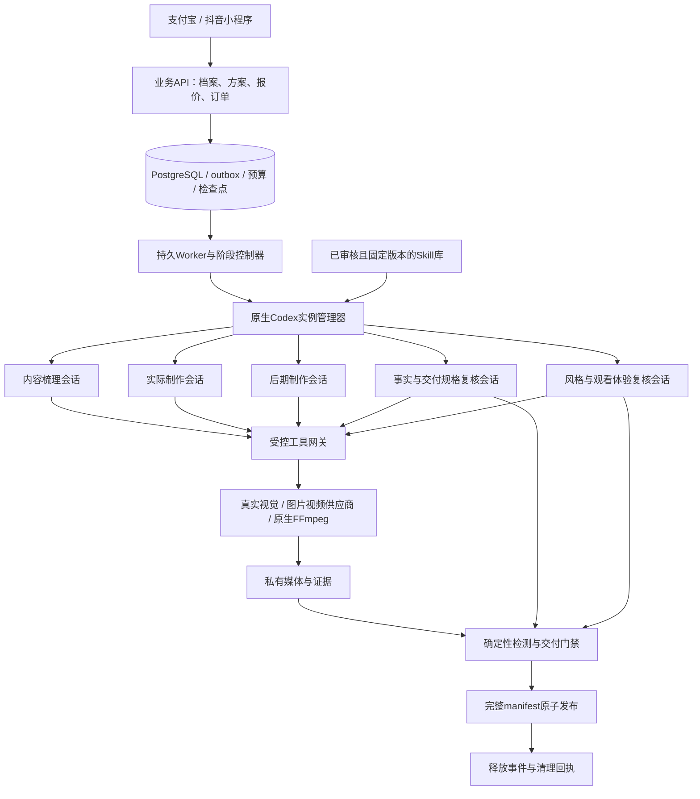

# 14 · Codex内核与分阶段编排

2026-10-30快速功能收口：[Plus独立图片正式制作与手机付款交付](../实施/Plus独立图片正式制作与手机付款交付-v1.0.md) · [准确证据](../verification/plus-render-source.json)。电脑保存图片编辑修订并经手机明确授权整理独立清单，冻结来源/裁切/尺寸/文案/风格/价格，再回原小程序确认费用并主动付款；CONTENT、制作、后期、QC、事实和风格独立复核后交付新 PNG 与文案。原素材与原订单权益保留，旧电脑连接不会自动获得制作权限。新增036迁移、4接口；518源码/36迁移/95业务38管理、296schema80实体、42契约/Skill槽位和4字体资源，仍为17个小程序页面。新权限/报价/付款/实际交付4项最终源码专项、类型/server/preview/本机启动和6浏览器检查通过；早期7项单元及首轮中7项工作台断言保留原源码差异，8次初始失败及类型诊断不改标。新增9媒体，总171，旧162媒体和方案C原件保持。付款/模型/审核结论/进程身份为合成；全面测试与宿主真机未执行，真实服务和销售关闭，完整产品/生产/云端false。Plus视频、字幕、批量和复杂作者工具、长期双平台身份绑定及完整验收仍待。

以下记录保留历史来源，当前状态以本轮说明与准确证据为准。

2026-10-30快速功能收口：新增[原生声音售前绑定与购买交付](../实施/原生声音售前完整绑定与购买交付-v1.0.md)，[准确来源](../verification/native-sale-source.json)。两生成声音路线以完整原合同接通新报价、下单、原付款确认及私有交付；能力撤回原单退款、费用总额合并，旧内部合同不升级。声音专项5、社区回归3通过/28未选，类型/server/preview及原生启动PASS，主库31无新迁移；不运行全面测试。支付/模型/授权/听音/身份/用量/OSS配置合成，实际文件使用本地测试适配。真实服务/真机/完整准入/资源与有声样例/Plus/云端仍待完成，所有方案禁售。

以下内容保留其历史来源，当前状态以上述记录为准。

2026-10-28｜开发设计v1.1，对应需求v3.1。用户确定内容梳理、实际制作、后期和预验收全部采用Codex。当前已有协议、Skill预热、受控推理/工具、PLAN及原图无声的PRODUCTION/POST/QC/独立双复核/DELIVER源码和夹具集成；原图流程已验证实际媒体与完整发布，但所有模型判断/隔离仍为明确替身。独立回收框架和冻结照片保留已有源码及故障测试；真实Codex、完整三路线、有限修复、生产进程树清理和部署尚未贯通。详见[源码进度](../实施/源码实现进度-v3.1.md)、[独立视觉复核与交付](../实施/独立视觉复核与原子交付接入-v1.0.md)和[独立回收](../实施/独立实例回收与冻结输入保留-v1.0.md)。

## 1. 采用结论与适用边界

采用官方Codex app-server作为服务端Agent内核，平台编写`CodexRuntimeAdapter`管理原生进程、协议、角色会话、Skill注入、事件、限额及回收。接入层使用stdio，不向小程序、社区作者或公网暴露app-server。SDK适合简单后台任务，本产品需要直接控制逐阶段生命周期，故以app-server为主线；`codex exec`只作为离线实验/诊断候选，不建立双套生产编排。

官方文档确认app-server提供thread/turn、事件、中断和Skill输入，SDK提供程序化会话操作。这些是接入能力依据，服务质量、商业可用性和本产品的隔离/成本仍须实测。[App-server](https://learn.chatgpt.com/docs/app-server)、[Codex SDK](https://learn.chatgpt.com/docs/codex-sdk)。

“实例”定义为一个订单执行尝试的隔离工作区、原生进程、受控凭证及若干角色会话；不表示购买或独占一份模型/GPU。模型、实际地域、组织账户、授权接入与额度在G0验证并锁定。商业服务默认评估平台项目的API凭证和成本归集，不复用开发者个人桌面登录态，不把个人订阅当可转售算力。[认证方式](https://learn.chatgpt.com/docs/auth)。

## 2. 服务结构

PostgreSQL继续是订单、租约、外部调用、预算与发布的真源。Codex有工具选择和诊断能力；执行结果只有经工具回执、文件哈希和独立检测核实后才能推进阶段。Agent的自然语言“完成”或RPC成功不直接改变履约状态。

## 3. 四阶段职责与工件

| 阶段 | Codex承担的工作 | 受控工具与输入 | 必需输出及推进条件 |
| --- | --- | --- | --- |
| CONTENT | 组织多模态证据、提取商品档案/未知、适配风格与用途、编排文案/分镜 | 原始照片、真实视觉服务、已审核预设、目标清单 | `content-brief`、商品锁、事实引用、逐帧计划；schema/证据/能力/预算校验通过才能报价 |
| PRODUCTION | 按冻结计划安排素材、参考帧、图片、逐镜或整片生成，检查返回结果并定位问题 | 仅本单已授权素材、固定模型适配器、参考帧QC、提交/查询原任务 | 原始媒体、参考映射、供应商回执、素材清单；关键帧不合格不提交付费视频 |
| POST | 检查原声、字幕、节奏、包装版式，形成并执行结构化后期计划 | 素材哈希、实际音轨/转写、受控排版及FFmpeg模板 | 成品候选、实际编码/音轨/帧数报告、文案；保护中文原声，不以生成的剪辑脚本充当成片 |
| PRE_ACCEPTANCE | 从原图/合同重新核对成片，分别复核事实/规格与风格/体验 | 封存的审查包、真实取帧/音轨、确定性报告，只读工具 | 两份独立审查报告及问题定位；交付控制器按硬门禁决定发布或有限修复 |

CONTENT同时包含付费前识别与方案规划。它必须调用支持图片的真实视觉能力；若Codex所选模型本身不满足视觉要求，通过工具调用已注册视觉服务，不用文字猜图。原图排版路线也使用四阶段：制作/后期可调用确定性工具，正常路径不无谓购买生成视频。

角色是平台调度的独立会话，首版顺序推进，两个复核可在固定并发额度内执行；不依赖Codex自主递归创建子Agent或把整个订单无限续聊。交叉复核分别启动受限app-server子进程并用`thread/start`创建新上下文，只读取封存包，不fork制作会话历史或访问制作工作目录。日常客户无需聊天、填表、写提示词或逐阶段审批。

## 4. 协议接入与适配

运行时锁定CLI构建/哈希及其生成协议类型。启动后做`initialize`/`initialized`握手，再执行Skill发现、`thread/start`、`turn/start`；每次turn附结构化`outputSchema`并使用服务端校验器验证输出。模型ID从经验证的可用目录选择后冻结，不在文档写假模型ID。

Skill采用`skills/list`核对受控目录，`turn/start`显式附`type: skill`与绝对路径；不靠仅列名称就认定全文已加载。工具采用平台自有MCP服务；`dynamicTools`为官方标注的实验接口，首版不把它设为必选。MCP启动失败、schema不匹配或出现未允许Skill立即阻断该阶段，不能在缺工具时假装执行。

事件适配处理item完成、turn终态、token用量、中断、连接丢失、模型路由变化和未知结果。模型路由若与合同不兼容须阻断/处置，不能静默接受。存最小业务事件和可验证结果，不收集/展示原始思维链。协议方法是否存在及字段大小写以锁定构建生成的schema为准；本地alpha CLI只能证明可读帮助，不能直接作为生产锁版。

## 5. 工具执行权与预算

工具网关每次调用独立校验租户、订单、执行代次、角色、阶段、输入哈希、允许模型/资源、预算预留和绝对截止。模型提供的订单ID、路径、费率和“已获授权”文字均不可信。工具只接受资产ID和结构化计划，不接受任意URL、SQL、FFmpeg命令或任意脚本。

平台API/供应商/支付密钥留在网关；Codex进程仅有该单、该阶段、短期的网关能力。Codex推理认证由受限运行代理/隔离服务账户管理；如兼容性要求进程获取项目凭证，单独记录暴露面、限额、出站白名单和G0准入，不能把“无任何密钥暴露”写成已实现事实。

Agent无权直接支付、退款、发布交付物、修改商品事实或预算、安装Skill、联网下载代码、操作浏览器及启动Docker/WSL。预先批准的订单内工具动作可自动完成；新增权限请求默认拒绝并进入可解释失败，不把后端审批弹窗抛给普通买家。

仅监听token用量事件并发送interrupt无法保证账单硬上限，已在途推理可能继续计费。G0必须验证推理出口也能在每次请求前按上下文/最大输出上界预留成本并限制请求，或有等效供应侧硬限额；预留包含在途与修复。若锁定接入不能满足，不能把软阈值当硬预算准入。生产工具网关与推理出口分别限额，断开进程不视为停止远端收费的证据。

付费前工具意图归属tenant＋preview成本域，不要求尚未存在的order_id；报价时冻结`CodexQuoteBinding`，付款后在原报价下复制为已售执行快照。付费后归属tenant＋order，二者不能同时为空或同时填写。推理/Agent工具预留与底层供应商预留通过原意图关联，同一付费动作只计一次；免费分析/本人预览成本由平台承担并受原额度/限流及单独成本上限约束，不能把免费成本隐性追加到已售单。

## 6. 不确定性与质量收益

Codex可用反馈纠正规划和工具参数，但“更优质”是待证假设。同一模型的不同会话仍有相关偏差。发布评测要与原固定流水线用同一批授权输入对照，记录整包通过率、事实缺陷漏检、误拒、人工介入、p95耗时、首次/修复成本和资源释放成功率；不能以Judge自评分上涨证明服务改善。

接入后的推理、Skill上下文、视觉、生成、后期与双复核成本都进入报价/成本快照。保留最多一轮修复及原硬截止，新增上下文/重启不重置额度。既有14变体×30次整包、独立识别与高危样本门槛继续有效，详见[实施验证](18-Codex接入验证与实施计划.md)。
