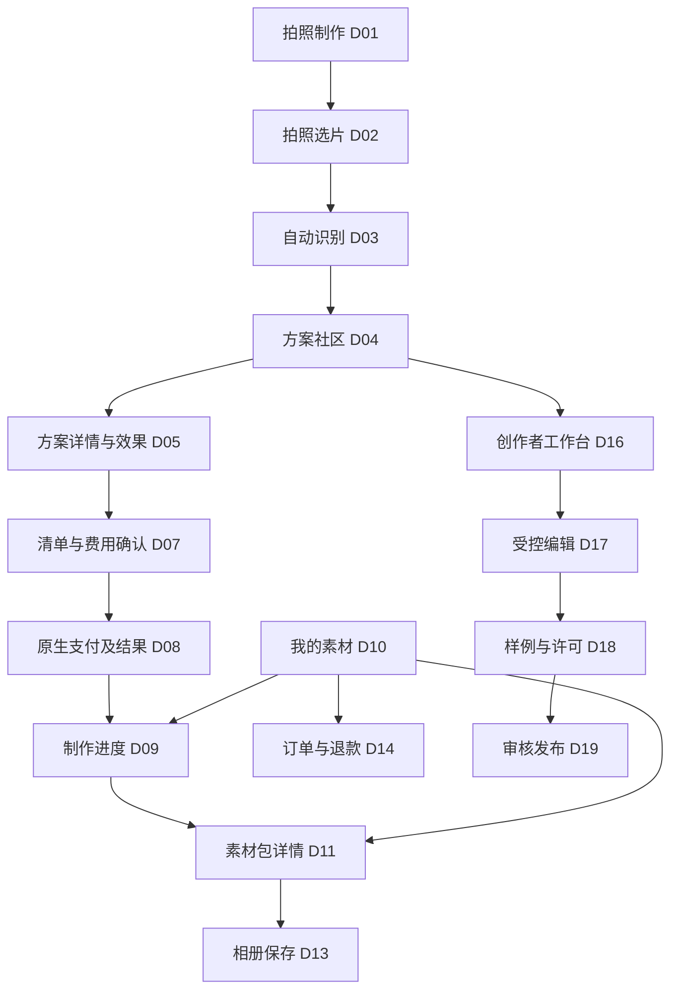

# 03 · 页面与导航定型

本版登记23个页面/交互单元，不等同于23个独立路由。D08可由原生支付返回后的状态页实现，D13/D20含弹层/动作页。平台路由及源码文件在技术实现时确定。详见[page-registry.json](../../../../assets/design/柚子创作社/v1.0/page-registry.json)。

## 1. 信息架构

根页固定三栏：拍照制作D01、方案社区D04、我的素材D10。D01支持继续未完成草稿；D04既支持先浏览后拍照，也支持识别后推荐；D10承载作品/订单、我的收藏、创作者入口和设置，不新增第四个“我的”底栏。

详情页不常驻根页底栏，使用宿主认可的返回；返回时保留来路、商品草稿和社区筛选。直接打开分享的方案详情时，提供明确“返回方案社区”。若需登录，在上传/持久草稿/订单/收藏等动作时进行，普通样例浏览不强制登录。



零费用且后端已允许的合同从D07确认直接进入制作，不能制造假支付步骤。付款结果未知停留D08查原订单；未验付不得进入制作。

## 2. 三个已有视觉参照

### D01 拍照制作首页

对应保存的C首页。原生顶部→一品成片→“拍下商品，成套出片”→“拍3–5张，自动识别商品与特点”→三张照片印样→`拍照做素材`→“试试这些方案”→三栏导航。首次印样标示例；已有草稿显示继续入口但不抢主行动。无必填表、聊天框或剪辑入口。

```text
原生顶部 / 一品成片
拍下商品，成套出片
拍3–5张，自动识别商品与特点
[整体印样] [角度印样] [细节印样]
[         拍照做素材          ]
试试这些方案  → 更多方案
[拍照制作] [方案社区] [我的素材]
```

### D04 方案社区

对应保存的C社区页。已有商品显示识别摘要/纠错；未拍照显示“先看看方案，拍照后为你匹配”，不假装识别完成。推荐/官方/社区→风格筛选→单列横向作品卡→当前选项的`用这个方案`，底部为社区选中。

卡片左样例、右信息和产出小缩略图，优先比较方案。作者名为实际公开署名；“夏日快闪”等设计稿示例不是自动上线的新官方方案。官方入口必须能浏览既定10套，不能只保留图里3套。

### D11 素材包详情

对应保存的C领取页，是我的素材下的详情。薄荷轻标题带→方案/效果/交付摘要→完整视频预览→图片清单→文案复制→固定`保存整套素材`，另有只存图片/视频和单项保存。页面可滚动，完整视频不能为了同屏排版而裁成方形。

根页D10与详情D11区分：D10没有假返回；D11保留正确返回。素材包名称、数量、时长、领取期限来自该订单，不固定清新日常或4图。

## 3. 全量页面规格

下表“关键状态”均是需实现的设计规格，不代表已经开发。20个非参照单元后续逐页出高保真稿时，沿用C的布局/组件，不重新选风格。

| ID | 单元/层级 | 固定结构与数据 | 主行动及转移 | 关键状态 |
| --- | --- | --- | --- | --- |
| D01 | 拍照首页/根页 | 品牌、短标题、三印样、示例方案、草稿入口 | 拍照做素材→D02 | 首次、草稿、恢复中、离线 |
| D02 | 拍照与选片/详情 | 3–5照片格、整体/角度/细节指引、逐项上传/移除 | 识别并选方案→D03 | 待拍、上传、照片不合格、部分失败、权限拒绝 |
| D03 | 自动识别/详情 | 当前照片、真实分析状态、轻摘要、必要补拍 | 完成后进D04；失败重试 | 分析中、完成、类别宽泛、多商品冲突、服务失败 |
| D04 | 方案社区/根页 | 商品摘要或先拍提示、来源/风格筛选、作品卡、收藏 | 看详情→D05；选用后进D05/D07 | 无商品、匹配、筛选空、无适配、停售、分页失败 |
| D05 | 方案详情/详情 | 样例、作者/许可、风格节奏、效果选择、完整清单、声音/AI、输入和报价摘要 | 用这个方案→D07；缺输入→D02 | 可做、缺照、不同变体、未开放、下架 |
| D06 | 可选识别纠错/详情或短弹层 | 原图证据、当前名称/可见特征、补拍或选候选；允许可选简短说明 | 保存修正并重新匹配→D04 | 未改、候选、补拍、更新中、失败；从不强制整表 |
| D07 | 内容与费用确认/详情 | 商品、方案/版本/效果、图片文案清单、AI/声音、总额、报价有效期、预计及硬截止、失败退款摘要 | 确认并支付→D08；合法免费确认→D09 | 规划、有效、过期、资料改变、不可售 |
| D08 | 支付返回与核验/状态页 | 原订单、真实付款状态、金额、查单入口 | 查看制作→D09；未知查询原单 | 待付、取消、验付中、结果未知、已确认、退款 |
| D09 | 云端制作/详情 | 商品/方案、真实阶段、预计区间、截止、离页说明、订单/帮助 | 查看素材→D11；失败查看退款→D14 | 排队、生成、后期、验收、修复、交付、失败 |
| D10 | 我的素材/根页 | 草稿/制作中/已完成/订单分组、作品卡；菜单含收藏、创作者、设置 | 查看/继续对应作品 | 未登录、空、加载、分页失败、处理中、到期 |
| D11 | 素材包详情/详情 | 真实清单、视频、图片、文案、AI说明、领取期限、售后入口 | 保存整套素材→D13 | 已交付、部分保存、保存未知、到期、退款受限 |
| D12 | 单项完整预览/沉浸详情 | 完整媒体、实际时长/声音、用途、AI标识、单项保存 | 保存单项→D13 | 加载、播放/暂停、失败、签名链接到期 |
| D13 | 保存队列/弹层或详情 | 媒体总数、逐项下载/保存状态、成功计数、未知说明 | 继续保存未完成项；明确再存一份 | 拒权、下载失效、空间不足、前后台暂停、部分完成、未知 |
| D14 | 订单、取消与退款/详情 | 原渠道订单、服务/实付、冻结清单、交易和退款状态、问题入口 | 当前合法动作：付款/查询/取消/退款详情 | 取消竞态、退款申请、处理中、到账、失败待查 |
| D15 | 帮助与问题反馈/详情 | 按拍照/识别/制作/保存/退款分类、关联订单、可选附件授权 | 按问题恢复或提交工单 | 自助、待提交、提交中、跟进；不强制传全部原图 |
| D16 | 创作者工作台/详情 | 我的预设、草稿/待审/已发/退回状态、基础创建说明 | 创建预设→D17 | 空、草稿、审核中、已发布、暂停 |
| D17 | 基础预设编辑/详情 | 安全组件、风格节奏、输出槽位、变体、输入条件、预览 | 继续样例与许可→D18 | 不完整、有效、预览中、能力不可用；无任意代码 |
| D18 | 自有样例与许可/详情 | 样例、使用权说明、资源来源、允许派生、署名/来源链、输入校验 | 提交审核→D19 | 缺样例、缺许可、校验失败、可提交 |
| D19 | 审核与发布状态/详情 | 版本、提交清单、真实审核状态、驳回项、修改入口 | 修改重提或查看已发布版本→D20 | 草稿、待审、退回、发布、暂停 |
| D20 | 预设版本与派生/详情或动作页 | 当前公开版本、许可/作者、来源链、更新影响、合法派生 | 允许时派生→D17；查看公开详情 | 可派生、禁止派生、新版、下架、旧单保留 |
| D21 | 举报、下架与申诉/详情或弹层 | 目标方案/版本、可理解原因、证据范围、真实处理记录 | 提交举报/申诉 | 待填、提交、受理、结果；不暴露其他用户数据 |
| D22 | 账户与隐私设置/详情 | 当前平台身份、权限说明、数据处理/删除、帮助；绑定/Plus标后续 | 查看当前设置或确认合法删除 | 未登录、会话过期、删除处理中、完成、受限说明 |
| D23 | 交付后受限修改/详情 | 允许的封面/顺序/显示文字、48小时窗口与次数、平台问题纠错入口 | 提交允许的小修改或问题纠错 | 可改、已用、到期、范围外、处理中、失败 |

## 4. 返回与连续性

拍照取消回D02保留有效照片；识别纠错后刷新草稿档案、适配结果和报价，不改旧已购订单。社区→详情→返回保留筛选与滚动；先选方案再拍照，识别完成后回该方案的适配判断。

支付未知只查询原订单，不能用第二个收费按钮绕过。生成退出后从D10恢复D09；本地保存离页可能暂停，回D13读取逐项确认状态而非重新生成。样例浏览和普通素材制作不需要进入创作者流程。

## 5. 有限扩展

网页Plus、跨端主动绑定、多语言、A/B开头为P1；条件化高级方案、授权外部发布为P2。可以在未来复用本主题，但不得以禁用按钮堆满当前小程序，或将评论、关注、消息、榜单、模板提现等当成已确定P0。
