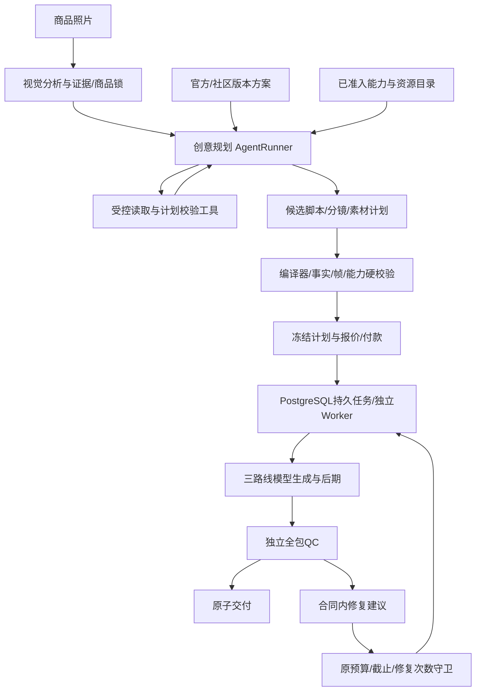

# 一品成片：内容生产主体与 Agent 内核评估

> 历史评估，方向已被v3.1取代：用户已要求Codex贯穿四阶段。下文的上游代码事实仍作为证据，AI SDK Core/仅创意节点建议不再是当前方案。当前见[Codex服务设计](../开发/14-Codex内核与分阶段编排.md)。

2026-10-27｜基于当前工作区、需求v3.0、开发设计v1.0及上游固定提交。本文回答“由谁完成内容梳理和制作、目前是否接了Agent内核、推荐怎样接”。属于架构评估与建议，不表示安装SDK或实现服务，也不改变C视觉/已定P0范围。结构化证据见[核查记录](../../assets/research/agent-kernel/assessment-20261027.json)。

## 1. 当前结论

| 核查对象 | 当前事实 | 意义 |
| --- | --- | --- |
| 一品成片应用代码 | src下没有应用源文件，只有既定目录 | 没有真实运行的内容后端，也没有实际Agent内核接入 |
| 一品成片开发设计 | 明确了LLM识别、脚本/帧计划编译、Worker、三产线、后期/QC和持久恢复 | 当前属于模型调用与业务工作流设计，Agent的运行协议尚未定型 |
| 上游脚本/识别 | generator.ts直接调用chat.completions，解析JSON并有限纠正 | 真实存在LLM调用代码；不能仅由此称为完整通用Agent运行时 |
| 上游“五位判官” | script-judge.ts定义五个审稿维度；对应路由一次LLM调用生成多维报告，可做格式纠正 | 是多角色提示与审稿机制，不能计作五个独立Agent服务或五份独立真值 |
| 上游MCP | mcp脚本注册工具列表/调用处理器，映射到HTTP API | 可供外部Agent调用；MCP工具服务与内置Agent决策循环分属不同职责 |

上一版文档已经回答“流水线怎样执行”，但没有明确AgentRunner、工具白名单、上下文/检查点和推理循环如何归属。对外应准确表述为：**已规划AI内容生产流水线，Agent内核尚未接入；建议在创意规划环节补充受控Agent能力。**

## 2. 内容的主题与负责主体

内容始终围绕**当前照片中有证据的这一件商品，按用户选定方案完成一整套可用营销素材**。商品事实、包装/数量/结构和声音合同是约束；方案决定叙事、风格、节奏和清单。不能因为代理“觉得这样更好”变更SKU、虚构功效/价格或改掉用户所选效果。

负责主体是自建的**云端内容生产引擎**，部署在独立Worker中，内部按理解、规划、生产、后期和验收划分责任。数据库/队列负责持久执行，具体模型与媒体工具完成对应的计算。

| 阶段 | 负责模块/能力 | 输入 → 产物 | Agent参与方式 |
| --- | --- | --- | --- |
| 商品理解 | analysis＋多模态LLM＋证据校验 | 3—5张照片 → ProductProfile/IdentityLock | 可先用固定结构化视觉调用，必须真实分析；无需为了命名Agent增加循环 |
| 内容梳理 | compiler中的创意规划器 | 档案/锁＋方案/变体＋能力/资源 → CreativeBrief、脚本、分镜、素材计划 | 最适合接有工具调用能力的规划Agent |
| 合同编译 | 编译器＋版本/能力/事实/帧校验 | 候选计划 → READY Plan、plan_hash、报价/执行快照 | 服务端程序判定；模型建议不直接成为有效合同 |
| 素材生产 | references＋三路线renderers＋模型适配器 | 已冻结快照 → 图片/关键帧/逐镜视频/原生整片 | 持久Worker执行受理计划；图像/视频模型实际生成媒体 |
| 后期 | post-production＋FFmpeg/声音/字幕模块 | 已生成素材 → 字幕、配乐闪避、商品卡、封面、正式编码 | 用受控参数计划驱动真实工具执行 |
| 质检/有限修复 | 独立QC规则/视觉音频检测＋修复规划器 | 全包/缺陷证据 → PASS/BLOCK或有界修复建议 | Agent可解释缺陷、提局部建议；最终放行与预算由程序守卫 |
| 交付 | lifecycle＋订单事务＋私有存储 | 全槽位QC通过 → 不可变manifest与领取权益 | 后端原子交付，不由Agent自由发链接/改付款状态 |

“AI负责梳理”和“AI直接制作”不是同一层能力：文本/多模态模型负责理解和计划，图像/视频模型产出媒体，FFmpeg等执行后期，业务程序保证交易与交付。买家继续只拍照、选方案、确认付款和保存；不增加聊天、填商品表、审脚本或调模型的关卡。

## 3. 上游事实与复用边界

- [商品/脚本生成器](https://github.com/copypasteltd/one-tap-ads/blob/1aab133dd75f4db57c3f62e6da2fdd121c5d509b/src/lib/script-engine/generator.ts)：338行附近generateScript构建提示并调用completeWithJsonRetry；297行附近的辅助函数最多两次格式解析尝试；546行附近analyzeProduct直接发送图片给视觉模型。
- [审稿维度](https://github.com/copypasteltd/one-tap-ads/blob/1aab133dd75f4db57c3f62e6da2fdd121c5d509b/src/lib/script-judge.ts)：2行附近说明五个维度在一次LLM调用中完成；[审稿路由](https://github.com/copypasteltd/one-tap-ads/blob/1aab133dd75f4db57c3f62e6da2fdd121c5d509b/src/app/api/project/[id]/script-judge/route.ts)66行附近执行该调用。旧注释有“四位”的遗留，实际维度常量为五项。
- [MCP服务](https://github.com/copypasteltd/one-tap-ads/blob/1aab133dd75f4db57c3f62e6da2fdd121c5d509b/mcp/clipforge-mcp.mjs)：704行附近handleCreateVideo依次调脚本、审稿和合成；1420行附近注册tools/list及tools/call处理器，由外部客户端选择工具。
- [依赖声明](https://github.com/copypasteltd/one-tap-ads/blob/1aab133dd75f4db57c3f62e6da2fdd121c5d509b/package.json)含openai客户端与MCP SDK；已核查的核心链路未见模型自主tool_calls循环。该结论限定于固定提交和本次核查范围，依赖缺失本身不能排除所有自研代理实现。

可以借鉴配方展开、人物/Look/运镜约束、脚本审稿与生成提示。云服务必须自行建设租户隔离、持久任务、合同/预算与恢复。上游MCP的审稿是best-effort，异常可跳过；本项目真实视觉、商品锁和关键QC不能沿用静默跳过策略。上游SDK网络重试与格式纠正也不能直接当成本项目整单修复政策。

## 4. 推荐架构：业务工作流内嵌受控创意Agent

AgentRunner只管理一个受控认知任务：给定上下文，允许有限工具调用，最后产出结构化候选计划/修复建议。任务的领取、版本、账务、媒体副作用、并发预算和发布仍由原业务工作流管理。

先明确三种逻辑角色：商品理解、创意规划、质量审查。它们可以是不同节点/提示和调用策略，不要求启动三个独立服务或引入Agent群聊。创意质量反馈与独立商品/声音/规格QC各有证据，生成器自评不直接放行。

## 5. Agent内核候选与选择建议

2026-10-27查阅官方资料，未安装或实跑这些框架。

| 候选 | 官方能力依据 | 本项目判断 |
| --- | --- | --- |
| AI SDK Core的ToolLoopAgent | 工具调用循环、显式停止条件和逐步工具/设置控制 | 首选做局部AgentRunner实验，集成现有TypeScript Worker；业务持久层继续采用原PostgreSQL合同 |
| LangGraph JavaScript | 可混合确定性与Agent节点，提供状态持久化和长任务编排能力 | 当认知部分本身需要复杂分支、长时间挂起/人工续跑时重点评估；明确图检查点与业务状态各自所有权 |
| Mastra | Agent、工具、结构化输出及与工作流组合 | 若需要更完整Agent应用框架可评估；与现有API/存储/观测模块做集成成本对照 |

上述选型优先级是本项目架构判断，尚无实测性能/成本排名。官方依据：[AI SDK Agent](https://ai-sdk.dev/docs/agents/overview)、[循环控制](https://ai-sdk.dev/docs/agents/loop-control)、[LangGraph JS](https://docs.langchain.com/oss/javascript/langgraph/overview)、[Mastra Agent](https://mastra.ai/docs/agents/overview)。

AI SDK有[OpenAI兼容适配器](https://ai-sdk.dev/providers/openai-compatible-providers)，但“兼容文本请求”不能证明某模型支持工具选择、图片、严格结构化输出或正确返回usage。实际模型需分别验证这些能力。服务端显式配置获准provider/model对象，不因示例模型字符串而默认经过第三方网关；密钥与访问目标沿现有准入政策处理。

本轮建议新增ADR-11的评估项，而不是将某SDK标记为已采用：**保留AgentRunner业务接口，首选AI SDK Core适配实验，G0完成后锁确切版本与模型能力。** 使用该库不要求小程序变成对话产品，也不意味着部署到其云平台。

## 6. AgentRunner需补齐的设计合同

建议后续目录为`src/worker/agents/`，分runtime适配、只读tools、policies、context与角色定义；这是拟建路径，当前未建立功能代码。

| 合同部分 | 必须明确的内容 |
| --- | --- |
| 输入 | task_id、phase、产品/档案/锁/预设变体版本、上下文哈希、允许工具、模型/提示/政策版本；租户与权限由后端绑定 |
| 输出 | CreativeBrief/ScriptPlan/ShotPlan/ArtifactPlan或RepairProposal；每句事实的证据、镜头帧、资源/声音要求、阻断原因，均需schema校验 |
| 上下文 | 单租户/单商品/当前版本范围，最小必要图像与证据；社区文本视为创意输入，不能提升工具权限 |
| 运行记录 | run_id、阶段、step、调用/结果摘要或私有引用、usage/成本、终止原因；不记录隐含思维链或把私图/完整提示上传默认外部追踪 |
| 恢复 | 持久保存已确认的输入/工具调用意图与结果，按输入/版本复用；SDK重启不直接重新产生外部付费副作用 |
| 终止 | 最大模型决策步、工具调用数、token/费用、时间上限及成功/阻断判定；SDK默认值不能代替本项目政策 |
| 变更 | 报价前可在事实/所选变体/准入目录内细化；付款后禁止改实际模型/声音/路线/清单，修复只能提符合原合同的局部建议 |

工具起步清单：read_product_profile、read_identity_lock、read_preset_version、list_admitted_capabilities、list_licensed_resources、validate_fact_refs、validate_timeline、validate_reference_plan、validate_output_contract。Agent只拿当前主体/任务范围的数据，服务端不信任它传入的tenant_id或资源归属。

模型最终文本与每次工具参数都重新校验。服务端受信schema是源，投影成模型实际支持的工具schema子集，再用本项目JSON Schema2020-12/语义规则校验返回；不能让作者上传可执行schema或任意工具代码。

付费生成、任意URL/文件读写、shell、支付/退款、跨租户查询和公开发布不列入创意Agent的自由工具。媒体调用由已冻结阶段通过受控适配器执行；Agent的修复提议通过后才能入原任务队列，不直接调用模型多买一次。

## 7. 成本、循环与回退

首轮G0可测试创意规划最多4个模型决策步、8次只读/校验工具调用的候选配置；这是实验值，不是当前默认/SLA。一次视觉分析的初始＋一次重试、Agent决策步、媒体整单最多一轮修复分别计数，不相互套娃扩大调用量。

每次模型请求前预留预算并检查剩余时限，设置可用输出token与超时；SDK隐式重试关闭或纳入统一调用/成本计数。停止条件通常在一次模型响应后才判断，必须同时有调用前守卫，不能只靠step计数保证硬预算。生成阶段UNKNOWN先查原意图，Agent不获准重新购买。

工具/结构输出不支持时，记录能力限制，可以在同一档案/方案合同内用经过验证的固定提示/确定规则生成计划；不能静默跳过真实视觉、改原生人物效果为照片卡片或换已售模型。若该方案依赖的计划能力不足，在收费前阻断。正常订单仍不引入用户填表/逐项审稿或人工代做。

## 8. 如何验证采用价值

| G0实验 | 必须证明什么 |
| --- | --- |
| 同输入对照 | 固定LLM工作流与受控Agent使用同一授权照片/档案/变体，比较事实正确、脚本可拍、帧计划通过、独立商品/声音QC、整包成功及p95/成本 |
| 工具能力 | 至少真实走通“读取方案/能力→校验→根据缺陷修订→结构化结束”，验证实际端点的tool call/usage/中止行为 |
| 权限/输入 | 图中文字/作者配置不能改系统政策，读不到其他买家资料，模型伪造价格/模型/工具参数会被拒绝 |
| 有界运行 | 循环、超时、格式错误、并发和Worker重启不扩大预算/次数；不靠SDK停止标记假装事务成功 |
| 合同保持 | 付款后模型/声音/路线/清单哈希保持，修复不延原截止、不重复付费，QC不过不交付 |

验证尚未执行，不为Agent架构承诺提高成功率或缩短工期。根据对照证据决定采用范围；不论是否采用某SDK，原v3要求的14变体/≥420次整包、独立识别/高危质量评测与四组真机门槛均保留。

## 9. 对当前实施计划的影响

在V3-01加入工具调用/结构化输出/usage/恢复兼容实验；V3-02明确Agent任务/工具IO/结果schema；V3-03落实创意AgentRunner和事实/帧编译边界；V3-12做独立QC与修复提议隔离；V3-11/16负责持久化、成本和追踪。无需改变已有API/数据库/双小程序总体方向。

本次只完成核查与建议，未修改销售开关、生产模型、运行依赖或C留存。现阶段适合向团队描述为：**方案驱动的云端内容工厂，计划引入受控创意Agent，实际生产由持久Worker和专业模型/媒体工具执行。**
