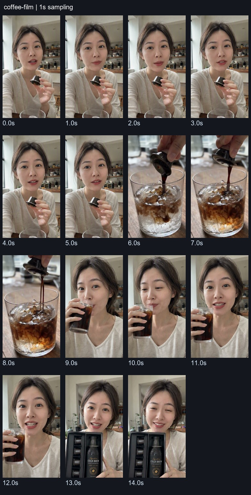
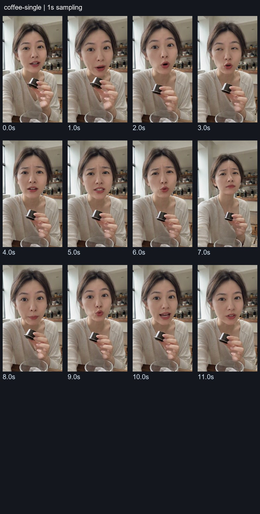
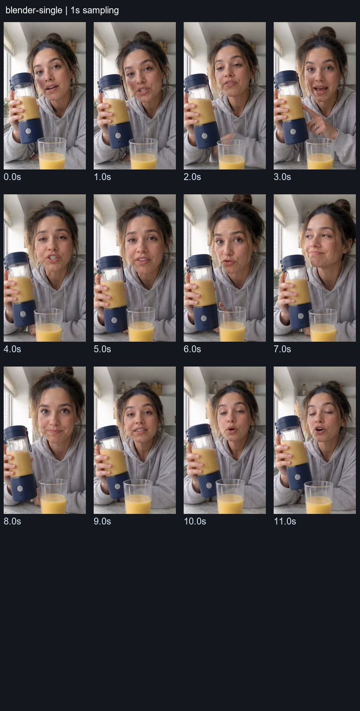
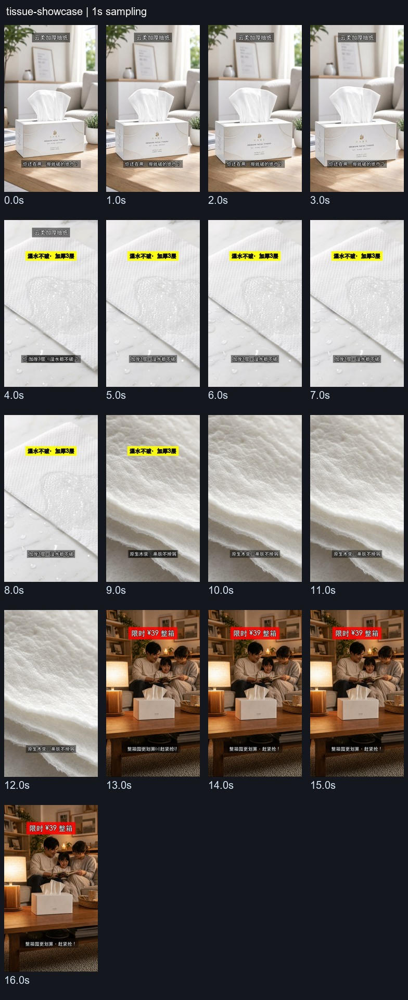

# one-tap-ads：方案案例、具体内容与生成流程深析

2026-10-27｜固定提交 `1aab133dd75f4db57c3f62e6da2fdd121c5d509b`。本轮重点检查仓库方案本身，为后续云端生成服务和双小程序封装提供蓝本。源代码、配方、示例与演示视频均保留上游ClipForge/xixihhhh署名；没有调用模型重新生成这些案例，没有把配置数量计作已验证成片数量。

完整数据已提取为 [391条逐项目录](one-tap-ads全量方案目录-2026-10-27.md)、[完整JSON](../../assets/research/one-tap-ads/方案完整目录-1aab133.json)、[CSV筛选表](../../assets/research/one-tap-ads/方案筛选目录-1aab133.csv)。后续封装方案见 [云端服务与小程序设计](../实施/方案驱动的云端服务与小程序封装-2026-10-27.md)。

## 1. 核心判断

该仓库最值得借鉴的是把广告创作方法包装为一份可选择的“成片配方”：脚本怎么说、以什么画面形态呈现、镜头如何运动、光线色调如何统一、字幕和配乐如何合成。后续小程序可以直接让用户选这种成片效果，后台自动完成脚本、人物/商品参考、素材生成和合成。

其中既有实拍图片驱动的展示，也有AI人物口播、生成场景、剧情和创意特效。本轮全部纳入蓝本调查；不能仅用静态照片剪辑解释仓库的案例价值。另一方面，配方仍是创作意图与参数组合，需要云端进一步编译成有模型、预算、输入和输出约定的可履约服务。

后续用户已要求将研究融入主需求，当前为v3.0：保留官方10套/社区/双端，并将三路线、四类生成式变体纳入P0，见 [PRD](../01-产品需求PRD.md) 与 [变体规格](../设计/方案组件与执行变体规格-v3.0.md)。本报告的源码/案例观察仍固定于原提交，不代表新增能力已经实现或重跑模型。

## 2. 方案系统的真实层次与数量

| 层次 | 实际内容 | 数量及说明 |
| --- | --- | --- |
| 成片配方AdTemplate | 名称、适用类目、脚本风格、画面形态、Look、按镜头角色的运镜、合成、创意要求 | 391条，用户选择方案时最值得直接参考的层 |
| 浏览分组 | 商品展示、真人讲解、剧情叙事、生活种草、促销转化、创意视觉 | 6组；是目录分类，不是6种独立执行引擎 |
| 视频形态 | 商品特写、图文混剪、场景演示、人物出镜 | 4种，决定素材与人物策略 |
| 脚本风格 | 痛点、场景、比较、故事、短剧、反转、采访、开箱、物品拟人、口播 | 10种；原始ID在不同层有别名，服务端需统一 |
| 类目参考脚本 | 美妆4、食品5、家居4、服饰4、数码5 | 22套，有分镜角色/时长/台词示例；默认生成逻辑取该类目第一套参考，非全部自动最优匹配 |
| 运镜预设 | 推拉、环绕、跟随、升降、手持、特殊技法 | 实际22个，是提示词句子；不是22种确定性视频算法 |
| Look预设 | 灯光、背景、色彩、景深，部分带手机视角开场 | 实际14个；391条内置配方只引用其中8个styled Look |
| 字幕 | standard、bold、minimal、karaoke | 4种 |
| 合成风格包 | 带货重击、卡拉OK爆款、纪实极简、标准通用 | 4套，仅合成层；不等于391条成片配方 |
| 人物预设 | 邻家姐姐、通勤上班族、大学生妹妹、实在宝妈、理工直男、实在大叔 | 6套外观/口吻设定，不是6位已授权真实代言人 |
| 产线档位 | rapid、balanced、cinematic | 3档，调分辨率/单镜时长/运动/链式参考，不是成片方案本身 |
| 引导示例 | 示例商品、参考脚本、纸巾展示页 | 3商品、3参考脚本、1展示条目；另有3条docs演示视频 |

源码：[配方类型](https://github.com/copypasteltd/one-tap-ads/blob/1aab133dd75f4db57c3f62e6da2fdd121c5d509b/src/lib/ad-templates.ts#L44)、[类目库](https://github.com/copypasteltd/one-tap-ads/blob/1aab133dd75f4db57c3f62e6da2fdd121c5d509b/src/lib/script-engine/templates/index.ts)、[人物库](https://github.com/copypasteltd/one-tap-ads/blob/1aab133dd75f4db57c3f62e6da2fdd121c5d509b/src/lib/presenters.ts)、[产线档位](https://github.com/copypasteltd/one-tap-ads/blob/1aab133dd75f4db57c3f62e6da2fdd121c5d509b/src/lib/production-profiles.ts)。

仓库的 `docs/templates.html` 仍有18运镜/8 Look的介绍，已落后于本次源码。以上数量由实际导出计算，不照抄宣传页。

### 2.1 六大方案组与四种画面形态

| 方案组 | 条数 | 典型成片内容 |
| --- | --- | --- |
| 商品展示 | 66 | 转台、微距、试色、食物近景、科技结构、真实测试 |
| 真人讲解 | 95 | 单人口播、答疑、价格解释、知识讲解、采访/对谈 |
| 剧情叙事 | 69 | 反转、送礼、日记、办公室/家庭故事、产地溯源 |
| 生活种草 | 69 | 日常流程、厨房/工位/穿搭、沉浸、ASMR、探店 |
| 促销转化 | 34 | 快闪、比价、套餐、预售、上新、直播预告 |
| 创意视觉 | 58 | 巨物、悬浮、变形、粒子、匹配剪辑、虚拟试衣、白底生景 |

按底层videoMode计算：商品特写77、场景演示174、人物出镜116、图文混剪24。浏览组与底层形态不一一对应，例如“真人讲解”目录里也有商品特写配方，不能仅按分组决定是否必须生成人脸。

去掉名称/适用品类/创意要求，只比较规范化键顺序后的脚本风格、形态、Look、运镜、合成配置，有385组执行参数；有6对参数相同但创意要求不同，加入scriptHint后391条均不同。这说明叙事创意是重要差异，不能把每条都理解为一套独有渲染程序。

## 3. 一条配方到底怎样生效

以“转台大片”为例：

```json
{
  "id": "turntable_hero",
  "styleType": "pain-point",
  "videoMode": "product_closeup",
  "look": "studio_product",
  "cameraPlan": {
    "hook": "crash_push",
    "product_reveal": "lazy_susan",
    "demo": "macro_glide",
    "cta": "hero_rise"
  },
  "compose": {
    "captionPreset": "bold",
    "bgm": "upbeat",
    "bgmDuck": true,
    "quality": "hd",
    "productCard": true
  }
}
```

具体作用是：急速推近负责开头抓眼，转台负责商品亮相，微距滑移展示细节，升起的英雄镜头收尾；统一影棚光线/深色渐变背景；合成阶段用粗字幕、欢快配乐、旁白时压低音乐和商品卡。`quality:hd`是合成质量档，不能直接等同于某生成模型的原生1080p承诺。

源码中的交接链路如下：

1. 选方案，前端预填 `styleType/videoMode`；建项目时将Look写入设置、配方写入该项目的localStorage。
2. `adTemplateScriptDirective` 将scriptHint、Look生图描述、各镜头角色的运镜句子展开为LLM额外要求。
3. 脚本生成器同时接收类目示例、风格要求、视频形态、目标时长和商品信息，产出shots及描述/台词/素材来源/运镜。
4. 素材页根据当前Look追加生图提示与运动光线锚点，按镜生成或选择素材。
5. 进入视频页时，从localStorage读方案，用StylePack路径应用compose一次；之后手动调整不被重复覆盖。

参考：[新建时交接](https://github.com/copypasteltd/one-tap-ads/blob/1aab133dd75f4db57c3f62e6da2fdd121c5d509b/src/app/project/new/page.tsx#L539)、[脚本指令展开](https://github.com/copypasteltd/one-tap-ads/blob/1aab133dd75f4db57c3f62e6da2fdd121c5d509b/src/lib/ad-templates.ts#L5725)、[素材页Look](https://github.com/copypasteltd/one-tap-ads/blob/1aab133dd75f4db57c3f62e6da2fdd121c5d509b/src/app/project/%5Bid%5D/assets/page.tsx#L760)、[合成预填](https://github.com/copypasteltd/one-tap-ads/blob/1aab133dd75f4db57c3f62e6da2fdd121c5d509b/src/app/project/%5Bid%5D/video/page.tsx#L311)。

云端需要将这条依赖浏览器设置的链路搬为一个不可变RecipeSnapshot，并统一交给服务端执行；否则不同项目/设备的当前设置可能影响同一个已售方案。

## 4. 实际案例：检查到了什么

本次使用本机FFmpeg、`ai-shortcut-video-breakdown`技能做固定时间窗抽帧，再每秒取样制作联系表并目视对照。固定时间窗不是镜头切点检测；以下时间段是按画面观察的近似范围。音频只核验流存在，没有做ASR、逐字台词或音画同步的定量验证。

### 4.1 冷萃咖啡多镜广告：最值得参考的生成服务蓝本

本地文件 `docs/videos/demo-coffee-film.mp4`：15.072秒、720×1280、24fps、H.264＋AAC，约1.66MB。README将其描述为商品图→九宫格→一次生成四镜整片；本次确认文件、输入图、九宫格和以下画面存在，未重新执行模型验证“一次成功/无人修片”的制作过程。

| 近似范围 | 可见内容 | 对应广告功能 |
| --- | --- | --- |
| 0–约6秒 | 女性在厨房对镜讲解、手持小杯装咖啡液 | 人设/口播钩子、商品入画 |
| 约6–9秒 | 小杯装咖啡液倒入冰水，液体混合特写 | 动作演示、感官细节 |
| 约9–13秒 | 同一女性举杯、饮用、继续讲话 | 体验式叙事与人物延续 |
| 约13–15秒 | 同一人物手持黑色盒装商品收尾 | 商品亮相与结束引导 |



它的服务价值是让没有演员/拍摄/剪辑团队的商家获得一条有角色、动作和连续叙事的广告。后台可将“脚本→统一关键帧→原生多镜/语音→合成”封装，买家只选效果。

**重要的商品形态偏差：** 仓库输入图是单瓶装冷萃；九宫格和成片中出现小杯/胶囊装以及礼盒。它们不是同一种包装形态，不能把这条演示当作严格SKU保真的证明。生成文案不能据此推导商家真的有胶囊装或礼盒。


后续云端应先形成ProductIdentityLock：商品本体/容器形状、瓶盖/按钮/提手等关键结构、主色、商标文字、包装单位和附件。关键帧阶段先检查，视频阶段再检查；瓶装变杯装必须失败/有限重试，不能靠画面好看放行。

演示九宫格文件本身为720×1280，切成9格后参考细节有限；这可能是用于展示的压缩文件，不能据此断言所有原始生图仅有该分辨率。云端应单独规定参考帧的最低细节质量。

### 4.2 冷萃咖啡单镜口播：低镜头复杂度的AI讲解服务

`demo-coffee.mp4`：12.064秒、720×1278、24fps、H.264＋AAC。取样中基本保持同一厨房、同一女性、同一机位，人物用表情/嘴部/手势变化讲解。适合抽象为“AI讲解单镜”服务：脚本一句结论＋2–3项有依据特点，固定人物和机位，生成一段，再加可控字幕/封面。

它与多镜咖啡共享商品/人物视觉，不计作另一个独立品类验证；包装形态问题同样需要处理。人物为AI演绎时不能声称真实消费者已购买/长期使用。



### 4.3 英文榨汁杯口播：语言变体与海外版式的蓝本

`demo-blender-en.mp4`：12.064秒、718×1282、24fps、H.264＋AAC。画面为厨房内人物手持蓝底透明杯体的榨汁杯，桌面有果汁，机位稳定、自然窗光。相较咖啡，它更接近输入图的商品主体形式，但本次没有做商标小字逐帧精确比对。

可形成“同一商品/同一方案的中文或英文讲解”服务。语言影响台词长度、说话速度、字幕断行和字体，不能只翻译文字而沿用中文语速预算；生成模型是否支持对应语音仍须逐模型实测。输入图里刀头/电池/功率等不可见性能不能凭人物台词补造。



### 4.4 纸巾展示片：图片排版/动效和字幕的蓝本

`public/examples/sample-tissue.mp4`：17秒、720×1280、30fps、H.264，**无音频流**。画面依次为客厅盒装纸巾、纸巾水珠细节、纹理近景、家庭场景，带商品名、黄色卖点字和收尾价格。

这是可参考的四段商品展示：4秒钩子、5秒展示、4秒细节、4秒收尾。源码展示对象写 `resolution:1080p`，实际文件是720p；shots有voiceover文案，视频却没有音轨。因此，示例对象是展示文案和结构，不能直接当真实交付规格。

其中“湿水不破”“原生木浆”“限时39”等属于演示内容，不是从一张照片就能证实的商家事实。我们的服务默认用已观察特征；真实价格/活动或性能必须有可用信息来源，否则去掉相关承诺。



四条视频证据含元数据、哈希与取样时间，见 [演示证据JSON](../../assets/research/one-tap-ads/演示视频证据-2026-10-27.json)。没有找到能把这四条成片与391条某个ID精确一一对应的项目快照，以下配方案例与视频示例分开说明。

## 5. 12套代表方案的具体内容与云端封装价值

### 5.1 转台大片 · turntable_hero

商品展示/商品特写，痛点风格，studio_product。开头急推→商品转台→微距滑移→英雄升起；bold字幕、upbeat配乐、旁白闪避、hd合成、商品卡。创意重点为材质和工艺细节，文案克制。

适合数码、香氛、饰品、包装商品的质感广告。云端必须区分“原图轻动效”和“模型生成转台”：前者不能真的恢复未拍背面；后者需要多角度照片或经验证的商品参考，防止旋转中造出新结构。成片效果卡可以叫“商品质感展示”，按实际执行路线说明是否AI演绎。

### 5.2 微距质感 · macro_texture

商品展示/商品特写，原ID为product_pov，premium_gray。微距滑移→下降贴近→焦点转移→慢推；minimal字幕、chill配乐、hd。创意聚焦纹理、光泽和工艺，少文案。

适合有真实细节照的包袋、面料、包装和电子产品。真实裁切＋轻运动可做保真版本；AI补出细纹则可能改材质，只能作为经验证的生成路线。与fabric_closeup执行参数相同但创意不同，适合共用一个引擎、两份领域文案。

### 5.3 美食食欲 · food_crave

商品展示/商品特写，scenario，food_appetizing。急推→微距→俯拍→慢推；bold字幕、upbeat配乐、商品卡。原创意包含色泽、质地和热气等食欲信号。

可包装为食品商品展示，但不自动创造不存在的切面、馅料或热气状态。带实拍食物/制作素材时可用真实近景；只有密封包装照时应展示包装/标签/摆放，不生成未经证实的内部食材和效果。

### 5.4 拼贴快闪 · pack_flatlay

商品展示/图文混剪，pain-point，daylight_clean。甩镜→俯拍→焦点转移→推进停留；bold、energetic、商品卡。每镜一句卖点，商品平铺＋大字，强调快节奏。

这是最容易标准化成云端服务的一类：照片＋有依据文案→固定2–4秒卡片→受控动效/转场→音乐/字幕。严格卡点需要另有节拍和时间轴数据，配方中的“跟音乐卡点”文字不会自动等于真正节拍对齐。

### 5.5 达人口播 / AI素人开麦 · presenter_talk / ai_ugc_actor

前者talking_head＋live_presenter＋premium_gray，卡拉OK字幕、chill配乐；后者同为talking_head＋live_presenter，daylight_clean、bold/upbeat，创意强调不同开头A/B变体。都通过人物表情/手势和短句讲卖点。

可封装为AI讲解单镜、AI讲解多镜两类执行路线。默认选平台允许使用的人物设定，用户不需上传真人肖像；人物/声音参考来自已准入资源。台词按商品档案生成，不冒充真人买家证言。A/B变体应固定商品、事实、主体规格，只改开头/结构等可比较变量。

### 5.6 生活场景种草 · lifestyle_seed

生活种草/scene_demo，scenario，warm_life。第一人称行进→手持痛点→跟随使用→慢推；standard字幕、chill配乐、商品卡。创意是像朋友分享，商品融入日常。

对应厨房、工位、居家等场景服务。原scene_demo模式原则上避免清晰人脸，适合手部或物件场景；如果产品需要完整出镜人物，应切到人物策略，不能同时叠加“不要人脸”和“演员近景”。商品尺寸比例、真实使用方式必须单独检查。

### 5.7 感恩送礼叙事 · gift_story

剧情/story＋live_presenter，warm_life。慢推开场→手持生活痛点→微距礼物→焦点转移反应→推进停留；standard、emotional、商品卡。结构是操劳日常→“这次换我来”→送礼与反应。

适合礼品场景的AI演绎广告，需要稳定的双人物/道具和礼物形态。不能把单瓶无外盒商品擅自变礼盒；如果用户只提供单品图，使用该单品的礼物摆放，不虚构赠品/套装内容。

### 5.8 剧情反转 · drama_flip

剧情/reversal＋live_presenter，warm_life。希区柯克变焦钩子→手持铺垫→跟随演示→停留收尾；standard、emotional。创意是先立冲突预期，再由商品触发反转。

可作为较复杂的场景广告。比单镜增加角色台词归属、动作和镜头连续性要求；选择原生整片或逐镜路线必须在报价前决定。反转应该来自广告叙事，不能通过编造产品效果完成反转。

### 5.9 治愈ASMR · cozy_asmr

生活/product_pov＋product_closeup，night_neon。微距→下降贴近→焦点转移→慢推；minimal字幕、无BGM、不闪避、hd。创意主线是开合、倾倒、揉捏等动作声音，慢而近，少文案。

它需要真实或生成的动作声音与画面同步；`bgm:none`只关闭音乐，不自动产生ASMR音效。云端若只有静图轻运动和静音，就只能叫安静展示，不能卖成完成ASMR。无原声能力时应在报价前禁用该执行变体。

### 5.10 促销快闪 · flash_sale

促销/pain-point＋graphic_montage，daylight_clean。急推→英雄升起→焦点转移→推进停留；bold、energetic、商品卡。前段讲价值，后段集中优惠。

适合有真实活动/价格来源的商家；照片仅能看出外观时可保留快闪风格、用中性CTA，不强制用户补表。若要显示价格/折扣，读取已授权商品数据或可选补充信息，不能从示例里的39元/限时话术直接复制。

### 5.11 白底生景术 · scene_grow

创意/product_pov＋graphic_montage，studio_product。推进停留→拉远揭示→弧形环移→慢推；minimal、chill。创意是一张白底商品图周围生出厨房/露营/梳妆场景，再停留在适合场景。

很适合作为“商品场景广告”的云端蓝本：抠出或引用商品身份，在周围生成背景，核心商品不改变。原graphic_montage默认不需要生成人物/场景，与这个scriptHint并不完全一致，必须在服务端显式选择场景生成引擎，不能仅套原videoMode。

### 5.12 虚拟试衣间 / AI房改预览 · ai_tryon / ai_room_preview

前者product_pov＋scene_demo＋studio_product，展示数字人换穿；后者scenario＋graphic_montage＋daylight_clean，展示同一房间的家具方案。两者都需要比普通商品图更多的参考约束。

虚拟试衣需要服装轮廓、图案、人体与遮挡一致性，不能把产品特写模型当专用试衣能力；房改需要用户另选真实房间照并保持几何/尺度，不应从商品照片猜客户家。它们适合独立服务SKU，额外输入只在选中此类方案时请求，不让所有买家填表或上传房间照。

## 6. 值得暂缓的“事实型方案”

`extreme_test`、`safety_crash`、`uv_proof`、`decibel_test`、`power_bill`、`long_term_review`、`street_vox`、`expert_lab`等可以作为内容结构蓝本，但依赖真实测试、账单、长期体验、受访者或资质来源。只有商品照片时，生成一个看似真实的测试画面不能证明相应性能。

建议目录分成输入条件：仅照片可完成的展示/AI演绎方案；另需测试/活动/真人授权资料的方案；需专门能力验证的试衣/空间/复杂特效方案。买家看到的是“此方案需要什么素材”，不需要理解内部模型。没有事实来源时隐藏相应服务变体或改成明确的外观展示，不伪造证言/实测。

## 7. 配方内容层发现的具体问题

### 7.1 物品拟人与商品画面主导存在语义冲突

许多商品展示配方使用 `styleType:product_pov`，例如微距质感、科技酷感。可是原脚本指令把该ID定义为“物品拟人”，结构为商品开口自我介绍/吐槽/亮绝活。仅将配方直接传入原提示词，可能把克制商品大片带向拟人叙事。这是指令含义冲突，尚未通过真实模型实验统计发生率。

服务端应拆为 `narrative_strategy:product_showcase` 和 `product_personification` 两个不同概念；不要只重命名字段、保留矛盾长提示。[原风格定义](https://github.com/copypasteltd/one-tap-ads/blob/1aab133dd75f4db57c3f62e6da2fdd121c5d509b/src/lib/script-engine/prompts.ts#L231)。

### 7.2 原生整片链路不会自动兑现所有compose设置

原生整片接口读取关键帧，调用 `buildStoryboardFilmPrompt`，设置audioEnabled，下载结果直接写compositions。生成提示明确不要字幕/BGM；接口本身没有执行配方的字幕/BGM/商品卡合成。当前调用也未显式传入styled Look的realism关闭选项，提示默认偏UGC手机感。[整片接口](https://github.com/copypasteltd/one-tap-ads/blob/1aab133dd75f4db57c3f62e6da2fdd121c5d509b/src/app/api/project/%5Bid%5D/storyboard-film/route.ts#L209)、[保存结果](https://github.com/copypasteltd/one-tap-ads/blob/1aab133dd75f4db57c3f62e6da2fdd121c5d509b/src/app/api/project/%5Bid%5D/storyboard-film/route.ts#L308)。

所以“配方选了卡拉OK字幕”不代表点原生整片就已经烧好字幕。云端应显式追加后期阶段，保护原声，再统一字幕/配乐/标识/商品卡/封面和输出规格。

### 7.3 参考脚本存在时长元数据不一致

| 引导示例 | 声明时长 | 分镜时长之和 |
| --- | --- | --- |
| 痛点种草·黄金3秒 | 28秒 | 23秒 |
| 对比测评·横向种草 | 30秒 | 25秒 |
| 剧情故事·情景代入 | 26秒 | 21秒 |

这些是示例对象，不能作为报价/执行精确时间轴。391条AdTemplate均不直接声明总时长；344条还未指定compose.quality，依赖应用默认值。云端必须补齐并冻结总帧数、尺寸、原生/后处理规格和默认值，不能复制卡片文字就销售。

### 7.4 示例文案不应当成商品事实来源

22套类目参考和引导示例含月销、回购、功效、价格等具体示范话术。它们帮助说明文案结构，但服务端需把事实从商品档案/授权商家数据取得，不能让few-shot里“月销10万”等渗入新商品结果。已有卖点裁长和敏感词检查不能替代事实追踪。

### 7.5 不能把所有方案强塞进同一种执行路线

AI口播需要原生语音或独立口型链路；ASMR需要动作声；商品微距需要保真细节；图文快闪需要精确后期；试衣/房改需要不同额外输入。原videoMode是重要参考，但还不足以做自动云端路由。

## 8. 适合保留的两条生成主线

**逐镜主线：** 商品档案→脚本分镜→商品/人物参考→逐镜关键帧→逐镜视频或原图动效→原声/TTS→FFmpeg合成。优点是某镜失败可单独处理、字幕节奏可控，适合展示、图文和需要独立镜头预算的方案；代价是调用次数和连续性管理更多。

**九宫格＋原生整片主线：** 商品/人物锁→脚本→一次多格图→裁切各镜关键帧→按时间码和参考映射一次生成含原声的多镜片→后期规格化/字幕等→QC。仓库将九宫格限制为最多9镜，原生整片按配置检查模型时长/参考图上限，含人物定妆图时还要占一个参考名额；这些是本次仓库实现约束，不作为供应商当前通用上限承诺。[九宫格](https://github.com/copypasteltd/one-tap-ads/blob/1aab133dd75f4db57c3f62e6da2fdd121c5d509b/src/lib/storyboard-grid.ts)、[整片策略](https://github.com/copypasteltd/one-tap-ads/blob/1aab133dd75f4db57c3f62e6da2fdd121c5d509b/src/lib/storyboard-film.ts)。

服务端还可提供确定性的原图排版/动效路线，覆盖需要强保真和快速交付的预设。三条路线共用方案目录和订单，但能力、价格、时间和验收分别定义，不能失败后悄悄从AI场景广告改交几张文字卡。

## 9. 本轮交付和可追溯性

已完成391条真实配置/解析指令导出，22类目参考、14 Look、22运镜、4字幕、4合成包、6人物、3档位提取；4条视频元数据/固定窗及每秒取样、输入与九宫格对照；形成12组代表方案和云端封装细则。

复现数据导出用项目根目录运行 `node scripts/提取仓库方案.mjs`，生成Markdown/CSV与内容审计运行 `python -X utf8 scripts/生成仓库方案目录.py`。JSON中的模型ID/实现上限是固定提交信息，服务上线前须用实际可用供应商配置验证；本轮无新模型调用、无云端部署、无小程序实现。

原始代码与文本采用AGPL-3.0-only，完整 [LICENSE](../../assets/research/one-tap-ads/LICENSE.upstream.txt) 和 [NOTICE](../../assets/research/one-tap-ads/NOTICE.upstream.txt) 随研究导出保留。视频/商品样例的公开展示许可另核验，研究联系表不自动成为本产品商用广告或社区案例。
